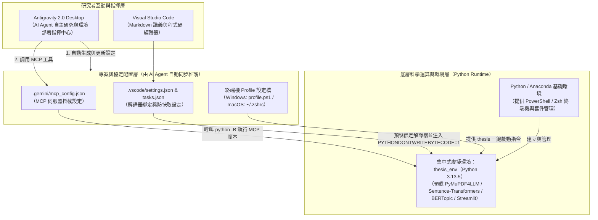
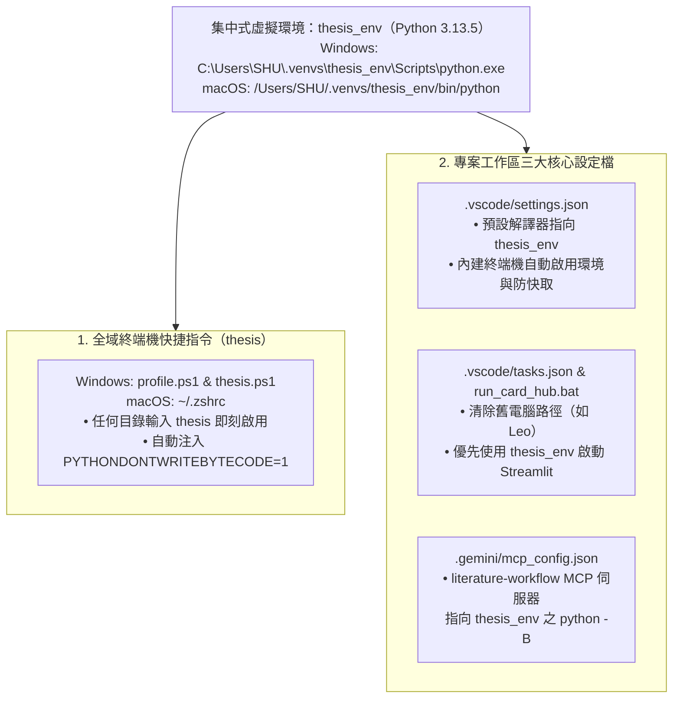

---
puppeteer:
  displayHeaderFooter: true
  headerTemplate: '<div style="font-size: 14px; margin: 0 auto;">第零章：課前環境建置——研究工具鏈安裝與 AI Agent 集中式虛擬環境配置</div>'
  footerTemplate: '<div style="font-size: 14px; margin: 0 auto;">第 <span class="pageNumber"></span> 頁 / 共 <span class="totalPages"></span> 頁</div>'
  margin:
    top: "1.5cm"
    bottom: "1.5cm"
    left: "1.5cm"
    right: "1.5cm"
---
<style>
  /* 全域字型大小放大為 1.4 倍（預設 16px * 1.4 = 22.4px） */
  html, body, .mume, .markdown-preview {
    font-size: 22.4px !important;
    line-height: 1.6 !important;
  }
  /* 標題分頁控制 */
  h2 {
    page-break-before: always;
  }
  /* 表格與程式碼區塊維持等比例適配 */
  table {
    font-size: 0.9em !important;
  }
  pre, code {
    font-size: 0.88em !important;
  }
</style>
---

# 第零章：課前環境建置——研究工具鏈安裝與 AI Agent 集中式虛擬環境配置

## 課程導讀：從「手動設定地獄」邁向「AI Agent 自主環境治理」

歡迎來到「AI Agent 學術研究與文獻探討實務」的第零週預備課程。在正式踏入第一週的自主代理人（Artificial Intelligence Agent，簡稱 AI Agent）理論與學術工作區設計之前，我們必須先在個人電腦中搭建起一套穩定、乾淨且跨平台相容的「數位研究基礎設施（Research Infrastructure）」。

過去許多非資訊相關科系的研究生在嘗試使用 Python 執行文本探勘、向量檢索或主題建模時，往往在第一堂課就因為繁瑣的環境配置而倍感挫折。傳統教學通常要求學生自己打開終端機（Terminal），手動敲入數十行命令列指令來建立虛擬環境、修改系統環境變數、編輯隱藏的終端機設定檔（如 PowerShell 的 `profile.ps1` 或 macOS 的 `~/.zshrc`），甚至還要親手修改多個 JSON 設定檔。然而，只要在手動過程中打錯一個英文字母、漏掉一個反斜線轉譯符號（`\\`），或是選錯電腦裡舊版的 Python 解譯器（如誤用 Python 3.8），整個研究環境就會陷入無止境的報錯迴圈。

既然本課程的核心是學習運用 **Antigravity 2.0 Desktop** 的自主代理人進行學術研究，那麼 **「讓 AI Agent 替我們自動化完成複雜的虛擬環境建置與跨檔案環境變數配置」**，正是同學們體驗 AI Agent 強大感知與行動力的最佳起點！本章將帶領使用 **Windows 10/11** 與 **Apple Mac（macOS）** 兩大主流作業系統的同學，依序完成兩階段任務：

1. **第一階段（第一節）：基礎軟體工具鏈安裝。** 親手完成 **Anaconda（內建 Python 科學運算環境）**、 **Visual Studio Code（簡稱 VS Code）** 與 **Antigravity 2.0 Desktop** 三大核心軟體的標準安裝，為 AI Agent 準備好運作的舞台。
2. **第二階段（第二、三節）：指揮 AI Agent 自主部署集中式虛擬環境與環境變數。** 我們將深入剖析傳統手動設定為何容易失敗，並學習如何透過結構化的自然語言指令，直接指揮 Antigravity 的 AI Agent 自動偵測並選取相容的現代穩定版 Python（如 Python 3.11 至 3.13+，本章以 Python 3.13.5 為展示範例）建立集中式虛擬環境（`thesis_env`）、清理專案內殘留的舊版 `.venv` 與 `__pycache__` 快取、安裝並驗證 14 項核心學術套件、設定防快取環境變數（`PYTHONDONTWRITEBYTECODE=1`）與終端機一鍵快捷指令（`thesis`），最後同步更新所有專案設定檔。

貫穿本章的核心工程與教學哲學為：

> **研究者負責理解架構原理與下達驗收規格，將繁瑣易錯的路徑配置、環境變數注入與跨檔案同步交由 AI Agent 自主執行。**

---

## 第一節：核心軟體工具鏈安裝與跨平台配置

### 1.1 三大核心工具的角色分工與協同架構

在現代化的 AI Agent 輔助學術研究工作流中，單一軟體無法包辦所有任務。我們需要透過三套各司其職的專業軟體，共同構成「推論指揮、文本編輯、科學運算」三位一體的協同架構。在開始下載安裝之前，請先透過圖 0-1 理解這三大工具在個人電腦中的互動關係與職責邊界。



如圖 0-1 所示，三大核心軟體工具各自扮演不可或缺的角色：
1. **Python（Anaconda 發行版）：** 扮演底層的「科學運算引擎」。不論是第二週向 OpenAlex API 檢索論文、第四週將雙欄 PDF 轉為純淨 Markdown、第五週計算 768 維稠密語意向量，或是第七週執行 BERTopic 跨篇主題聚類，所有實質的資料處理都在 Python 環境中完成。
2. **Visual Studio Code（VS Code）：** 扮演研究者的「數位寫作與工程工作台」。用來撰寫與預覽結構化 Markdown 閱讀卡片、檢視文獻比較矩陣、編輯研究規格書 `PROJECT.md`，以及檢視工作區設定檔。
3. **Antigravity 2.0 Desktop：** 扮演具備感知與行動力的「自主研究代理人平台」。在本章的第二與第三節中，我們就會直接請 Antigravity 裡面的 AI Agent 幫我們自動建置虛擬環境與配置所有設定檔；而在後續週次中，它更會透過模型上下文協定（Model Context Protocol，簡稱 MCP）直接調用這套環境，協助研究者進行文獻爬梳、證據錨定與批判性寫作。

### 1.2 Anaconda（內建 Python）之安裝與跨平台終端機配置

在開始安裝前，請同學們先建立一個非常重要的觀念： **安裝 Anaconda 時，系統就已經自動包含完整的 Python 解譯器了，千萬不要再另外去 Python 官方網站（python.org）單獨下載安裝 Python！** 許多初學者誤以為「裝完 Python 還要再裝 Anaconda」，結果導致電腦裡同時存在兩套不同來源的 Python，這正是造成日後環境路徑衝突的最大元兇。

此外，由於軟體版本會隨時間持續演進， **同學們下載 Anaconda 時所附帶的 Python 版本（例如 Python 3.12.x、3.13.x 或更新版本）不一定剛好是本章範例顯示的 `Python 3.13.5`，這是完全正常的現象！** 本課程並不強制綁死單一特定小版本，只要是支援現代科學計算套件預編譯執行檔（Wheels）的穩定版 Python（建議為 **Python 3.11 至 3.13 系列**）皆可完美運作。更棒的是，在第二節中，我們會直接交由 Antigravity 的 AI Agent 自動檢測你電腦中 Anaconda 內附的 Python 版本是否與本課程 14 個套件相容，並自動為你選取最佳版本建立虛擬環境。

請依據你所使用的作業系統，前往 Anaconda 官方下載頁面（https://www.anaconda.com/download）取得對應的安裝程式，並遵循下列跨平台規範完成安裝：

1. **Windows 10 / 11 系統安裝步驟：**
   - 下載 Windows 64-Bit Graphical Installer（`.exe` 安裝檔）並雙擊執行。
   - **安裝路徑規範：** 選擇「Just Me (recommended)」，安裝路徑請維持預設的使用者目錄（如 `C:\Users\<你的使用者名稱>\anaconda3`）。請特別確認使用者名稱與路徑中 **不包含中文漢字或空白字元**，以免後續命令列解析失敗。
   - **進階選項設定：** 在 Advanced Installation Options 頁面中，建議勾選「Register Anaconda3 as my default Python 3.x」，完成安裝後即可在開始功能表的「Anaconda3 (64-bit)」資料夾中找到 **Anaconda PowerShell Prompt**。
2. **Apple Mac（macOS）系統安裝步驟：**
   - **晶片架構確認：** 點擊畫面左上角蘋果圖示「關於本機（About This Mac）」，若處理器顯示為 Apple M1 / M2 / M3 / M4 系列晶片，請務必下載 **macOS Apple Silicon (M1/M2/M3/M4) 64-Bit Graphical Installer（`arm64` 架構 `.pkg` 檔）**；若為舊款 Intel 處理器，則下載 Intel 64-Bit Installer（`x86_64` 架構）。選錯架構會導致後續 PyTorch 與向量運算效能大幅衰退。
   - 雙擊 `.pkg` 安裝包依畫面指示完成安裝（預設安裝於 `/opt/anaconda3` 或 `~/anaconda3`）。
   - 安裝完成後，打開 macOS 內建的「終端機（Terminal.app）」，輸入 `conda init zsh` 並重啟終端機，確認命令列前方出現 `(base)` 提示字元，即代表 Anaconda 已成功掛載至 macOS 的預設 Zsh 環境中。

### 1.3 Visual Studio Code 安裝與必備學術擴充套件

Visual Studio Code 是當代支援度最廣、對 Markdown 學術寫作與 Python 開發最友善的免費開源編輯器。請前往 VS Code 官方網站（https://code.visualstudio.com/）下載安裝程式：

1. **Windows 系統安裝要點：**
   - 執行下載的 `VSCodeUserSetup-x64-x.xx.x.exe`。
   - 在「選取其他工作（Select Additional Tasks）」步驟中， **請務必勾選以下三個選項**：「將『以 Code 開啟』動作新增至 Windows 檔案總管檔案快顯功能表」、「將『以 Code 開啟』動作新增至 Windows 檔案總管目錄快顯功能表」以及 **「新增至 PATH（重新啟動後生效）」**。這能讓你日後在任何資料夾直接按右鍵用 VS Code 開啟工作區。
2. **macOS 系統安裝要點：**
   - 下載 `VSCode-darwin-universal.zip` 解壓縮後，請務必將 **Visual Studio Code.app** 圖示滑鼠拖曳至 **「應用程式（Applications）」** 資料夾中（切勿直接在「下載項目」中執行，否則將無法正常自動更新與儲存權限）。
   - 開啟 VS Code 後，按下快速鍵 `Cmd + Shift + P` 喚出命令面板（Command Palette），輸入 `shell command`，點選 **「Shell Command: Install 'code' command in PATH」**。完成後，你就能在 macOS 終端機中隨時輸入 `code .` 開啟當前資料夾。

安裝完畢後，請點擊 VS Code 左側活動列的「延伸模組（Extensions）」圖示（快速鍵：Windows 為 `Ctrl + Shift + X`，macOS 為 `Cmd + Shift + X`），搜尋並安裝表 0-1 所列的四款課程核心擴充套件。

| 擴充套件名稱（Extension Name） | 發布者（Publisher） | 在本課程學術研究工作流中之核心用途 |
| :--- | :--- | :--- |
| **Python** | Microsoft | 提供 Python 語法突顯、虛擬環境（`thesis_env`）自動偵測、腳本執行與終端機自動啟用支援。 |
| **Pylance** | Microsoft | 隨 Python 套件一併安裝之高效能語言伺服器，提供精準的型別檢查與套件載入驗證提示。 |
| **Markdown Preview Enhanced** | Yiyi Wang | 支援本課程講義與研究報告之即時預覽、Mermaid 架構圖渲染、KaTeX 數學公式排版及 Puppeteer PDF 匯出。 |
| **Chinese (Traditional) Language Pack** | Microsoft | 將 VS Code 操作介面完整中文化，降低初學者的介面認知門檻。 |

透過表 0-1 的擴充套件配置，VS Code 便從單純的程式碼編輯器，升級為能即時渲染複雜學術圖表與管理 Python 虛擬環境的全功能研究工作站。

### 1.4 Antigravity 2.0 Desktop 安裝與權限檢核

本課程的核心靈魂—— **Antigravity 2.0 Desktop**，是專為深度研究與自主代理人協作打造的桌面端環境。與網頁版聊天機器人最大的不同在於：Antigravity 的 AI Agent 具備 **「操作本機終端機」** 與 **「讀寫系統檔案」** 的實體行動能力。請依照下列步驟完成跨平台安裝與初始設定：

1. **Windows 與 macOS 安裝程序：**
   - **Windows 使用者：** 執行 Antigravity 安裝程式（`.exe`），系統會自動完成主程式部署並將 `agy` 命令列工具註冊至系統路徑中。
   - **macOS 使用者：** 雙擊下載的 `.dmg` 磁碟映像檔，將 **Antigravity** 圖示拖曳至 `Applications` 資料夾。首次於「應用程式」中開啟時，若 macOS 跳出網路下載應用程式之安全確認視窗，請點擊「打開（Open）」並授予必要之本機資料夾存取權限。
2. **Google OAuth 原生帳號認證：**
   - 啟動 Antigravity 2.0 Desktop 後，點擊登入按鈕，系統會透過預設瀏覽器引導你完成 Google 帳號授權（OAuth）。授權成功後憑證由系統安全加密保管，無須在設定檔中明文填寫任何 API 金鑰。
3. **開啟課程專案工作區（Workspace）：**
   - 點擊左上角「File -> Open Folder」（或左側 Projects 面板的「+」），選取本課程專案資料夾（例如 `C:\Users\<使用者名稱>\Documents\GitHub\literature_agent` 或 `~/Documents/GitHub/literature_agent`）。接下來在第二節與第三節中，我們就要在這個工作區裡直接指揮 AI Agent 為我們建立集中式虛擬環境！

### 1.5 課堂實作小活動：三大軟體工具鏈就位檢核

> **活動時間：** 10 分鐘
> **活動任務：** 驗證 Python (Anaconda)、VS Code 與 Antigravity 2.0 Desktop 是否已在你的 Windows 或 Mac 電腦中正確安裝，並在 Antigravity 中開啟課程專案。
>
> 1. **開啟對應系統之終端機確認 Anaconda 就位：**
>    - **Windows 同學：** 從開始功能表打開 **Anaconda PowerShell Prompt**，輸入 `conda --version`。
>    - **macOS 同學：** 打開 **Terminal（終端機）**，輸入 `conda --version`。
> 2. **確認 VS Code 擴充套件已安裝：**
>    打開 VS Code，確認已安裝 `Python` 與 `Markdown Preview Enhanced` 兩項必備擴充套件。
> 3. **啟動 Antigravity 2.0 Desktop 並載入工作區：**
>    登入 Google 帳號並開啟本課程資料夾，在右側或中央的 Agent 對話畫布（Chat Canvas）中輸入：*「你好！請告訴我目前我電腦的作業系統、使用者家目錄路徑，以及目前系統預設的 Python 版本為何？」*，初步體驗 Agent 感知本機環境的能力。

```text
老師的真心話：
在第一堂課帶領大家裝軟體時，Windows 與 Mac 同學最常踩到的兩個地雷分別是：
第一，Mac 同學下載了 .dmg 或 .zip 之後，直接點開裡面的 VS Code 或 Antigravity 就開始用，
忘記把它拖進『Applications（應用程式）』資料夾！這會導致系統把它當成唯讀的臨時外接磁碟，
不僅設定檔無法更新，重開機後軟體甚至會直接消失。
第二，Windows 同學在電腦使用者名稱取了中文（例如 C:\Users\王小明），或者把專案放在雲端硬碟
同步資料夾（如 OneDrive / iCloud Drive）裡。當 Python 深度學習套件在讀寫大型模型權重時，
雲端同步鎖定與中文路徑轉碼往往會造成莫名其妙的崩潰。
請大家務必在今天把軟體堂堂正正地裝進本機標準英文路徑中，這是保障未來十六週研究順暢的第一道防線！

```

---

## 第二節：利用 AI Agent 建置集中式虛擬環境（`thesis_env`）與套件部署

### 2.1 為什麼需要集中式虛擬環境？剖析傳統「手動建置」的五大痛點

當我們安裝好基礎軟體後，緊接著面臨一個關鍵的工程問題： **我們該如何管理本課程所需的十幾個重量級學術與 AI 套件（如 PyTorch、Sentence-Transformers、BERTopic、PyMuPDF4LLM、Streamlit）？**

在傳統的程式教學中，老師通常會要求學生在每個專案資料夾下各自建立一個 `.venv` 虛擬環境，並叫學生自己打開命令列逐行輸入指令。然而，這種 **「傳統分散式 + 純手動敲指令」** 的做法，在真實的研究生課堂上幾乎每次都會引發以下五大慘烈痛點：

1. **多版本 Python 路徑迷航與版本過新/過舊陷阱（Version & Path Trap）：** 許多同學的電腦裡同時裝過大學時期的舊版 Python（如已淘汰的 Python 3.8），或是下載了最新版的 Anaconda 但其內建的 Python 版本「太新」（例如剛發布不久的全新大版本，導致 `numba`、`hdbscan` 或 `torch` 尚未釋出預編譯好的安裝包）。手動輸入 `python -m venv .venv` 時，學生根本無從判斷當前版本是否相容，一旦觸發 C++ 底層編譯錯誤（如 `Microsoft Visual C++ 14.0 is required`）就會徹底卡死。
2. **隱藏目錄與位元組碼快取污染（`.venv` 與 `__pycache__` 殘留）：** 當同學發現環境建錯想重來時，由於 `.venv` 在 macOS Finder 與部分 Windows 設定中屬於隱藏目錄，且舊版 Python 執行時產生的 `__pycache__`（`.pyc` 快取檔）散落在專案底下數十個子資料夾中，人工手動翻找刪除極易遺漏，導致「明明重裝了環境，執行時卻還在跑舊快取」的靈異現象。
3. **跨平台語法與權限阻擋（Windows vs. macOS 差異）：** Windows 與 macOS 的路徑斜線相反（`\` 對比 `/`）、虛擬環境結構不同（`Scripts\Activate.ps1` 對比 `bin/activate`）。更糟的是，Windows 同學手動執行 `Activate.ps1` 時，常因 PowerShell 預設的執行原則（ExecutionPolicy）限制而跳出紅字錯誤「因為這個系統上已停用指令碼執行……」，讓非資訊背景的學生瞬間手足無措。
4. **套件名稱混淆與漏裝（Package Naming Traps）：** 手動逐一輸入 `pip install` 時，極易發生拼字錯誤或裝錯同名套件。例如：將 UMAP 降維套件 `umap-learn` 誤打成 `umap`、將 Word 處理套件 `python-docx` 誤打成 `docx`，或忘記驗證 `pymupdf`（匯入名稱為 `fitz`）與 `torch` 是否能正常載入。
5. **硬碟空間重複浪費：** 本課程的深度學習與向量檢索套件總容量超過 3 GB。若每個作業資料夾或新研究專案都各自手動建一個 `.venv`，筆記型電腦的 SSD 硬碟很快就會被重複的套件塞爆。

為了解決上述五大痛點，本課程在架構上採用 **「集中式虛擬環境（Centralized Virtual Environment）」**——將環境統一建立在使用者家目錄下的 `.venvs/thesis_env`，供所有研究專案共享；而在操作上，我們 **不再依賴人工手動敲指令，而是直接授權 Antigravity 的 AI Agent 為我們自動檢測電腦中相容的現代穩定版 Python（如 Python 3.11 ~ 3.13 系列，本章以 `Python 3.13.5` 作為實機展示範例），並自動完成舊檔清理、環境建立與套件驗證！** 圖 0-2 展示了「傳統手動設定」與「AI Agent 自主環境部署」的流程對比。

```mermaid
flowchart TD
    subgraph ManualWay["傳統手動設定流程（高認知負荷、極易踩坑）"]
        M1["學生手動開終端機敲指令"] --> M2["誤用舊版 Python 3.8 或過新版本<br/>或遭遇 PowerShell 權限紅字阻擋"]
        M2 --> M3["手動刪除不乾淨<br/>殘留隱藏 .venv 與散落的 __pycache__"]
        M3 --> M4["手動 pip install 拼錯套件名<br/>（如 umap-learn 誤裝為 umap）"]
        M4 --> M5["環境衝突、浪費數小時除錯"]
    end

    subgraph AgentWay["Antigravity AI Agent 自主部署流程（精準、跨平台、可驗證）"]
        A1["研究者下達自然語言規格指令"] --> A2["Agent 自動感知作業系統（Win/Mac）<br/>並檢測/調配相容之 Python 3.11~3.13+"]
        A2 --> A3["Agent 自動建立集中式環境<br/>~/.venvs/thesis_env"]
        A3 --> A4["Agent 遞迴掃描並徹底清除專案內<br/>舊版 .venv 與所有 __pycache__"]
        A4 --> A5["Agent 批次安裝 14 項核心套件<br/>執行 import 驗證並匯出 requirements.txt"]
    end

```



如圖 0-2 所示，當我們將環境建置任務交給 Antigravity 的 AI Agent 時，即使未來同學下載 Anaconda 時預設的 Python 版本已經變更，Agent 也能自動檢查該版本是否支援所有 AI 套件的預編譯安裝包（Wheels）；若發現版本過舊或過新，Agent 甚至能自動透過 Conda 為你調配最穩定的 Python 版本來建立 `thesis_env`，並在遭遇錯誤時自我修復（Self-Healing），直到所有套件通過載入測試為止。

### 2.2 實戰演練：指揮 AI Agent 建立 `thesis_env` 並清理舊環境

在開始指揮 AI Agent 之前，我們先透過表 0-2 了解 Agent 即將在 Windows 與 Apple Mac（macOS）電腦中建立的集中式虛擬環境標準路徑結構（以電腦使用者名稱 `SHU` 為例）：

| 環境項目 | Windows 系統標準路徑（以使用者 `SHU` 為例） | Apple Mac (macOS) 系統標準路徑（以使用者 `SHU` 為例） |
| :--- | :--- | :--- |
| **集中式虛擬環境根目錄** | `C:\Users\SHU\.venvs\thesis_env` | `/Users/SHU/.venvs/thesis_env`（或 `~/.venvs/thesis_env`） |
| **Python 解譯器執行檔** | `C:\Users\SHU\.venvs\thesis_env\Scripts\python.exe` | `/Users/SHU/.venvs/thesis_env/bin/python` |
| **Pip 套件安裝器執行檔** | `C:\Users\SHU\.venvs\thesis_env\Scripts\pip.exe` | `/Users/SHU/.venvs/thesis_env/bin/pip` |
| **Streamlit 執行檔** | `C:\Users\SHU\.venvs\thesis_env\Scripts\streamlit.exe` | `/Users/SHU/.venvs/thesis_env/bin/streamlit` |
| **手動啟用環境腳本** | `C:\Users\SHU\.venvs\thesis_env\Scripts\Activate.ps1` | `source ~/.venvs/thesis_env/bin/activate` |

同時，我們希望 Agent 為 `thesis_env` 一次性安裝並驗證表 0-3 所列的 14 項課程全週期核心套件（表中所列版本號為教師實機於 `Python 3.13.5` 環境下通過驗證之參考基準版本；Agent 安裝時會自動依據你當前的作業系統與 Python 版本解析最相容之穩定版本）：

| 套件分類 | 套件名稱（Package） | 驗證版本（Version） | 對應課程週次與核心學術工程用途 |
| :--- | :--- | :--- | :--- |
| **文獻解析與文檔工程** | `pymupdf` | 2.1 | 第四週：高速底層 PDF 結構解析與頁面座標提取引擎。 |
| **文獻解析與文檔工程** | `pymupdf4llm` | 2.1 | 第四週：破解雙欄排版詛咒，將學術 PDF 自動轉譯為純淨 Markdown。 |
| **文獻解析與文檔工程** | `pypdf` | 6.19.0 | 第三週：外部自尋 PDF 文獻之基礎元數據讀取與頁面掃描輔助。 |
| **文獻解析與文檔工程** | `python-docx` | 1.2.0 | 第八至九週：將結構化文獻探討草稿與研究筆記轉換輸出為 Word 文件。 |
| **資料處理與科學計算** | `pandas` | 3.0.6 | 全學期通用：處理學術元數據表格、文獻比較矩陣與統計報表匯出。 |
| **神經向量檢索與深度學習** | `torch` | 2.14.1 | 第五至七週：PyTorch 深度學習張量運算核心（支援 CPU 與 Apple MPS / GPU 加速）。 |
| **神經向量檢索與深度學習** | `sentence-transformers` | 6.1.0 | 第五週：載入 `BAAI/bge-base-en-v1.5` 嵌入模型，計算論文區塊之 768 維稠密語意向量。 |
| **神經向量檢索與深度學習** | `scikit-learn` | 1.9.1 | 第五至七週：提供餘弦相似度矩陣運算、正規化與 c-TF-IDF 特徵提取。 |
| **跨篇主題建模與聚類** | `bertopic` | 0.17.4 | 第七週：基於神經嵌入向量之跨篇文獻主題建模與代表關鍵詞提煉。 |
| **跨篇主題建模與聚類** | `umap-learn` | 0.5.12 | 第七週：UMAP 流形降維演算法，將 768 維語意向量保留局部拓撲投影至低維空間。 |
| **跨篇主題建模與聚類** | `hdbscan` | 0.8.44 | 第七週：階層式密度聚類演算法，自動識別主題聚落並過濾離群雜訊區塊。 |
| **跨篇主題建模與聚類** | `numba` | 0.68.1 | 第七週：即時編譯（JIT）加速器，大幅提升 UMAP 高維度距離矩陣之計算速度。 |
| **互動視覺化與卡片中心** | `plotly` | 7.1.0 | 第七週：繪製高解析度、可互動縮放之主題分佈與知識拓撲視覺化圖表。 |
| **互動視覺化與卡片中心** | `streamlit` | 1.65.0 | 第六週：驅動本機網頁端「學術閱讀卡片維護中心（Academic Card Hub）」。 |

現在，你不需要自己去查 Windows 或 Mac 的命令列語法，只需打開 **Antigravity 2.0 Desktop**，在對話框中貼入以下這段 **跨平台通用提示詞（Prompt）**，直接交由 AI Agent 自動執行：

> **給 Antigravity AI Agent 的環境建置指令（Windows 與 macOS 通用）：**
>
> 「請幫我在本機建立並配置本課程專用的集中式 Python 虛擬環境，具體要求如下：
> 1. **建立集中式虛擬環境**：請先偵測我的作業系統（Windows 或 macOS）、使用者家目錄以及 Anaconda 內附的 Python 版本。請使用與科學計算套件相容的現代穩定版 Python（建議為 Python 3.11 至 3.13 系列，如 Python 3.13.x；若目前預設 Python 版本過舊或過新導致套件尚無預編譯 wheel，請自動透過 conda 調配相容的 Python 3.13 或 3.12 版本），在使用者家目錄下的 `.venvs/thesis_env` 建立集中式虛擬環境。
> 2. **徹底清理舊環境與快取**：請檢查目前專案目錄下是否有先前誤建的舊版 `.venv` 資料夾，以及各子目錄下所有的 `__pycache__` 暫存檔，請將它們一併清理乾淨，確保不會發生環境衝突。
> 3. **安裝與驗證核心套件**：請在 `thesis_env` 環境中安裝（或確認已安裝）以下兩組核心套件：
>    - 基礎共享套件：`sentence-transformers`、`torch`、`streamlit`、`scikit-learn`、`pandas`、`pypdf`、`python-docx`
>    - 進階分析與 PDF 套件：`umap-learn`、`bertopic`、`hdbscan`、`numba`、`plotly`、`pymupdf`、`pymupdf4llm`
> 4. **載入驗證與匯出清單**：請以 `python -B`（不產生快取）執行 `import` 測試，確認上述 14 個套件皆能成功載入無誤，最後將 `thesis_env` 的完整套件清單匯出至專案根目錄的 `requirements.txt`，並向我回報實際採用的 Python 版本、各套件安裝版本與驗證結果。」

### 2.3 透視黑盒子：AI Agent 在背景為你做了什麼？

當你按下發送後，你會在 Antigravity 畫面上看到 AI Agent 開始一連串自主的工具調用（`run_command`）。為了讓同學們「知其然，更知其所以然」，我們將 Agent 在背景執行的邏輯拆解為三個關鍵步驟：

1. **自動環境感知、版本相容性判斷與虛擬環境建立：**
   - Agent 會先檢查你電腦中 Anaconda 內附的 Python 版本（例如 `Python 3.13.5`）。若該版本可直接安裝上述 14 個套件，Agent 在 **Windows** 會直接執行 `python -m venv "$HOME\.venvs\thesis_env"`，在 **macOS** 則執行 `mkdir -p ~/.venvs && python3 -m venv ~/.venvs/thesis_env`。
   - 萬一未來某位同學下載到的 Anaconda 內建了剛發布不久的全新 Python 大版本（例如未來的 Python 3.15），導致 `numba` 或 `torch` 尚未提供預編譯包，Agent 也能根據我們的指令自動改用 Conda 建立穩定版 Python 基底，完全不必由學生手動排錯。
2. **無死角遞迴掃除舊版 `.venv` 與 `__pycache__`：**
   - Agent 會透過 PowerShell 的 `Get-ChildItem -Include "__pycache__" -Recurse`（Windows）或 `find . -type d -name "__pycache__"`（macOS），在不到一秒鐘內把散落在 `scripts/__pycache__`、`skills/` 各子目錄下的舊版位元組碼快取連根拔起，這比人類用滑鼠點開十幾個資料夾手動刪除要精準百倍。
3. **自動化套件驗證與版本盤點：**
   - 安裝完畢後，Agent 會自動編寫一段簡短的驗證命令（加上 `-B` 防快取參數），實際測試載入每一個套件並讀取其 `__version__`，最後執行 `pip freeze > requirements.txt`，向你提交一份結構清晰的驗收報告（例如確認 `umap-learn 0.5.12`、`bertopic 0.17.4`、`sentence-transformers 6.1.0`、`torch 2.14.1` 等全數就緒）。

### 2.4 課堂實作小活動：指揮 AI Agent 打造並驗證你的 `thesis_env`

> **活動時間：** 15 分鐘
> **活動任務：** 在 Antigravity 2.0 Desktop 中使用自然語言提示詞，讓 AI Agent 為你完成集中式虛擬環境建置、舊快取清理與 14 項套件驗證。
>
> 1. 複製本節 2.2 的 **「給 Antigravity AI Agent 的環境建置指令」**，貼入 Antigravity 的對話視窗並送出。
> 2. 觀察 Agent 的思考過程（Thinking）與終端機工具調用（Command Execution）：看看 Agent 是如何自動判斷你的電腦是 Windows 還是 Mac，以及如何找出你的家目錄路徑（如 `C:\Users\SHU\.venvs\thesis_env` 或 `/Users/SHU/.venvs/thesis_env`）。
> 3. 若在安裝過程中遇到網路瞬斷或權限提示，觀察 Agent 如何自動重試或調整參數解決問題。
> 4. 檢視 Agent 最終回報的套件版本清單，並確認專案根目錄下已經自動生成了最新的 `requirements.txt` 檔案。

```text
老師的真心話：
以前還沒有 AI Agent 的時候，光是在課堂上教大家建立虛擬環境、處理 Windows PowerShell 權限紅字、
還有幫同學抓出為什麼某個套件 import 失敗，就要花掉整整兩堂課的時間！
現在透過 Antigravity，你只要把『目標規格』（我要在哪裡建環境、要清掉哪些舊檔、要裝哪些套件、
要如何驗證）清楚告訴 Agent，它就能在幾分鐘內幫你把環境建置得滴水不漏。
這就是我們在第一週即將深入探討的『代理思維（Agentic Mindset）』：你不再是辛苦敲打螺絲的工人，
而是負責制定標準與驗收品質的總工程師！

```

---

## 第三節：利用 AI Agent 自動配置環境變數、快捷指令（`thesis`）與專案設定檔

### 3.1 為什麼環境變數與設定檔最不該「手動硬改」？剖析傳統手動配置的四大陷阱

當集中式虛擬環境 `thesis_env` 建置完成後，我們還面臨最後一哩路： **如何讓終端機、VS Code 與 Antigravity 的 MCP 伺服器都能自動使用這套環境，並預設開啟防快取保護（`PYTHONDONTWRITEBYTECODE=1`）？**

在傳統教學中，這一步被公認為初學者的「終極惡夢」。因為如果要手動完成這些配置，學生必須自己去修改系統環境變數、編輯終端機啟動腳本，還要手動修改工作區裡三、四個不同的 JSON 與批次設定檔。表 0-4 詳細列出了 **「傳統人工手動設定」** 最常引發的四大致命錯誤，以及 **「交由 Antigravity AI Agent 自動配置」** 如何徹底化解這些危機：

| 配置維度 | 傳統手動設定常發生的致命問題（Manual Pitfalls） | 交由 Antigravity AI Agent 自動配置的優勢（Agentic Advantage） |
| :--- | :--- | :--- |
| **1. 終端機快捷指令與環境變數（`profile.ps1` / `~/.zshrc`）** | Windows 的 `$PROFILE` 檔案預設不存在，手動建立常放錯資料夾；macOS 的 `~/.zshrc` 為隱藏檔，學生用一般文書軟體編輯時常誤將直線引號 `"` 轉為全形彎引號 `”`，導致每次開終端機都報語法錯誤。 | Agent 自動偵測 Shell 類型，精準建立 `profile.ps1`、`anaconda3\Scripts\thesis.ps1` 或寫入 `~/.zshrc`，自動綁定 `thesis` 指令並注入 `PYTHONDONTWRITEBYTECODE=1`。 |
| **2. JSON 設定檔路徑轉譯（`.vscode/settings.json` & `mcp_config.json`）** | Windows 路徑包含反斜線 `\`，在 JSON 格式中必須雙重轉譯為 `\\`（如 `C:\\Users\\SHU\\...`）。學生手動複製貼上單反斜線路徑，會導致 JSON 解析崩潰（把 `\U` 或 `\t` 當成跳脫字元），整個 VS Code 與 MCP 瞬間失效！ | Agent 完美掌握 JSON 語法規範，自動將當前使用者的真實家目錄轉為合規的雙反斜線（Windows）或正斜線（macOS），絕不發生漏逗號或轉譯錯誤。 |
| **3. 跨電腦硬編碼路徑殘留（`tasks.json` & `run_card_hub.bat`）** | 從 GitHub 下載專案後，設定檔中常殘留作者舊電腦的絕對路徑（如 `C:\Users\Leo\anaconda3\...`）。人工手動檢查常漏改其中一處，導致第六週啟動 Streamlit 卡片中心時出現找不到路徑錯誤。 | Agent 可一次性全域掃描專案內所有 `.json`、`.bat` 與 `.sh` 檔案，自動將所有舊電腦路徑精準替換為本機的 `thesis_env` 路徑。 |
| **4. 防快取機制不同步（`PYTHONDONTWRITEBYTECODE=1` 與 `-B`）** | 學生手動設定時，常只在終端機加了變數，卻忘了在 `.vscode/settings.json` 與 `.gemini/mcp_config.json` 的 MCP 啟動參數加上 `-B`，導致背景執行時依然狂生 `__pycache__`。 | Agent 執行全域一致性配置，同時在終端機 Profile、VS Code 內建終端環境與 MCP 伺服器參數（`python.exe -B`）全面貫徹防快取保護。 |

從表 0-4 可以清楚看出，環境變數與多檔案 JSON 配置涉及高度嚴格的語法格式與跨檔案路徑一致性，這正是人類手動操作最容易出錯、而 AI Agent 最擅長的領域！

### 3.2 實戰演練：一道指令讓 AI Agent 完成快捷指令與全專案設定檔同步

現在，我們同樣不需要自己動手去翻找隱藏設定檔或數反斜線。請直接在 **Antigravity 2.0 Desktop** 的對話框中，輸入以下這段結構化提示詞，請 AI Agent 一次幫我們把終端機快捷指令（`thesis`）與四大專案設定檔全部配置到位：

> **給 Antigravity AI Agent 的環境變數與設定檔配置指令（Windows 與 macOS 通用）：**
>
> 「請幫我將剛剛建置好的集中式虛擬環境 `thesis_env` 設定為日常一鍵啟動，並同步更新本專案的所有設定檔，具體需求如下：
> 1. **設定終端機一鍵快捷指令 `thesis`**：
>    - 若為 Windows：請在我的 PowerShell 設定檔（`$PROFILE` / `profile.ps1`）與 Anaconda Scripts（`thesis.ps1`）設定好快捷指令 `thesis`。
>    - 若為 macOS：請在我的 `~/.zshrc` 設定檔中設定好快捷函式 `thesis`。
>    - 當我在任何資料夾輸入 `thesis` 時，請自動啟用 `thesis_env`、自動設定環境變數 `PYTHONDONTWRITEBYTECODE=1`（開啟防快取，免手動加 `-B`），並在畫面顯示綠色提示：`[thesis_env] Activated Python <實際版本號> environment (PYTHONDONTWRITEBYTECODE=1)`。
> 2. **同步更新專案設定檔**：
>    - `.vscode/settings.json`：設定預設解譯器（`python.defaultInterpreterPath`）指向 `thesis_env`、開啟終端機自動啟用環境（`python.terminal.activateEnvironment: true`），並預設在終端機環境注入 `PYTHONDONTWRITEBYTECODE=1`。
>    - `.vscode/tasks.json` 與 `run_card_hub.bat`（macOS 請一併提供對應啟動方式）：修正檔案中殘留的舊電腦路徑（如 `C:\Users\Leo\...`），改為優先使用本機的 `thesis_env` 啟動 Streamlit 學術卡片中心。
>    - `.gemini/mcp_config.json`：將 `literature-workflow` MCP 伺服器的執行檔明確指向本機 `thesis_env` 的 Python 解譯器，並加上 `-B` 參數（即 `python -B`）與 `PYTHONDONTWRITEBYTECODE=1`。
> 3. 完成後請幫我測試確認設定無誤，並整理一份配置完成清單與日常使用指南給我。」

### 3.3 解讀 AI Agent 的配置成果：四大核心設定機制剖析

當 AI Agent 執行完上述任務後，它會在短短數十秒內為你修改好系統 Profile 與專案設定檔。為了讓同學們清楚掌握 Agent 究竟為我們完成了哪些工程配置，圖 0-3 展示了更新後的設定檔連動架構，接著我們逐一檢視各設定檔在 Windows 與 macOS 下的標準內容。



#### 1. 終端機快捷指令設定檔（Windows `profile.ps1` / `thesis.ps1` 與 macOS `~/.zshrc`）

AI Agent 會在你的系統終端機設定檔中自動寫入 `thesis` 函式（以下以 `Python 3.13.5` 為例展示 Agent 寫入的語法結構，實際版本號將由 Agent 依你電腦安裝的 Python 版本自動帶入）：

- **Windows 系統（寫入 `$PROFILE` 與 `anaconda3\Scripts\thesis.ps1`）：**

```powershell
function thesis {
    $env:PYTHONDONTWRITEBYTECODE = "1"
    & "$HOME\.venvs\thesis_env\Scripts\Activate.ps1"
    Write-Host "[thesis_env] Activated Python 3.13.5 environment (PYTHONDONTWRITEBYTECODE=1)" -ForegroundColor Green
}

```

- **Apple Mac (macOS) 系統（寫入 `~/.zshrc`）：**

```bash
thesis() {
    export PYTHONDONTWRITEBYTECODE=1
    source "$HOME/.venvs/thesis_env/bin/activate"
    printf "\033[0;32m[thesis_env] Activated Python 3.13.5 environment (PYTHONDONTWRITEBYTECODE=1)\033[0m\n"
}

```

#### 2. `.vscode/settings.json`：預設解譯器與內建終端機防快取注入

Agent 會在專案的 `.vscode/settings.json` 中自動填入你電腦的真實帳號路徑（以下以使用者 `SHU` 為例），確保無論在 VS Code 或 Antigravity 開啟內建終端機，都會自動啟用 `thesis_env` 並注入 `PYTHONDONTWRITEBYTECODE=1`：

- **Windows 版 `.vscode/settings.json`：**

```json
{
  "python.defaultInterpreterPath": "C:\\Users\\SHU\\.venvs\\thesis_env\\Scripts\\python.exe",
  "python.terminal.activateEnvironment": true,
  "terminal.integrated.env.windows": {
    "PYTHONDONTWRITEBYTECODE": "1"
  }
}

```

- **macOS 版 `.vscode/settings.json`：**

```json
{
  "python.defaultInterpreterPath": "/Users/SHU/.venvs/thesis_env/bin/python",
  "python.terminal.activateEnvironment": true,
  "terminal.integrated.env.osx": {
    "PYTHONDONTWRITEBYTECODE": "1"
  }
}

```

#### 3. `.gemini/mcp_config.json`：將 MCP 伺服器指向 `thesis_env` 並加上 `-B`

Agent 會同步更新 `.gemini/mcp_config.json`，將 `literature-workflow` MCP 伺服器直接綁定至 `thesis_env` 的 Python 解譯器並加上 `"-B"` 參數，徹底避免 Agent 在呼叫文獻檢索或 RAG 向量工具時抓錯 Python 環境或產生 `__pycache__`：

- **Windows 版 `.gemini/mcp_config.json`：**

```json
{
  "mcpServers": {
    "literature-workflow": {
      "command": "C:\\Users\\SHU\\.venvs\\thesis_env\\Scripts\\python.exe",
      "args": [
        "-B",
        "scripts/literature_workflow_mcp.py"
      ],
      "env": {
        "PYTHONIOENCODING": "utf-8",
        "PYTHONDONTWRITEBYTECODE": "1"
      }
    }
  }
}

```

- **macOS 版 `.gemini/mcp_config.json`：**

```json
{
  "mcpServers": {
    "literature-workflow": {
      "command": "/Users/SHU/.venvs/thesis_env/bin/python",
      "args": [
        "-B",
        "scripts/literature_workflow_mcp.py"
      ],
      "env": {
        "PYTHONIOENCODING": "utf-8",
        "PYTHONDONTWRITEBYTECODE": "1"
      }
    }
  }
}

```

此外，Agent 也會將 `.vscode/tasks.json` 與 `run_card_hub.bat` 中原本指向舊電腦（`C:\Users\Leo\anaconda3\...`）的路徑，一併修正為優先使用 `thesis_env` 啟動 Streamlit 卡片中心。

### 3.4 日常使用指南（超簡單步驟）：在終端機與 Antigravity 中無縫運作

當 AI Agent 幫你完成上述所有配置後，你在整個學期乃至於未來的碩士論文研究中，日常使用這套環境只需要記住以下超簡單步驟：

#### 1. 在 Anaconda PowerShell Prompt（Windows）或 Terminal（macOS）中使用

由於 AI Agent 已經在你的終端機設定檔設定好 `thesis` 快捷指令，日常操作只需三招：

- **啟用環境：** 打開 Anaconda PowerShell Prompt（或一般 PowerShell / macOS Terminal）後， **無論目前在哪個資料夾**，直接輸入：
  ```powershell
  thesis
  ```
  畫面會立即顯示綠色提示：
  `[thesis_env] Activated Python 3.13.5 environment (PYTHONDONTWRITEBYTECODE=1)`
  且命令列前方會出現 `(thesis_env)`，同時自動幫你開啟防快取（免手動加 `-B`）。
- **安裝新套件：** 啟用後直接輸入 `pip install <套件名稱>` 即可。
- **退出環境：** 輸入 `deactivate`。

#### 2. 在 Antigravity 中使用與跨專案共享

- **本專案（開箱即用）：** 已由 AI Agent 設定完成，無論是開啟 Antigravity 內建終端機、執行 Python 腳本，或是請 Agent 調用 MCP 文獻工具，系統都會 **自動使用 `thesis_env`**。
- **未來若有其他新專案（如個人論文工作區 `my_thesis_workspace`）想共用此環境：**
  - **方法一：** 在新專案的終端機裡同樣只要輸入 `thesis` 即可立即切換；
  - **方法二：** 將本專案的 `.vscode/settings.json` 複製過去（或者直接在新專案中對 Antigravity 的 AI Agent 說：*「請幫我將這個工作區的設定檔綁定到集中式虛擬環境 `thesis_env`」*），就能直接共用同一套環境與所有重量級 AI 套件！

### 3.5 課堂實作小活動：體驗 AI Agent 自動化配置與 `thesis` 一鍵連通驗證

> **活動時間：** 10 分鐘
> **活動任務：** 透過 Antigravity AI Agent 完成環境變數、快捷指令與專案設定檔同步更新，並親手測試 `thesis` 快捷指令的威力。
>
> 1. 複製本節 3.2 的 **「給 Antigravity AI Agent 的環境變數與設定檔配置指令」**，貼入 Antigravity 對話框中執行。
> 2. 觀察 Agent 如何自動讀取你的使用者名稱、自動生成或修改 `profile.ps1`（或 `~/.zshrc`），並逐一修正 `.vscode/settings.json`、`.vscode/tasks.json`、`run_card_hub.bat` 與 `.gemini/mcp_config.json`。
> 3. **驗證外部終端機快捷指令：**
>    打開電腦的 Anaconda PowerShell Prompt（Windows）或 Terminal（macOS），故意先切換到桌面（`cd ~/Desktop`），然後直接輸入：
>    ```powershell
>    thesis
>    ```
>    確認畫面跳出綠色的 `[thesis_env] Activated Python 3.13.5 environment (PYTHONDONTWRITEBYTECODE=1)`，且命令列最前方出現 `(thesis_env)`！
> 4. **驗證防快取生效：**
>    在啟用狀態下輸入 `python -c "import sys; print(sys.dont_write_bytecode)"`，確認螢幕印出 `True`（代表防快取環境變數已成功生效）。

```text
老師的真心話：
請大家回想一下剛剛這 20 分鐘的體驗：
如果今天我們用傳統的方法，叫大家自己去建 PowerShell 的 profile.ps1、自己改 JSON 裡面的
雙反斜線路徑、自己去找舊電腦留下的 C:\Users\Leo 路徑來改，全班大概有一半的同學會因為少打一個
引號或斜線而卡關一整節課。
但當我們懂得運用 Antigravity 的 AI Agent 時，你只需要下達清楚的『結構化指令』，Agent 就能在
幾十秒內幫你把集中式環境、防快取變數、快捷指令與四個專案設定檔全部改好，還能自動驗證！
更棒的是，這套集中式虛擬環境（thesis_env）建好之後，以後不管你開多少個新的研究資料夾，
永遠只要輸入『thesis』六個字母，或是請 Agent 把 .vscode/settings.json 複製過去，
就能一秒鐘共用所有 AI 套件。這才是真正聰明、優雅的現代數位研究者工作流！

```

---

## 本週小結與下週預告

在本週（第零章）的預備課程中，我們不僅為整個學期的 AI Agent 學術研究築起了最堅實的地基，更提前體驗了自主代理人（AI Agent）在解決複雜系統工程任務時的強大威力。我們首先在 Windows 與 macOS 雙平台上完成了 **Python（Anaconda）**、 **Visual Studio Code** 與 **Antigravity 2.0 Desktop** 三大核心工具的標準化安裝；接著，我們跳脫了傳統容易出錯的手動敲指令模式，直接指揮 Antigravity 的 AI Agent 為我們打造了基於 Python 3.13.5 的 **集中式虛擬環境（`.venvs/thesis_env`）**，一次性清理了舊版 `.venv` 與 `__pycache__` 暫存檔、部署並驗證了 14 項核心學術套件，並自動配置好全域防快取環境變數（`PYTHONDONTWRITEBYTECODE=1`）、終端機一鍵啟動指令 **`thesis`** 以及所有專案設定檔的同步更新。

在下一週（第一章）的課程中，我們將正式深入 **Antigravity 2.0 Desktop** 的核心理論，剖析自主代理人（AI Agent）與傳統聊天機器人（Chatbot）在認知架構上的本質差異（ReAct 循環），並親手建立符合軟體工程標準的碩士論文五層工作區（`my_thesis_workspace`），透過上下文工程（Context Engineering）撰寫你的第一份研究規格書 `PROJECT.md`。請同學們務必確認本週的 `thesis` 快捷指令與環境驗證已全數通過，我們第一週課堂見！
