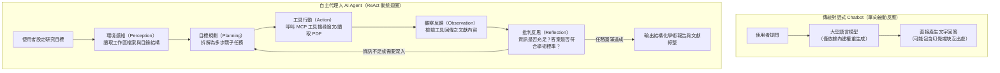
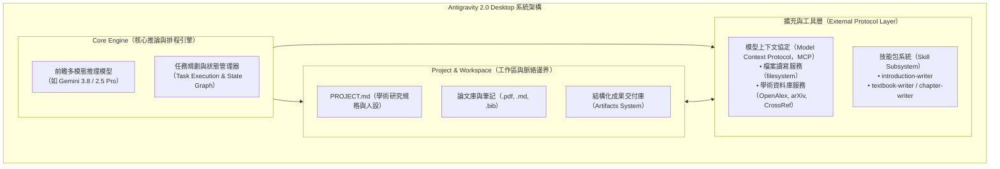
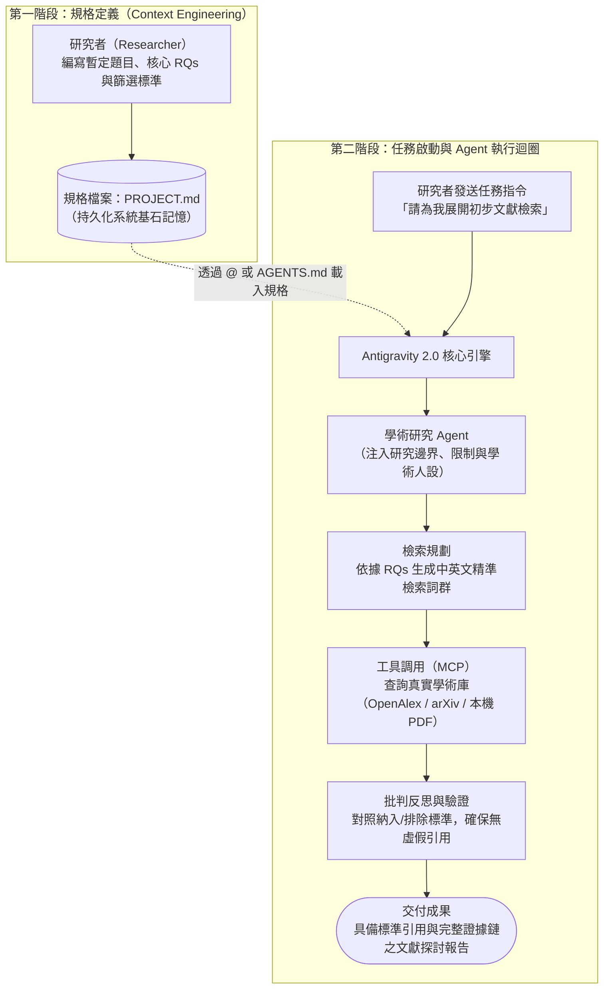
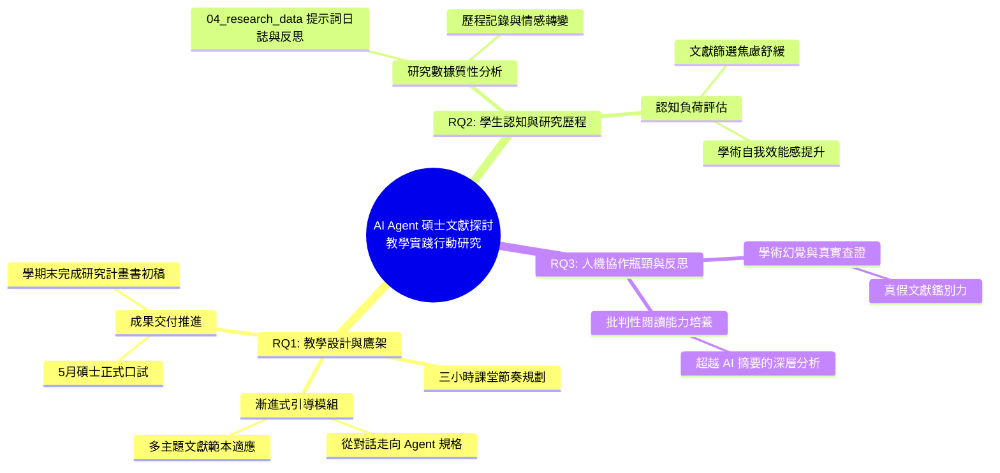

---
puppeteer:
  displayHeaderFooter: true
  headerTemplate: '<div style="font-size: 14px; margin: 0 auto;">第一章：從對話走向自主代理——Antigravity 2.0 Desktop 核心概念與論文工作區建構</div>'
  footerTemplate: '<div style="font-size: 14px; margin: 0 auto;">第 <span class="pageNumber"></span> 頁 / 共 <span class="totalPages"></span> 頁</div>'
  margin:
    top: "1.5cm"
    bottom: "1.5cm"
    left: "1.5cm"
    right: "1.5cm"
---
<style>
  /* 全域字型大小放大為 1.4 倍（預設 16px * 1.4 = 22.4px） */
  html, body, .mume, .markdown-preview {
    font-size: 22.4px !important;
    line-height: 1.6 !important;
  }
  /* 標題分頁控制 */
  h2 {
    page-break-before: always;
  }
  /* 表格與程式碼區塊維持等比例適配 */
  table {
    font-size: 0.9em !important;
  }
  pre, code {
    font-size: 0.88em !important;
  }
</style>
---

# 第一章：從對話走向自主代理——Antigravity 2.0 Desktop 核心概念與論文工作區建構

## 課程導讀

歡迎來到「AI Agent 學術研究與文獻探討實務」的第一週課堂。在過去幾年中，生成式人工智慧（Generative Artificial Intelligence）以驚人的速度進入了學術研究領域。大部分同學可能已經習慣在網頁瀏覽器中開啟 ChatGPT、Claude 或 Gemini，將一段文獻貼入對話框並請求摘要，或者請模型協助潤飾英文論文摘要。然而，當我們嘗試進行系統化、深度的學術文獻探討（Literature Review）時，往往會迅速撞上傳統對話式聊天機器人的技術天花板——文獻篇幅過長導致模型遺忘前文、模型無法感知電腦資料夾中的 PDF 檔案、引用來源無法查證，甚至隨意捏造看似真實卻根本不存在的論文篇名與作者。

本課程的核心宗旨，在於帶領同學們跨越「單純與大型語言模型對話」的初級階段，正式邁入「自主代理人（AI Agent）」的研究範式。我們將以專為深度工作與研究設計的 **Antigravity 2.0 Desktop** 為實踐平台，學習如何將 AI 轉化為受過嚴謹學術訓練的研究助理。貫穿本學期所有教材與實作的核心主軸為：

> **傳統對話式 AI 是被動的問答者，而 AI Agent 是具備「感知、規劃、行動與反思」能力的自主研究夥伴。**

在本週的課程中，我們將從底層運作機制出發，剖析 AI Agent 與傳統聊天機器人的本質差異；接著動手建立專屬的學術研究工作區（Workspace），並透過上下文工程（Context Engineering）在根目錄定義結構化研究規範文件（`PROJECT.md`），為 AI Agent 注入專屬的學術人設與研究問題，為整個學期的文獻探討打下堅實的根基。

---

## 第一節：AI Agent 的運作機制與研究典範轉移

### 1.1 聊天機器人（Chatbot）與自主代理人（AI Agent）的本質差異

為了清楚界定技術的邊界，我們首先需要理解聊天機器人與 AI Agent 之間在運作架構上的巨大鴻溝。一般的聊天機器人（Chatbot）本質上是基於機率分佈的「單輪或多輪文字預測引擎」。當使用者輸入一段文字（Prompt）後，模型會根據注意力機制計算下一個最具統計可能性的詞彙（Token），並直接輸出回答。在這樣的互動模式中，模型的行為是完全被動的：如果使用者的提示詞不夠精確，模型不會主動檢查資訊是否齊全，也不會自主去查證外部事實；一旦一次回答結束，模型的運算週期便立即終止，等待人類給予下一道刺激。

相較之下，人工智慧代理人（Artificial Intelligence Agent，簡稱 AI Agent）則是一個具備完整決策迴圈的自主認知系統。AI Agent 不僅僅是大型語言模型（LLM），而是以 LLM 作為其「大腦（Reasoning Engine）」，並結合了感知模組、長期與短期記憶系統、任務規劃器以及工具調用介面。當我們向 Agent 提出一個複雜目標時，它不會急於一次性給出答案，而是會啟動著名的 **ReAct 循環（Reason-Action Loop，ReAct）**，在思考、行動與反思之間不斷迭代，直到達成既定目標。



如上圖所示，AI Agent 的工作流程包含四個關鍵核心階段：
1. **環境感知（Perception）：** 掃描使用者指定的本機工作區、目錄架構與現有文獻資源，掌握客觀上下文環境。
2. **邏輯規劃（Planning）：** 面對「整理某主題近五年文獻」等抽象指令時，自動將其拆解為「關鍵字檢索、過濾重複論文、讀取重點摘要、提取方法學比較」等多個執行步驟。
3. **工具調用（Action）：** 透過外部介面（如終端機指令、學術資料庫 API、本機檔案系統讀寫器）執行具體操作，取得第一手真實文獻數據。
4. **批判反思（Reflection）：** 評估工具回傳的文獻是否真實回答了研究問題；若發現搜尋結果偏差或遺漏關鍵論點，會自動調整搜尋語法重新查詢，而非直接將瑕疵資訊呈現給使用者。

### 1.2 為什麼學術文獻探討迫切需要 Agent 範式？

在進行學術研究時，文獻探討往往被公認為最耗費心力、最具認知負荷的階段。研究生與研究學者在閱讀文獻時，經常面臨龐大的文獻量與碎片化的筆記資料。當我們嘗試使用一般的網頁版 ChatGPT 來輔助文獻回顧時，普遍會遭遇三大無法克服的致命痛點：

1. **上下文長度限制與長文遺忘（Context Drift & Needle-in-a-Haystack Problem）：** 即使現代大型模型號稱具備數十萬乃至百萬 Token 的上下文視窗，在將數十篇數萬字的學術論文一口氣倒入對話框時，模型仍極易產生「中間遺忘（Lost in the Middle）」現象，忽略論文中關鍵的統計數據、對照組條件或研究限制。
2. **缺乏本機檔案感知與目錄結構認知（File-System Agnosticism）：** 網頁版模型無法即時看見讀者電腦中整理好的資料夾（例如 `papers/2024_survey.pdf`、`notes/methodology.md`），更無法主動為新下載的論文建立統一的索引結構，導致人機之間必須不斷進行「複製、貼上、下載」的低效搬運。
3. **缺乏客觀驗證工具與學術幻覺（Academic Hallucination）：** 語言模型是基於文字接續機率運作，並無「真實性」的物理校驗能力。若向其詢問某個冷門領域的理論文獻，模型極可能自信地編造出格式完美的虛假文獻引用（包含假的 DOI、期刊名與卷期）。在學術研究中，引用不存在的文獻屬於嚴重的學術不端行為。

下表完整對比了傳統 Chatbot 與 AI Agent 在學術研究支援上的能力差異：

| 評比維度 | 傳統對話式 Chatbot（如 ChatGPT 網頁版） | 學術專用 AI Agent（如 Antigravity 2.0） | 對文獻探討的實務價值 |
| :--- | :--- | :--- | :--- |
| **運作模式** | 被動單向問答，一次性產生文字回應 | 主動自主循環，多步驟規劃與執行 | 能自主推進複雜的研究綜述任務 |
| **資訊來源** | 僅依賴訓練權重與當次貼入的對話片段 | 直接連結本機工作區、檔案系統與學術 API | 確保分析依據來自真實且完整的論文原件 |
| **長度適應** | 長文本處理成本高，容易遺忘細節 | 透過檔案索引、切片檢索與動態讀取管理脈絡 | 能有效掌握數十篇至上百篇文獻的交叉比對 |
| **驗證能力** | 無法執行代碼或呼叫工具驗證事實 | 可呼叫 Python 腳本、查詢 OpenAlex/CrossRef API | 完全杜絕虛假文獻篇名與假引用的幻覺問題 |
| **產出結構** | 隨機條列式文字，格式隨對話浮動 | 嚴格依照學術規範產出結構化 Markdown 文檔 | 直接作為學術論文文獻探討章節的正式底稿 |

### 1.3 Antigravity 2.0 Desktop 架構拆解

為了解決上述學術研究的實務痛點，Google 團隊打造了新一代深度研究與代理人開發環境——**Antigravity 2.0 Desktop**。這套系統並不是另一個簡單的聊天前端介面，而是一座整合了推論引擎、檔案系統感知、工具協定與技能擴充模組的專業工作站。



如架構圖所示，Antigravity 2.0 Desktop 由四個核心構件共同協同運作：

1. **核心引擎（Core Engine）：** 負責驅動頂尖多模態推理模型（如 Gemini 2.5/3.8 系列），管理非同步任務排程。核心引擎控制著 Agent 的注意力流，並具備自我修復與長程思考能力。
2. **專案與工作區（Project & Workspace）：** 這是 Agent 感知世界的實體物理邊界。每個工作區對應於本機電腦中的一個資料夾。透過根目錄下的研究規格書（`PROJECT.md`），Agent 能在啟動時迅速載入研究目標、學術規範與核心研究問題（Research Questions，RQs），並將產出的文獻回顧結構化儲存於成果目錄中。
3. **模型上下文協定（Model Context Protocol，MCP）：** 由 Anthropic 提出並迅速被業界接納的開放通訊協定。MCP 徹底打破了 AI 與本機工具之間的藩籬，讓 Antigravity 能夠安全地呼叫本機檔案讀寫工具、終端機執行器，甚至是外部學術 API（如涵蓋全學科 2.5 億篇文獻的 OpenAlex、CrossRef、arXiv），讓 Agent 擁有隨時取用外部知識的手腳。
4. **技能擴充系統（Skill）：** 技能包是高度結構化的專業工作指南。每個 Skill 包含特定的指令規則（`SKILL.md`）、風格規範（`writing_style.md`）、高質量示範範例（`examples/`）以及專用輔助腳本（`scripts/`）。

### 1.4 課堂探索小活動：體驗對話與代理的思維轉變

> **活動時間：** 5 分鐘
> **活動目標：** 體會「給予問題（Prompt）」與「賦予目標與邊界（Agent Mission）」的認知差異。
>
> 1. 請同學打開手邊習慣的網頁版 AI（如 ChatGPT 或 Gemini），輸入指令：
>    *「請幫我寫一篇關於大型語言模型在醫療診斷上應用的文獻探討。」*
>    *或是指明對 **你自己研究相關的主題**進行文獻探討*
> 2. 觀察其產出的結果：其摘要是否包含具體的論文發表期刊、DOI 與對照數據？引用的文獻是否經過查證？
> 3. 思考：若要將這項任務轉交給一位真實的學術助理，你會如何明確指示其搜尋的資料庫、納入的論文年份標準，以及論文存檔的資料夾路徑？請記錄下你的思維差別。

```text
老師的真心話：
許多同學一開始使用 AI 寫論文時，最容易犯的錯誤就是把 AI 當成「全知全能的搜索引擎」，
直接問它：「請問某某領域最新的頂級論文有哪些？」
請大家永遠記住：大型語言模型在沒有外部工具與工作區檔案約束的情況下，其本質只是一個
「句子接續器」。它會用極度自信的語氣，為你創造出一篇結構嚴謹、文法優美，但「作者是捏造的、
期刊卷號是湊出來的、DOI 是死連結」的假文獻！
這不是模型在說謊，而是它的數學本質只在乎「文字像不像真的論文」。
因此，學術研究唯一可信的途徑，是透過 Agent 讀取本機真實存在的 PDF 檔案，或是透過
MCP 工具即時連線官方學術資料庫。切忌拿未經檢驗的聊天對話直接放入畢業論文中！

```

---

## 第二節：Antigravity 桌面版環境建置與目錄結構

### 2.1 軟體安裝與安全性設定檢核

要讓 AI Agent 具備操作檔案的能力，環境的安全防護是學術研究中不可妥協的首要前提。Antigravity 2.0 Desktop 提供了一套完整的權限防護沙盒機制。在安裝與初始配置時，我們必須落實下列檢核步驟：

1. **安裝環境檢核：** 確認電腦作業系統（Windows 10/11 64-bit、macOS 或 Linux）已正確安裝 Antigravity 桌面端，並確認終端機具備基本執行環境（如 Python 3.10+、Git 工具鏈）。
2. **帳號認證與推論模型綁定：** Antigravity 2.0 Desktop 採用原生 Google 帳號授權（OAuth）機制。啟動時只需登入 Google 帳號，系統即會在背景安全保管授權憑證， **無需手動管理或複製貼上長串 API 金鑰**。模型切換可直接於對話畫布（Chat Canvas）下方的模型下拉選單中自由選取（如 Gemini 3.8 Flash / Pro），既直覺又徹底杜絕金鑰外洩之資安風險。
3. **檔案操作授權機制（Permission Boundary）：** 首次在 Antigravity 內執行具有寫入權限或終端機指令的工具時，系統會彈出確認提示。作為負責任的研究者，應確認指令的影響範圍侷限於指定的論文工作區內，嚴禁授權 Agent 對個人系統磁碟（如 `C:\Windows` 或使用者個人根目錄）進行全域檔案掃描與寫入。

### 2.2 建立論文專屬工作區（Workspace）的工程化標準

在一般的電腦使用習慣中，許多人習慣將下載的文獻隨意拖曳到桌面或「下載」資料夾中，導致檔名充滿 `document (1).pdf` 或亂碼數字。這種混亂的檔案組織方式對人類來說難以檢索，對 AI Agent 而言更是災難——因為 Agent 必須消耗寶貴的注意力視窗去梳理雜亂無章的無效檔案。

在 Antigravity 中， **一個工作區（Workspace）即代表一個獨立的研究專案邊界**。我們將在本課程中把論文專屬資料夾正式命名為 **`my_thesis_workspace`**，並**將其明確指定為 Antigravity 專案的根工作區（Workspace）**。為論文建立標準化的目錄結構，是實現自動化文獻探討的基石。我們建議所有研究生與學術從業者採用以下「研究專案五層標準樹狀結構」：

```text
my_thesis_workspace/
│
├── AGENTS.md                # 【課前預置】全域代理鐵律（啟動必讀 PROJECT.md、01_papers/ 唯讀、防幻覺）
├── .agents/                 # 【課前預置】Antigravity 原生客製化設定
│   └── rules/               # 模組化工作流與雙語檢索規則（學生無須手動修改）
├── PROJECT.md               # 【學生主導】當前唯一生效的精簡版個人研究規格書
│
├── 01_papers/               # 原始文獻庫（嚴禁手動污染，唯讀存取）
│   ├── raw_pdf/             # 存放原始發表的 PDF 原件（統一命名：年份_第一作者_篇名縮寫.pdf）
│   └── extracted_text/      # 由工具自動將 PDF 轉出之 Markdown/TXT 格式，供 Agent 秒級檢索
│
├── 02_notes/                # 文獻精讀筆記與矩陣卡片
│   ├── literature_matrix.md # 跨文獻研究方法與數據比較矩陣表
│   └── reading_cards/       # 針對單篇文獻的詳細提煉筆記
│
├── 03_drafts/               # 論文草稿與結構化產出
│   ├── 01_introduction.md   # 第一章：研究背景與動機
│   └── 02_literature_review.md # 第二章：文獻探討綜整
│
├── 04_research_data/        # 實證研究資料與歷程數據庫（依研究方法彈性擴充）
│   ├── diaries/             # 研究歷程日記或提示詞操作日誌（若採日記法或行動研究）
│   ├── interviews/          # 訪談逐字稿或質性編碼資料（若採質性訪談法）
│   └── surveys/             # 問卷原始數據與統計輸出表格（若採量化研究）
│
├── 05_project_history/      # 專案歷史規格歸檔區（存放 PROJECT_v0.1_初探版.md 等各階段舊版規格）
│
├── .gitignore               # Git 版本控制忽略清單（排除大體積 PDF 避免推送至遠端）
└── references.bib           # 全域學術引用 BibTeX 資料庫（供 LaTeX / Word 引用管理軟體連動）

```

這樣規劃的優點在於 **關注點分離（Separation of Concerns）**，建立起高度模組化且通用於各類研究方法的標準規範：
- `01_papers/` 是客觀文獻事實的來源，Agent 擁有唯讀權限，確保文獻原件不被竄改；
- `02_notes/` 是資訊的中間提煉層，Agent 可以在此處反覆更新多篇文獻的比對矩陣；
- `03_drafts/` 是最終呈現給指導教授或學位口試委員的正式學術成品章節；
- `04_research_data/` 是論文實證研究的原始數據庫。無論研究採用日記法、問卷調查、深度訪談或實驗數據，均可在此分門別類存放。這讓 Agent 具備「將文獻理論與實證數據互相對照」的能力，同時兼顧不同研究方法學的彈性需求；
- `05_project_history/` 則是專案元規格（Meta Specifications）的演進歸檔庫。專門收納因研究推進而演進的舊版 `PROJECT.md`（如 `PROJECT_v0.1_20260916_初探版.md`）。 **切記不可將舊版規格散落在根目錄**，以免 Agent 在全域檢索時產生認知衝突；將舊規格獨立於 `05_project_history/`，既確保根目錄的單一權威性，又能完好保存研究問題（RQs）聚焦歷程的客觀文本證據；
- 最頂層的 `PROJECT.md` 則是指揮全域的總導航圖，維持「根目錄僅保留當前最新權威版本」的原則，確保每次展開對話都能精準對齊最新的研究邊界。

#### 進階視野預告：研究規格書（`PROJECT.md`）與 Antigravity 原生代理設定檔之分工

許多同學在熟悉工作區後，常會進一步好奇：`PROJECT.md` 與專案中的 `AGENTS.md`、`skills/`、`.agents/rules/`、`.agents/agents/` 有何差別？簡言之，**`PROJECT.md` 管的是「你的論文要研究什麼」（由學生撰寫，簡短聚焦），而 `AGENTS.md` 與 `.agents/` 管的則是「Antigravity 系統如何約束與調度代理」（已於課前環境配置預先就位）**。下表為同學建立全學期的分工地圖：

| 檔案／目錄 | 管理對象與核心用途 | Antigravity 載入機制 | 課程導入時機 |
| :--- | :--- | :--- | :--- |
| **`AGENTS.md`** | **代理全域行為鐵律**（例如：「任務前必讀 `PROJECT.md`」、「嚴禁修改 `01_papers/`」） | **原生自動載入**（置於根目錄或子目錄，啟動時階層生效） | **第 0 週（課前預置）** |
| **`.agents/rules/`** | **模組化工作流與團隊規則**（MCP 工具強制調用、雙語 RAG 協定、防幻覺與審查紀律） | **原生自動載入**（支援常駐 `always_on` 或依 `model_decision` 條件觸發） | **第 0 週（課前預置）** |
| **`PROJECT.md`** | **個人研究內容與規格**（論文題目、時程、RQs、文獻檢索關鍵字與納排標準） | 課程自訂規格檔（由 `AGENTS.md` 強制必讀，或以 `@PROJECT.md` 引用） | **第 1 週（學生自建）** |
| **`skills/`** | **多步驟專業作業 SOP**（單篇閱讀卡片、主題建模、審查工作流） | **漸進式揭露**（平時僅讀名稱與簡介，觸發任務時再載入全文） | 第 6 週起 |
| **`.agents/agents/`** | **Subagent 獨立身分與工具白名單**（檢索員、撰稿員、稽核員等） | **原生註冊為 Subagent**（供主代理透過 `invoke_subagent` 隔離派工） | 第 10–11 週 |

### 2.3 工作區路徑與學術隱私防護規範

在數位人文與學術研究中，資料隱私（Data Privacy）與智慧財產權受到嚴格的學術倫理規範保護。建立工作區時，必須時刻堅守下列三大原則：

1. **路徑命名嚴禁包含空白與特殊符號：** 在 Windows 或 Linux 環境中，若工作區路徑包含空格（如 `C:\Users\Leo\My Research Papers\`），在背景呼叫 Python 腳本或命令列解析器時，極易因字串截斷而發生路徑解析錯誤。請養成使用底線 `_` 或減號 `-` 的標準工程命名習慣。
2. **統一存放於 GitHub 資料夾以利版本控制：** 強烈建議將 `my_thesis_workspace` 建立於本機專屬的 `GitHub` 目錄下（例如 Windows 系統的 `C:\Users\<使用者名稱>\Documents\GitHub\my_thesis_workspace\` 或 macOS/Linux 的 `~/Documents/GitHub/my_thesis_workspace/`）。將研究專案集中放置於 `GitHub` 資料夾具備極佳的工程優勢：不僅路徑乾淨標準，更能無縫搭配 Git CLI 或 GitHub Desktop 圖形介面進行每日提交（Commit）與雲端同步，讓每一次 `PROJECT.md` 與論文草稿的修改都有跡可循，徹底杜絕硬碟損壞或檔案被覆蓋的學術災難。
3. **本地優先與未公開資料隔離：** 許多同學的研究題目涉及未發表的實驗數據、訪談逐字稿或機密產學合作專案。在 Antigravity 2.0 中，工作區是以本機磁碟為根基，所有本機檔案索引與整理工作均在電腦內部執行；只有在需要推論理解時，才會將必要的文字片段發送至經過企業級隱私保護驗證的大型模型端點。嚴禁將含有受試者真實個資的機密資料夾直接暴露在無限制的網路搜尋工具下。
4. **版本控制與忽略清單（.gitignore）：** 搭配 Git 進行版本歷程控管時，原始 PDF 檔案通常體積龐大，且受各學術出版商版權約束，不適合推送到遠端 GitHub 儲存庫。我們應在 `my_thesis_workspace` 根目錄配置 `.gitignore` 檔案，寫入 `01_papers/raw_pdf/` 加以排除；如此一來，Git 只會輕量備份純文字筆記、`PROJECT.md`、實證數據與論文草稿，既合規又安全。

### 2.4 課堂實作小活動：搭建你的論文工作區骨架

> **活動時間：** 10 分鐘
> **活動任務：** 在電腦中親手建立標準研究目錄結構，並將其指定為專案的 Workspace。
>
> 1. 打開電腦中的檔案總管，切換至本機專門存放版本控制專案的 `GitHub` 資料夾（通常路徑為 `C:\Users\<你的使用者名稱>\Documents\GitHub\`，若無此資料夾可手動建立）。在其中建立論文專屬資料夾：`my_thesis_workspace`。
> 2. 在 `my_thesis_workspace` 資料夾內，確認五個子目錄：`01_papers`、`02_notes`、`03_drafts`、`04_research_data`、`05_project_history`，以及課前已預置的 `AGENTS.md` 與 `.agents/rules/`；並在根目錄建立簡短的個人 `PROJECT.md` 檔案與 `.gitignore` 檔案（若是自行新建空資料夾，記得將課程提供的 `AGENTS.md` 與 `.agents/` 一併複製至根目錄）。
> 3. 開啟 Antigravity 2.0 Desktop，在左側側邊欄的「Projects」面板點擊 **「+」**（或 **「New Project」**），瀏覽並選取剛剛建立的 `my_thesis_workspace` 資料夾， **將其明確指定為本專案的根工作區（Workspace）**。
> 4. 觀察 Antigravity 左側檔案導航列是否正確辨識出該目錄結構，確認當前 Project 已精確綁定至 `my_thesis_workspace`。

```text
老師的提醒：
在輔導學生建立研究環境時，我最常看到的災難就是：同學把整個 C 槽使用者目錄（C:\Users\Username）
當成 Workspace 打開！
這會導致什麼後果？當 Agent 試圖尋找你的論文筆記時，它會花費幾十分鐘去遍歷你的 Windows 暫存檔、
App 資料庫甚至是瀏覽器快取，不僅消耗大量運算資源，還會讓 Agent 完全失焦。
記住：將 my_thesis_workspace 放在 GitHub 資料夾下，並以它作為專案的單一邊界，
你的目錄既有乾淨的版本控制，Agent 的思考與回應也會最敏銳、最精準！

```

---

## 第三節：賦予 Agent 專屬人設與研究規格

### 3.1 上下文工程（Context Engineering）的核心原理

在過去使用聊天機器人時，大家普遍習慣撰寫落落長的「系統提示詞（System Prompt）」，例如：「你現在是一個精通資訊傳播學的教授，請用專業的語氣回答我……」。然而，當對話輪次增加或開啟新對話時，這些口頭約定往往會隨風而逝，模型又會回到預設的泛用客服語調。

為了解決這個問題，現代 Agent 開發全面轉向了 **上下文工程（Context Engineering）**。上下文工程的核心思想在於： **不要依賴臨時的口頭對話，而是將結構化規則、領域邊界、任務目標與交付標準，持久化固化為檔案系統中的實體文件**。

在 Antigravity 2.0 架構中，放置於 Workspace 根目錄下的 `PROJECT.md` 正是實現上下文工程的靈魂載體。當研究者在對話中透過 `@PROJECT.md` 引用，或搭配平台原生自動載入的 `AGENTS.md` 指示必讀時，這份規格書便成為全域常駐的「系統基石記憶（System Grounding Anchor）」。這意味著，無論後續指派什麼任務，Agent 都會在心中時刻衡量：「這項操作是否符合 `PROJECT.md` 所界定的研究題目？是否遵循了指導教授要求的學術嚴謹度？」



### 3.2 結構化研究定義書（`PROJECT.md`）的組成維度

#### 初期研究者的破局之道：`PROJECT.md` 是「動態演進的活文件（Living Document）」

在初次接觸 `PROJECT.md` 時，許多剛選定主題的碩士生或初探新領域的研究者往往會陷入深深的門檻焦慮：「我才剛開始看文獻，對理論架構和自變項都還不清楚，怎麼可能寫得出成熟嚴密的假說？」

請牢記一個關鍵觀念： **`PROJECT.md` 絕不是刻在石板上不可更動的死規矩，而是一份會隨著研究推進不斷成長的「動態演進活文件（Living Document）」**。

在研究初期（概念形成期），我們不需要過早下定論，而是可以將其定位為 **「`v0.1` 概念探索與檢索規格版」**。得益於課程已透過 `AGENTS.md` 與 `.agents/rules/` 在課前接管了「MCP 工具調用、PRISMA 追蹤、RAG 雙語檢索與防幻覺紀律」，同學們**無須在 `PROJECT.md` 中抄寫繁瑣的系統規則**，只需要聚焦在個人研究的四大核心區塊（約 25–35 行），並在第九週完成口試防禦測試後，收斂升級為 **`v1.0` 開題定錨版**（同時將 `v0.1` 歸檔於 `05_project_history/`）。

一份精簡且完整的個人研究規格書，涵蓋四個互為支撐的結構化模組：

1. **暫定題目與研究目標（Working Title & Objectives）：** 記錄現階段的工作名稱，並明確界定「實務成果」（如畢業時程）與「學術成果」（如期刊發表）。
2. **場域脈絡與時間節點約束（Context & Timeline Grounding）：** 明確定義研究對象、人數、資料蒐集來源與 **階段性里程碑節點**（例如本學期末完成前三章研究計畫書初稿、下學期完成學位論文口試）。時間邊界的約束能迫使 Agent 放棄漫無邊際的高談闊論，專注提供立即可落地的執行策略。
3. **探索性核心研究問題（Exploratory RQs）：** 初期問題宜使用開放性的「如何（How）」、「在何種歷程中（In what process）」，以「導入 AI Agent 於碩士論文文獻探討之教學實踐研究」為例，將焦點具體聚焦於教學介入設計、學生認知轉變或人機協作瓶頸。
4. **文獻檢索範疇與篩選標準（Search Scope & Criteria）：** 列出核心關鍵字維度與納入／排除條件，作為第二週啟動文獻檢索與篩選的基準。

以下為同學示範一份精簡版（約 30 行）的 `PROJECT.md (v0.1 概念探索與檢索規格版)` 範本：

```markdown
# 論文研究規格書：PROJECT.md (v0.1 概念探索與檢索規格版)

> **使用說明：** 本檔僅填寫「你的論文要研究什麼」。系統工具調用、PRISMA 追蹤、雙語檢索與事實錨定紀律已由根目錄 `AGENTS.md` 與 `.agents/rules/` 預先配置，無須在此重複撰寫。

## 1. 暫定研究主題與目標
- **工作題目：** 導入 AI Agent 於碩士論文文獻探討之教學實踐研究：研究生認知轉變與研究歷程之行動探索
- **研究目標：**
  1. **實務目標：** 協助修課碩士生於本學期末（第 16 至 18 週）完成高品質之研究計畫書初稿（含文獻探討核心章節），並於下學期順利完成學位論文口試。
  2. **學術目標：** 以本課程為田野場域，撰寫一篇高等教育教學實踐（SoTL）或教育科技領域之期刊論文。

## 2. 研究場域與時程約束
- **研究對象：** 碩士班研究生共 15 人，每週上課 1 次（每次 3 小時）；多數已選定題目，但面臨文獻探討（Chapter 2）撰寫瓶頸。
- **關鍵時程節點：**
  - **本學期末（第 16 至 18 週）：** 完成碩士論文研究計畫書初稿（Chapter 1–3）。
  - **明年 5 月初：** 碩士論文正式學位口試。
- **資料蒐集方法：** 研究者每週教學省思日誌、學生每週研究日記（`04_research_data/diaries/`）與文獻探討成果文本分析。

## 3. 核心研究問題（RQs）
- **RQ1（教學設計與鷹架）：** 在碩士班文獻探討教學中，如何建構以 AI Agent 為核心的漸進式引導架構，以支援不同研究主題學生的文獻梳理？
- **RQ2（認知轉變與歷程）：** 研究生在導入 AI Agent 輔助文獻探討的過程中，其研究動機、檢索策略與認知負荷（Cognitive Load）呈現何種轉變歷程？
- **RQ3（人機協作瓶頸）：** 學生在與 Agent 協作產出文獻探討時，最常遭遇的質性障礙為何？（如幻覺識別困難、批判反思不足、過度依賴等）

## 4. 文獻檢索範疇與篩選標準
- **核心關鍵字維度：**
  1. **介入自變項（Intervention）：** `"AI Agents"`, `"Generative AI"`, `"Large Language Models"`, `"Scaffolding"`, `"Automated Literature Review"`
  2. **認知與歷程（Cognitive Mechanisms）：** `"Cognitive Load"`, `"Self-Regulated Learning"`, `"Reflective Journals"`, `"Research Self-Efficacy"`
  3. **場域與對象（Context）：** `"Higher Education"`, `"Graduate Students"`, `"Thesis Writing"`, `"Educational Action Research"`
- **納入標準：** 2022–2026 年發表於 SSCI / SCI 期刊或頂級教育科技研討會之實證研究論文（Empirical Studies）。
- **排除標準：** 純觀點投書／書評、K-12 或幼兒教育範疇、純底層模型演算法之工程論文。
```

### 3.3 驅動 Agent 啟動自主研究：開展心智圖與關鍵字群

當我們在工作區根目錄妥善保存好 `PROJECT.md` 後，我們便可以發送第一道指令，測試 Agent 是否已經完全吸收這份研究規格。

我們不需要一次丟給它「請寫出整章文獻回顧」這種龐大且失焦的任務。最理想的啟動方式，是請 Agent **「閱讀 `PROJECT.md`，並針對三大核心 RQs 展開初步的概念心智圖與多維度中英文關鍵字群」**。

當 Agent 正確讀取文件後，它會自動為研究者梳理出清晰的研究概念層級，並產出如下的結構化概念心智圖：



除了心智圖外，Agent 還能根據納入排除標準，提煉出供學術資料庫（如 IEEE Xplore、ERIC、Web of Science）檢索使用的精準關鍵字群組（Keywords Group）：

| 檢索維度（Dimension） | 核心概念（Core Concept） | 英文檢索關鍵字（English Keywords） | 中文檢索關鍵字（Chinese Keywords） |
| :--- | :--- | :--- | :--- |
| **維度一：教學實踐與行動研究** | 高等教育教學介入與研究設計 | `Scholarship of Teaching and Learning`, `Educational Action Research`, `Design-Based Research in Education`, `Graduate Seminar Pedagogy` | 教學實踐研究、教育行動研究、設計本位研究、研究生專題研討教學 |
| **維度二：AI Agent 與學術寫作** | 智慧代理人輔助文獻探討 | `AI Agents in Higher Education`, `Literature Review Automation`, `GenAI Academic Writing`, `Scaffolding Thesis Writing` | 人工智慧代理人高等教育、文獻探討自動化、生成式 AI 學術寫作、論文寫作鷹架 |
| **維度三：學習歷程與認知反思** | 研究日誌與認知負荷分析 | `Reflective Journals in Research`, `Cognitive Load in AI-assisted Learning`, `Self-Regulated Learning`, `Human-AI Collaboration Barriers` | 研究反思日誌、AI 輔助學習認知負荷、自主調節學習、人機協作瓶頸 |

透過這組關鍵字群，研究者便能有系統地使用學術檢索工具，將下載的文獻精準投放至工作區的 `01_papers/` 目錄中，讓後續的文獻精讀與章節寫作水到渠成。

### 3.4 課堂實作小活動：編寫你的第一份 `PROJECT.md`

> **活動時間：** 15 分鐘
> **活動任務：** 將個人感興趣的研究構想具體化為規格檔案，並與 Agent 展開首次學術對話。
>
> 1. 請同學打開 VS Code 或文字編輯器，在剛才建立的 Workspace 根目錄中開啟 `PROJECT.md`。
> 2. 參考本節範本，不必擔心題目尚未成熟！先填入你暫定的論文工作名稱、關鍵時程節點（如學期末完成研究計畫書初稿）、至少兩項探索性研究問題（RQ1、RQ2），並寫下你的文獻篩選標準。
> 3. 在 Antigravity 2.0 介面中向 Agent 輸入指令：
>    *「請閱讀根目錄下的 `PROJECT.md`，告訴我你對本研究目標的理解，並為我列出 3 組適合在 Google Scholar 或 Web of Science 搜尋的精準布林檢索字串（Boolean Search Strings）。」*
> 4. 檢視 Agent 是否有嚴格按照你的規範回答，並體會有無 `PROJECT.md` 約束的巨大品質差距。

```text
老師的真心話：
寫作 PROJECT.md 的過程，其實不是在『伺候 AI』，而是在『逼迫自己把研究想清楚』。
在研究初期，不要害怕問題寫得不夠完美，因為這是一份隨著每週研究進展動態調整的 Living Document。
很多同學論文寫到碩二甚至碩三還在卡關，不是因為書讀得不夠多，而是從來沒有把自己的核心時程與
研究關切（RQs）一字一句精確寫下來。
當你能夠寫出一份邊界清楚、時間節點明確的 PROJECT.md 時，你的論文研究其實就已經成功了一大半！
請把 PROJECT.md 當成你與 Agent 之間的『學術契約』，隨著每週 04_research_data 資料的累積與 05_project_history 規格迭代，隨時回來修訂它！

```

---

## 本週小結與下週預告

在本週的第一講中，我們成功建立了對自主代理人（AI Agent）的宏觀認知地圖。我們明白了從聊天機器人邁向自主代理，關鍵在於引進具備環境感知與工具行動的 ReAct 循環；我們也實地搭建了標準的學術工作區（Workspace），並透過上下文工程在根目錄注入了靈魂核心——`PROJECT.md`，學會如何引導 Agent 生成研究心智圖與關鍵字群。

在下一週（第二講）的課程中，我們將正式進入 **「智慧文獻爬梳與本機向量化檢索」** 的實戰。我們將學習如何運用 MCP 擴充模組與 API 工具，自動從 **OpenAlex（收錄超過 2.5 億篇論文、涵蓋全學科與人文社會科學的開放資料庫）** 抓取開放獲取（Open Access）論文，並透過文字清理腳本將 PDF 轉譯為乾淨的 Markdown 格式，讓 Agent 能在數秒內精確標定上百篇論文中的方法學異同。請同學們務必在課後確認自己的 Workspace 與 `PROJECT.md` 已設置妥當。

---

## 附錄：本章學理基礎與參考文獻（APA 第七版格式）

本章所建立之「自主代理人（AI Agent）認知架構」、「ReAct 動態迴圈」、「上下文工程（Context Engineering）」與「學術研究工作區治理」，其學理基礎與核心參考文獻依 APA 第七版格式臚列如下，供學習者延伸研讀：

- **Kasneci, E., Sessler, K., Küchemann, S., Bannert, M., Dementieva, D., Fischer, F., Gasser, U., Groh, G., Günnemann, S., Hüllermeier, E., Krusche, S., Kutyniok, G., Michaeli, T., Nerdel, C., Pfeffer, J., Poquet, O., Sailer, M., Schmidt, A., Seidel, T., ... & Kasneci, G. (2023).** ChatGPT for good? On opportunities and challenges of large language models for education. *Learning and Individual Differences*, *103*, Article 102274. https://doi.org/10.1016/j.lindif.2023.102274
- **Lu, C., Lu, C., Lange, R. T., Foerster, J., Clune, J., & Ha, D. (2026).** Towards end-to-end automation of AI research. *Nature*, *638*(8045), 321–330. https://doi.org/10.1038/s41586-026-10265-5
- **Schmidgall, S., Su, Y., Wang, Z., Patel, X., & Ziaei, R. (2025).** Agent Laboratory: Using LLM agents as research assistants. *arXiv*. https://doi.org/10.48550/arXiv.2501.04227
- **Wang, L., Ma, C., Feng, X., Zhang, Z., Yang, H., Zhang, J., Chen, Z., Tang, J., Chen, X., Lin, Y., Zhao, W. X., Wei, Z., & Wen, J.-R. (2024).** A survey on large language model based autonomous agents. *Frontiers of Computer Science*, *18*(6), Article 186345. https://doi.org/10.1007/s11704-024-40231-1
- **Yao, S., Zhao, J., Yu, D., Du, N., Shafran, I., Narasimhan, K., & Cao, Y. (2023).** ReAct: Synergizing reasoning and acting in language models. In *International Conference on Learning Representations (ICLR 2023)*. https://doi.org/10.48550/arXiv.2210.03629

