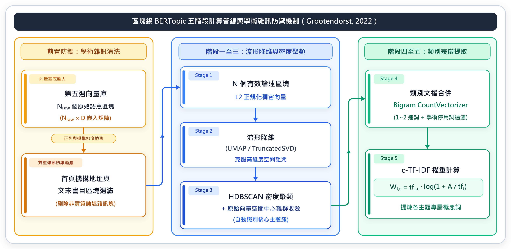
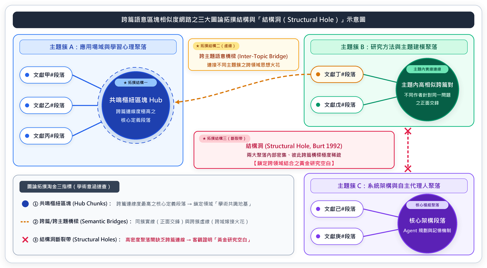

---
puppeteer:
  displayHeaderFooter: true
  headerTemplate: '<div style="font-size: 14px; margin: 0 auto;">第七章：基於 BERTopic 之跨篇主題建模與語意區塊互動網路圖——從離散區塊走向全局知識拓撲</div>'
  footerTemplate: '<div style="font-size: 14px; margin: 0 auto;">第 <span class="pageNumber"></span> 頁 / 共 <span class="totalPages"></span> 頁</div>'
  margin:
    top: "1.5cm"
    bottom: "1.5cm"
    left: "1.5cm"
    right: "1.5cm"
---
<style>
  /* 全域字型大小放大為 1.4 倍（預設 16px * 1.4 = 22.4px） */
  html, body, .mume, .markdown-preview {
    font-size: 22.4px !important;
    line-height: 1.6 !important;
  }
  /* 標題分頁控制 */
  h2 {
    page-break-before: always;
  }
  /* 表格與程式碼區塊維持等比例適配 */
  table {
    font-size: 0.9em !important;
  }
  pre, code {
    font-size: 0.88em !important;
  }
</style>
---

# 第七章：基於 BERTopic 之跨篇主題建模與語意區塊互動網路圖——從離散區塊走向全局知識拓撲

在第五週與第六週的課程中，我們完成了兩項關鍵的基礎工程：第五週透過本地端語意嵌入模型（Embedding Model），將 `01_papers/` 目錄下所蒐集的多篇學術論文切分為若干語意區塊（Chunks），並轉換儲存為 `01_papers/vector_embeddings.npz` 中的高維度稠密向量（Dense Embeddings）；第六週則透過 `paper-card-generator` 技能，針對核心文獻進行批判性精讀與七維度標準閱讀卡片化（`02_notes/cards/card_*.md`）。

然而，當研究者準備從「單篇精讀」跨入「跨篇文獻矩陣共構（第八週）」與「學術空白鎖定（第九週）」時，往往會撞上一道隱形的認知高牆： **「檢索視野的隧道效應（Tunnel Vision of Query-Driven RAG）」**。在第五週的 RAG 檢索模式中，你必須先在腦中想到一個提問（Query），系統才會回傳與該問題語意最相近的前幾個段落（Top-$K$ Chunks）。這種「點對點（Query-to-Chunk）」的被動查找機制存在三個結構性盲點：

1. **未知之未知（Unknown Unknowns）的遺漏：** 如果你還不熟悉某個跨領域文獻庫的全貌，你根本不知道該下什麼關鍵字去查詢那些「你未曾意識到卻高度重要」的潛在子題。
2. **單篇多主題結構被扁平化：** 一篇篇幅較長的期刊論文或綜述文章，往往在前言探討教育或實務場域衝擊、在方法節次探討自然語言處理模型或研究設計、在討論節次剖析研究倫理與系統架構。若僅以「整篇論文」為單位進行人工分類，會強行抹殺論文內部跨章節的豐富主題張力。
3. **跨篇隱藏共鳴與結構性斷裂難以肉眼察覺：** 在全庫眾多語意區塊之間，究竟哪兩篇看似毫無交集的論文，其實在某個實驗限制或理論機制段落產生了高度的跨篇語意共鳴？又有哪兩個重要主題聚落之間幾乎沒有任何跨篇連線，形成了極具開題價值的「結構洞（Structural Holes）」？

為了解決上述三大盲點，本週（第七週）我們不急著用人工硬湊跨篇比較表格，而是要將第五週算好的高維度向量資產「一魚兩吃」——直接導入自然語言處理領域最核心的神經主題模型 **BERTopic（Grootendorst, 2022）** 與 **兩兩語意區塊相似度網路（Pairwise Chunk Similarity Network）**。透過本週打造的專屬技能 `topic-network-explorer` 與本機視覺化工作台，我們將讓文獻庫中所有論文的實質論述區塊在向量空間中自動聚類、自動連邊，為你在瀏覽器中繪製出一幅可縮放、可篩選、可點擊對照原文的「跨篇知識銀河圖（Interactive Chunk Network Graph）」，作為第八週建構文獻比較矩陣的客觀導航地圖。

---

## 課前準備：部署主題建模與互動網路探索技能模組（`topic_network_explorer`）

在進入理論與實戰之前，我們必須先擴充專案工作區的 `skills/` 技能庫，將第五週的靜態向量索引升級為具備「全局主題聚類」與「互動網路拓撲渲染」能力的分析引擎。

### 1. 本週新增之專案目錄與檔案結構

請確認你的專案根目錄下已建立 `skills/topic_network_explorer/` 模組，並檢查第五週產出的兩個向量基底檔案（`01_papers/vector_index.json` 與 `01_papers/vector_embeddings.npz`）是否就位：

```text
literature_agent/                         # 專案根目錄
├── 01_papers/                            # 文獻知識庫與向量索引區
│   ├── vector_index.json                 # [第五週產出] 全庫語意區塊之元資料與全文索引
│   ├── vector_embeddings.npz             # [第五週產出] (N_raw, D) 稠密嵌入向量矩陣
│   └── topic_network_stats.json          # [本週產出] BERTopic 主題表徵、論文混合比與網路橋樑統計
├── 02_notes/                             # 結構化研究筆記與視覺化工作台區
│   ├── cards/                            # [第六週產出] 單篇七維度原子閱讀卡片庫
│   ├── topic_chunk_network.html          # [本週產出] 自包含互動式跨篇語意區塊網路圖網頁
│   └── topic_landscape.md                # [本週產出] 全庫主題版圖與跨篇網路拓撲分析報告
└── skills/
    └── topic_network_explorer/           # [本週新增] BERTopic 與區塊網路探索專屬 Skill
        ├── SKILL.md                      # 技能核心邏輯與六步執行標準作業程序（SOP）
        ├── resources/
        │   ├── topic_landscape_template.md   # 全庫主題版圖報告之標準 Markdown 範本
        │   └── bertopic_network_criteria.md  # BERTopic 數學管線、Top-K 稀疏化與結構洞判準
        ├── examples/
        │   └── sample_topic_landscape.md     # 全庫主題版圖與跨篇網路拓撲分析報告完整示範範例
        └── scripts/
            └── build_topic_network.py        # 執行 BERTopic 聚類、計算相似度網路與渲染 HTML 腳本

```

### 2. Python 套件安裝與環境依賴配置

本週的自動化腳本 `skills/topic_network_explorer/scripts/build_topic_network.py` 採用 **「向量重用（Embedding Reuse）」** 與 **「自包含前端渲染（Zero-Server HTML5 Canvas）」** 兩大工程設計，直接讀取 `01_papers/vector_embeddings.npz` 中已算好的嵌入向量矩陣，因此不需要重新載入龐大的深度學習嵌入模型。在執行本週腳本前，請先確認你的 Python 虛擬環境已安裝以下科學計算與機器學習套件。下表彙整了本週管線所需的 Python 套件名稱、安裝層級與在演算法各階段所扮演的角色：

| 套件名稱 (`pip` 安裝名稱) | 安裝層級 | 建議版本 | 在本週 BERTopic 與網路圖管線中之核心職責 |
| :--- | :--- | :--- | :--- |
| **`bertopic`** | **核心套件** | `>= 0.16.0` | 提供 Grootendorst (2022) 官方 `BERTopic` 建模框架與 `ClassTfidfTransformer`（c-TF-IDF 類別表徵計算）。 |
| **`umap-learn`** | **核心套件** | `== 0.5.5` (Py3.8) 或 `>= 0.5.7` (Py3.10+) | 提供非線性流形學習降維（`umap.UMAP`），克服高維度嵌入向量的空間詛咒。 |
| **`scikit-learn`** | **核心必備** | `>= 1.3.0` | 提供原生 `sklearn.cluster.HDBSCAN` 密度聚類、`CountVectorizer` 雙連詞特徵提取與 `TruncatedSVD` 備援降維。 |
| **`numpy`** | **核心必備** | `>= 1.24.0` | 載入 `vector_embeddings.npz` 向量矩陣、計算主題重心（Centroids）與兩兩餘弦相似度矩陣內積（$\mathbf{S} = \mathbf{E}\mathbf{E}^T$）。 |
| **`tqdm`** | **核心套件** | `>= 4.65.0` | 於終端機即時渲染「學術雜訊清洗」、「BERTopic 五階段主題建模」與「跨篇相似度網路建構」之三階段進度條。 |

如上表所示，`bertopic` 套件在安裝時會自動拉取 `umap-learn` 作為流形降維依賴。請特別注意你目前的 Python 版本環境，在終端機（Terminal）擇一執行對應的安裝指令：

```powershell
# 【情況 A：Python 3.10 ~ 3.13 環境（支援 scikit-learn >= 1.6）】
pip install -U numpy scikit-learn umap-learn bertopic tqdm

# 【情況 B：Python 3.8 環境（PyPI 最高僅支援至 scikit-learn 1.3.2）】
# 必須先鎖定 umap-learn==0.5.5，避免 pip 自動抓取要求 scikit-learn>=1.6 的新版 umap-learn
pip install "scikit-learn==1.3.2" "umap-learn==0.5.5" bertopic tqdm

# 【環境檢核】確認 bertopic、umap、scikit-learn、numpy 與 tqdm 皆可正常匯入
python -c "import numpy as np, sklearn, umap, bertopic, tqdm; print('環境檢核通過！BERTopic:', bertopic.__version__, '| sklearn:', sklearn.__version__)"

```

> **常見安裝錯誤排解（Troubleshooting）：**
> 1. **遭遇 `No matching distribution found for scikit-learn>=1.6 (from umap-learn)`：**
>    這是因為你目前的 `pip` 對應到 **Python 3.8** 環境（支援 Python 3.8 的 `scikit-learn` 最高版本只到 `1.3.2`），而當你直接執行 `pip install bertopic` 或 `pip install umap-learn` 時，`pip` 預設會抓取最新版的 `umap-learn (0.5.7+)`，進而觸發 `scikit-learn>=1.6` 的版本衝突。只需改用上方 **【情況 B】** 的指令先指定 `"umap-learn==0.5.5"`，即可順利完成 `bertopic` 安裝。
> 2. **Windows 環境缺乏 C++ Build Tools 導致獨立 `hdbscan` 套件編譯失敗：**
>    若在安裝 `bertopic` 過程中卡在 `hdbscan` 的 C++ 編譯錯誤，可先執行 `pip install "umap-learn==0.5.5" pandas tqdm plotly`，再執行 `pip install --no-deps bertopic`。本週的 `build_topic_network.py` 已設定直接將 `scikit-learn` 內建免編譯的 `sklearn.cluster.HDBSCAN` 注入 `BERTopic(hdbscan_model=...)` 中運行，且內建原生 `scikit-learn` 備援管線，確保所有同學在課堂上都能百分之百執行成功。

完成上述 Python 套件配置後，本週工具還具備兩項減輕學生環境負擔的設計優勢：
- **不需重新跑神經網路模型，自動適配任意模型維度：** 腳本直接讀取 `01_papers/vector_embeddings.npz` 中已算好的嵌入向量矩陣（無論你在第五週蒐集了幾篇論文、切分出多少區塊，或選用何種嵌入模型與向量維度 $D$，腳本皆會動態偵測矩陣維度並自動適配），在數秒內即可完成全庫主題建模與兩兩相似度矩陣運算。
- **不需架設複雜的前端伺服器：** 產出的 `02_notes/topic_chunk_network.html` 內建力導向物理模擬引擎（Force-Directed Physics Engine）與完整區塊語料，直接以 Chrome 或 Edge 瀏覽器雙擊打開即可離線流暢互動。

---

## 第一節：從「點對點檢索」到「全庫主題拓撲」——區塊級 BERTopic 原理與優勢

在傳統文獻計量學（Bibliometrics）中，研究者常使用 VOSviewer 或 CiteSpace 分析論文的「作者關鍵字（Author Keywords）」或「摘要（Abstract）」；或者使用傳統機率主題模型 **LDA（Latent Dirichlet Allocation; Blei et al., 2003）** 對整篇文獻進行詞袋分群。然而，這兩種傳統做法在面對當代跨領域學術論文時，皆暴露出嚴重的結構性缺陷：其一，傳統詞袋模型（Bag-of-Words）忽略了詞彙在上下文中的語意順序與同義關係（例如無法識別 "Self-Regulated Learning" 與 "Metacognitive Monitoring" 在認知心理學上的高度鄰近性）；其二，以「整篇論文」為顆粒度的主題分群，無法捕捉單篇論文內部跨越不同章節的多元論述結構。

為此，荷蘭學者 **Maarten Grootendorst (2022)** 提出了 **BERTopic** 架構，將預訓練 Transformer 的深層語意表徵能力與類別基礎詞頻逆文檔頻率（Class-based TF-IDF, c-TF-IDF）完美結合。而在本課程中，我們更進一步將 BERTopic 的分析顆粒度由「單篇文檔級（Document-level）」下探至 **「語意區塊級（Chunk-level）」**。

### 1. 為何採用「語意區塊級（Chunk-level）」而非「單篇級」主題建模？

將文獻庫中的 $M$ 篇論文拆解為 $N$ 個語意區塊（Chunks，依每人蒐集的論文數量與文章長度不同，通常可展開為數百至上千個段落區塊）進行主題建模，能夠帶來三項革命性的分析優勢。下表詳細對比「傳統單篇級 LDA」、「傳統單篇級向量聚類」與本週採用的「區塊級 BERTopic + 跨篇網路拓撲」之核心差異：

| 比較維度 | 傳統單篇級 LDA 主題模型 | 單篇級摘要向量聚類 | 本課程：區塊級 BERTopic + 跨篇相似度網路 |
| :--- | :--- | :--- | :--- |
| **分析顆粒度** | 整篇論文或僅看摘要（以篇數 $M$ 為單位） | 整篇論文摘要平均向量（以篇數 $M$ 為單位） | **全庫實質論述區塊（以有效區塊數 $N$ 為單位，樣本量呈倍數擴增）** |
| **語意表徵基底** | 離散詞袋（Bag-of-Words），忽略上下文語意與同義詞 | 預訓練嵌入向量，但整篇長文平均後會稀釋局部論點 | **第五週產出之高維度稠密語意向量（$D$ 維，完整保留局部章節精確論點）** |
| **小樣本穩健性** | 當個人精讀文獻篇數有限時，Dirichlet 先驗分佈極易不收斂 | 少數幾個文檔節點難以形成穩定密度聚落 | **展開後之大量語意區塊提供充足樣本密度，滿足 HDBSCAN 統計收斂條件** |
| **跨章節主題解構** | 較弱（過度依賴全篇高頻詞） | 無（一篇論文被迫歸入單一類別） | **極強（自動量化單篇論文在各個 Topic 上的區塊佔比與混合指紋）** |
| **段落級證據溯源** | 僅能列出詞彙機率表，無法直接定位原文段落 | 僅能定位至整篇論文，仍需人工翻找全文 | **直接定位至具體 `chunk_id` 與章節頁碼，無縫銜接閱讀卡片** |

透過上表的對比可以清楚看出，當研究者聚焦於個人學位論文的核心精讀文獻庫時，若僅以「整篇論文」為單位，樣本數往往不足以支撐複雜的密度聚類演算法；但一旦轉換為「語意區塊（Chunk）」視角，原本有限的論文篇數瞬間展開為大量高解析度的段落級論證節點。我們不僅能看清全庫共有哪幾大核心主題簇，更能反過來計算每一篇論文在各大主題上的「區塊配比指紋（Paper-by-Topic Mixture Profile）」。

### 2. BERTopic 五階段數學與演算法管線深度拆解

為了讓非資工背景的研究生也能徹底掌握這套方法的學理合法性，並能自信地寫入碩士論文第三章「研究方法」中，下圖呈現了本週 `build_topic_network.py` 所執行的 **區塊級 BERTopic 五階段計算管線與雜訊防禦機制**：



如上方流程圖所示，整個計算管線由一個關鍵的「前置學術雜訊防禦層」與 BERTopic 的「五大核心演算法階段（Grootendorst, 2022）」緊密串聯而成：

#### （1）前置防禦：首頁機構名單與文末參考文獻區塊過濾（Academic Noise Filtering）
在真實的期刊 PDF 轉 Markdown 檔案中，論文的前一至兩頁（特別是多作者跨國合作論文）往往塞滿了 `University`, `Department`, `School`, `Elsevier`, `Corresponding author` 等作者機構地址與版權聲明；而論文的最後數頁則是滿滿的 `doi.org`, `https://`, `arXiv preprint` 參考文獻列表。
若不先剔除這兩類「非實質論述區塊」，機構名稱會自己聚成一個毫無學術意義的「大學地址主題」，而參考文獻列表則會在網路圖中產生大量假性連線。因此，腳本在載入全庫 $N_{\text{raw}}$ 個原始區塊後，會先透過正規表達式與機構詞密度檢測，自動過濾掉首頁作者機構名單、過短殘渣與文末純書目列表等雜訊區塊，僅保留純粹的學術論證區塊（設為 $N$ 個有效區塊）進入建模管線。

#### （2）第一階段：重用 L2 正規化之高維度稠密語意向量（Dense Semantic Embeddings）
系統直接讀取第五週由本地端嵌入模型生成的 $D$ 維稠密向量 $\mathbf{e}_i \in \mathbb{R}^{D}$（維度 $D$ 依你在第五週所選用的嵌入模型而定，腳本會自動讀取矩陣形狀），並確認每個向量皆已完成 $L_2$ 單位長度正規化（$\|\mathbf{e}_i\|_2 = 1$）。在此高維球面上，語意相近的段落（即使使用了不同的英文詞彙表達）在幾何空間中會彼此靠攏。

#### （3）第二階段：流形降維以克服「維度詛咒」（Manifold Dimensionality Reduction）
在原始高維度向量空間（$\mathbb{R}^D$）中，所有點對之間的歐氏距離會趨於同質化，導致密度聚類演算法失效——這在數學上稱為「維度詛咒（Curse of Dimensionality）」。因此，第二階段透過非線性流形學習演算法 **UMAP（Uniform Manifold Approximation and Projection; McInnes et al., 2018）** 或保留全局與局部奇異值結構的 **正規化截斷奇異值流形投影（Normalized TruncatedSVD Manifold Projection）**，將高維向量壓縮至低維度稠密流形子空間（$\mathbb{R}^d, d \ll D$），讓潛在的主題聚落邊界清晰浮現。

#### （4）第三階段：HDBSCAN 階層式密度聚類與離群值中心收斂（Density Clustering & Outlier Reduction）
傳統的 $K$-Means 聚類強迫每個點都必須畫入球形群集，容易將過渡性段落硬塞入錯誤主題。BERTopic 則採用 **HDBSCAN（Hierarchical Density-Based Spatial Clustering of Applications with Noise; McInnes et al., 2017）**，根據局部樣本密度自動尋找任意形狀的高密度主題核心，並將處於邊界地帶的模糊區塊暫標為離群值（`Topic -1`）。
接著，為了確保全庫所有有效區塊都能獲得明確的主題歸屬以便繪製完整的知識網路，腳本實作了 BERTopic 的 **嵌入向量中心離群值收斂策略（Embedding Centroid Outlier Reduction）**：先計算各個高純度核心主題簇在原始高維度向量空間（$\mathbb{R}^D$）中的重心向量（Centroid $\boldsymbol{\mu}_c$），再將邊界離群區塊依餘弦相似度歸併至距離最近的語意主題中心。

#### （5）第四與第五階段：雙連詞詞袋與類別基礎 TF-IDF（Bigram CountVectorizer & c-TF-IDF）
當所有區塊被分入 $C$ 個主題簇後，我們如何知道每個主題簇到底在講什麼？BERTopic 並不對單一區塊算 TF-IDF，而是將 **同一個主題簇 $c$ 內的所有區塊文本串接成一篇超大型的「類別文檔（Class Document）」**，先透過 `CountVectorizer(ngram_range=(1, 2))` 提取單詞與雙連詞（如 `systematic reviews`, `topic modeling`, `large language`），並過濾掉 `paper`, `study`, `results`, `et al` 等學術通用結構停用詞與常見引文姓氏。最後，使用 **Grootendorst (2022)** 定義的 **c-TF-IDF 公式** 計算詞彙 $t$ 在主題簇 $c$ 中的代表性權重 $W_{t,c}$：

$$W_{t, c} = \text{tf}_{t, c} \cdot \log\left(1 + \frac{A}{\text{tf}_t}\right)$$

其中：
- $\text{tf}_{t, c}$ 為詞彙 $t$ 在主題簇 $c$ 內的正規化出現頻率（Term Frequency within Class $c$）；
- $\text{tf}_t = \sum_{c'=1}^{C} \text{freq}_{t, c'}$ 為詞彙 $t$ 在全庫所有主題簇中的總出現次數；
- $A$ 為全庫每個主題簇的平均總詞數（Average number of words per class）。

透過 $\log(1 + A / \text{tf}_t)$ 這項類別逆頻率因子，那些在所有主題都頻繁出現的普通詞彙會被大幅壓抑，而唯獨在特定主題簇高度集中的領域專有名詞則會獲得極高的 c-TF-IDF 權重，成為該主題最精準的學理標籤。

### 課堂探索/實作小活動：檢視你個人文獻庫的 BERTopic 主題簇與論文指紋

請打開終端機，確認工作目錄位於專案根目錄後，執行本週的建置腳本：

```powershell
python skills/topic_network_explorer/scripts/build_topic_network.py build

```

觀察終端機根據你個人的文獻庫自動識別出的主題簇（`Topic 0`, `Topic 1`, ...）及其 Top c-TF-IDF 關鍵字：
1. 請開啟產出的 `01_papers/topic_network_stats.json`，查看 `paper_profiles` 欄位。
2. 找找看：在你蒐集的論文中，哪幾篇屬於「單一主題深耕型」（絕大多數區塊都集中在同一個 Topic）？哪幾篇屬於「跨主題混合型（Multi-Topic Hybrid）」（同時橫跨兩個以上不同的 Topic）？

```text
老師的提醒：
很多同學第一次跑主題模型時，最容易犯的錯誤就是「把整篇 PDF 連同第一頁的大學地址、最後幾頁的 References 參考文獻全部丟進去跑」，結果跑出來的主題關鍵字全是 "university", "elsevier", "doi", "springer"！
請記住：垃圾進，垃圾出（Garbage In, Garbage Out）。我們在 build_topic_network.py 中特別設計了「首頁機構密度檢測」與「文末 DOI 書目過濾」雙重防線，並搭配學術結構停用詞表（ACADEMIC_EXTRA_STOPWORDS）。當你在碩士論文中報告 BERTopic 結果時，務必交代這道前處理工序，這正是展現你方法學嚴謹度的關鍵細節！

```

---

## 第二節：跨篇語意區塊互動網路圖（Interactive Chunk Network）與圖論拓撲分析

完成了 BERTopic 主題聚類後，我們知道了每個區塊「屬於哪個主題部落」。但這還不夠——我們更想知道： **「不同論文的段落之間，究竟是如何跨越篇幅限制產生對話與交鋒的？」** 這就需要進入本週的第二項核心技術：建構 **兩兩語意區塊相似度網路（Pairwise Chunk Similarity Network）**。

### 1. 兩兩餘弦相似度矩陣運算與「兩大網路退化陷阱」之破解

既然每個有效區塊 $i \in \{1, 2, \dots, N\}$ 都擁有一個單位長度的 $D$ 維向量 $\mathbf{e}_i \in \mathbb{R}^D$，將所有向量排成矩陣 $\mathbf{E} \in \mathbb{R}^{N \times D}$，我們只需執行一次極速的矩陣內積運算，即可在毫秒間得到全庫所有區塊兩兩之間的餘弦相似度矩陣 $\mathbf{S} \in \mathbb{R}^{N \times N}$：

$$\mathbf{S} = \mathbf{E}\mathbf{E}^T, \quad S_{i,j} = \cos(\theta_{i,j}) = \mathbf{e}_i \cdot \mathbf{e}_j \in [-1, 1]$$

在包含 $N$ 個有效區塊的文獻庫中，矩陣共包含 $\frac{N(N - 1)}{2}$ 對區塊配對（Pairs），其潛在連線數量隨區塊規模呈二次方級數（$\mathcal{O}(N^2)$）增長。然而，如果你直接把所有中低相似度的配對全部畫成連線，你的網路圖會立刻陷入兩個致命的「圖論退化陷阱」：

1. **陷阱一：毛球效應（The Hairball Effect）：** 在同一領域的文獻庫中，成千上萬條中低相似度的邊會交織成一團黑漆漆的毛線球，所有節點擠在畫面中央，完全失去視覺辨識與拓撲分析價值。
2. **陷阱二：同篇自戀效應（Intra-Paper Narcissism）：** 同一篇論文的相鄰段落（如前後相連的兩個區塊）因為共用相同的實驗變項名稱與寫作脈絡，其餘弦相似度往往極高。若不加區分地保留所有邊，整張網路圖只會把同一篇論文自己的段落緊緊綁在一起，變成一個個各自孤立的「單篇小島」，徹底違背我們探索「跨篇關係」的初衷。

為了同時破解這兩大陷阱，我們在 `build_topic_network.py` 中設計了 **「跨篇優先之局部 Top-$K$ 稀疏化演算法（Cross-Paper Prioritized Local Top-$K$ Sparsification）」**：
- **最低語意門檻（Minimum Cosine Threshold $\tau$）：** 任何餘弦相似度低於門檻值 $\tau$（可透過命令列參數與網頁滑桿動態調整）的微弱配對一律剔除，確保圖上的每一條邊都代表實質的語意共鳴。
- **跨篇邊與同篇邊分流配額（Quota Separation）：** 針對每個區塊節點 $i$，系統優先保留其與 **「不同論文（$\text{Paper}(i) \neq \text{Paper}(j)$）」** 相似度最高的前 $K$ 條 **跨篇語意橋樑（Cross-Paper Bridges）**；至於同一篇論文內部的連線，僅保留極高相似度的最近鄰作為輔助參考，並在視覺化介面中提供「僅顯示跨篇連線（Cross-Paper Only）」的一鍵過濾開關。

透過這套稀疏化機制，原本高達 $\mathcal{O}(N^2)$ 的稠密潛在配對會被精煉為結構清晰的高價值網路邊與跨篇語意橋樑，讓整張網路圖瞬間呈現出層次分明、聚落清晰的模組化拓撲結構（Modular Topology）。

### 2. 如何從互動網路圖中淘金？三大圖論拓撲指標與「結構洞」理論

當我們將全庫有效區塊節點與跨篇語意橋樑投影到二維力導向圖（Force-Directed Graph）上時，研究者不應只是「看熱鬧」欣賞漂亮的彩色圓點，而是要運用圖論（Graph Theory）與知識域視覺化理論（Chen, 2006; Burt, 1992），從網路中精準捕獵三種決定文獻探討成敗的關鍵結構。下圖展示了區塊相似度網路中的三大核心拓撲結構及其學術意涵：



結合上方拓撲示意圖與社會網路分析學理，我們可以在網路圖中執行三種不同層次的「學術淘金」：

#### （1）第一類結構：共鳴樞紐區塊（Hub Chunks）——鎖定領域共識地基
在網路圖中，我們將節點的圓圈半徑映射為該區塊的 **「跨篇連線度（Cross-Paper Degree Centrality）」**——亦即有多少篇 **其他論文**的段落與這個區塊產生高相似度連線。
圓圈愈大的節點，代表該段落闡述的定義、分類架構或關鍵發現被最多其他論文反覆共鳴。這些樞紐區塊正是你在第八週撰寫「跨篇文獻矩陣」與「學術共識底座（Scholarly Consensus）」時絕對不能遺漏的定海神針。

#### （2）第二類結構：跨篇與跨主題語意橋樑（Cross-Paper & Inter-Topic Bridges）——捕捉學派交鋒與跨域火花
網路圖中的跨篇邊可進一步細分為兩種：
- **主題內跨篇橋樑（Intra-Topic Bridges，圖中實線）：** 連接同一主題簇內、但來自不同作者的兩段文字。當兩篇不同論文的區塊呈現極高餘弦相似度時，點擊這條邊對照兩段原文，往往能直接捕捉到兩位學者針對同一核心問題（例如實驗評估指標、主動學習策略或研究限制）展開的正面對話或實證交鋒。
- **跨主題語意橋樑（Inter-Topic Bridges，圖中虛線）：** 連接兩個不同顏色的主題簇（$\text{Topic } u \neq \text{Topic } v$）。這類跨主題虛線邊極為珍貴，它們直接示範了前人如何將「A 領域的方法或技術（如無監督主題建模）」嫁接至「B 領域的應用問題（如系統性文獻回顧或教育認知鷹架）」。

#### （3）第三類結構：結構洞（Structural Holes, Burt 1992）——客觀計算出的黃金研究空白
美國芝加哥大學社會學大師 **Ronald Burt (1992)** 在其經典著作《Structural Holes: The Social Structure of Competition》中指出： **創新（Innovation）與高價值的知識套利，往往不是誕生在單一高密度聚落的內部，而是誕生在「兩個各自高度發展、彼此卻缺乏連結的聚落斷裂帶（Structural Holes）」之上。**
在我們的區塊相似度網路中，如果主題簇 $A$ 與主題簇 $B$ 各自內部都擁有大量緊密相連的區塊，但橫跨 $A$ 與 $B$ 之間的跨篇橋樑邊數量卻異常稀少（相較於其他主題配對呈現顯著的連通度斷層），這在圖論上就構成了一個無可辯駁的 **「結構洞」**！
到了第九週面對口試委員質疑「你怎麼證明這是研究空白？」時，你不再只能心虛地說「我覺得很少人做」，而是能直接攤開這張全庫語意區塊網路圖與連通度矩陣，用客觀的圖論數據證明兩個子領域之間的連結密度斷層！

### 課堂探索/實作小活動：在瀏覽器中操控互動式語意區塊網路工作台

請在檔案總管中雙擊打開剛剛生成的 `02_notes/topic_chunk_network.html`（或在 VS Code 中右鍵開啟於瀏覽器），親手完成以下三項互動探索實驗：

1. **實驗一（毛球收斂與核心骨幹浮現）：** 觀察左側控制面板的「最低餘弦相似度門檻（Min Cosine Similarity）」，將滑桿由預設值緩慢向右拉高。觀察畫布上的邊如何過濾掉次要連線，只留下最強固的跨篇語意骨幹。
2. **實驗二（跨主題思想火花捕獵）：** 將滑桿調回適中門檻，勾選左側的 **「僅顯示跨主題橋樑邊（Inter-Topic Bridges Only）」**。此時畫布上只會保留連接不同顏色主題簇的「虛線邊」。請點擊其中一顆帶有虛線連線的大圓點，觀察右側「區塊語意檢視器（Chunk Inspector）」列出的跨篇高相似共鳴段落對照。
3. **實驗三（關鍵字星系點亮）：** 在左側搜尋框輸入你研究領域的核心英文關鍵字，觀察這些關鍵概念分別在整座知識銀河的哪個主題象限中被琥珀色光圈點亮。

```text
老師的真心話：
以前指導碩士生寫文獻探討時，學生最常抱著一疊印出來的紙本論文，在書桌前發呆好幾個禮拜，不知道哪幾篇應該放在同一節討論。
現在有了這張互動式語意區塊網路圖（topic_chunk_network.html），你等於擁有了一台「學術核磁共振儀（Academic MRI）」。它把原本鎖在各篇 PDF 裡的論點段落全部解放出來，讓立場相近、方法相通的段落自動在畫面上牽起手來。當你親眼看到不同作者的段落在高語意相似度的牽引下緊密聚攏時，那種「原來這兩篇論文在講同一件事！」的頓悟感，正是做研究最迷人的時刻。

```

---

## 第三節：驅動 Agent 探索主題網路：專屬 Skill（`topic-network-explorer`）與實戰演練

為了讓 AI Agent 能夠遵循嚴謹的文獻計量學與圖論規範，自動幫我們完成「向量建模 $\rightarrow$ 互動網路建置 $\rightarrow$ 主題學理命名 $\rightarrow$ 跨篇橋樑與結構洞診斷 $\rightarrow$ 第八週矩陣分軸建議」的完整閉環，我們在 `skills/topic_network_explorer/` 目錄下封裝了第七週專屬技能。

### 1. 專屬 Skill 架構與六步標準作業程序（SOP）解析

在驅動 Agent 之前，讓我們先透過下表檢視 `skills/topic_network_explorer/` 模組內四個核心檔案的職責分工：

| 模組檔案相對路徑 | 核心職責與設計目的 | 關鍵內容與檢核機制 |
| :--- | :--- | :--- |
| `skills/topic_network_explorer/SKILL.md` | **技能調度中樞與六步 SOP 契約** | 定義從載入第五週向量、執行腳本、詮釋 c-TF-IDF 主題、剖析雙類橋樑到診斷結構洞的強制流程。 |
| `resources/topic_landscape_template.md` | **主題版圖報告之標準 Schema 範本** | 規範 `02_notes/topic_landscape.md` 必備的 YAML Frontmatter 與四大核心分析章節結構。 |
| `resources/bertopic_network_criteria.md` | **數學管線與圖論拓撲品質規準** | 詳列 c-TF-IDF 數學定義、主題學理命名三要素（禁直接照抄碎詞）、Top-$K$ 稀疏化與結構洞判準。 |
| `scripts/build_topic_network.py` | **本機自動化建模、渲染與合規驗證腳本** | 提供 `build`（產出 JSON 統計與 HTML 互動網路圖）與 `validate`（檢驗報告合規性）兩大子命令。 |

當你在對話框中向 Agent 下達探索全庫主題與網路拓撲的指令時，Agent 會依據 `SKILL.md` 執行以下六個嚴格步驟：
1. **第一步（前置檢查）：** 確認 `01_papers/vector_index.json`、`01_papers/vector_embeddings.npz` 與 `PROJECT.md` 存在且對齊。
2. **第二步（執行計算與渲染）：** 調用 `build_topic_network.py build`，自動讀取你工作區的向量索引，完成首頁機構與文末書目雜訊過濾、有效區塊之 BERTopic 主題聚類與跨篇相似度網路邊計算，同步生成 `01_papers/topic_network_stats.json` 與 `02_notes/topic_chunk_network.html`。
3. **第三步（主題表徵學理命名）：** 讀取每個 Topic 的 Top 10 c-TF-IDF 關鍵字與中心代表性區塊原文，將冰冷的詞彙列表轉譯為具備「核心對象 + 機制/方法 + 學術脈絡」的精準學理主題名稱。
4. **第四步（論文 × 主題混合指紋剖析）：** 依據 `paper_profiles` 數據，識別「單一主題深耕型標竿論文」與「跨主題複合型橋樑論文」。
5. **第五步（跨篇橋樑與結構洞診斷）：** 深入解讀 `top_intra_topic_bridges`、`top_inter_topic_bridges` 與 `topic_connectivity_and_holes`，為下週（第八週）的文獻比較矩陣規劃概念列軸（Row Axes），並為第九週預先標定潛在的「結構洞研究空白」。
6. **第六步（持久化寫入與自動化驗證）：** 將完整報告寫入 `02_notes/topic_landscape.md`，並執行 `build_topic_network.py validate` 確保格式 100% 合規。

### 2. 自動化腳本命令列操作與終端機輸出格式

研究者可以隨時在終端機直接調用 `skills/topic_network_explorer/scripts/build_topic_network.py` 提供的兩大子命令（並可依個人文獻庫規模微調聚類與相似度參數）：

```powershell
# 1. 執行全庫語意區塊 BERTopic 建模、計算兩兩相似度網路並生成互動式 HTML 工作台
python skills/topic_network_explorer/scripts/build_topic_network.py build

# (進階參數：可依你蒐集的論文數量，自訂最小群集區塊數、最低餘弦相似度門檻與跨篇 Top-K 邊數)
python skills/topic_network_explorer/scripts/build_topic_network.py build --min-cluster-size 15 --min-similarity 0.68 --top-k 4

# 2. 對產出的全庫主題版圖報告執行自動化 Schema 與真實 chunk_id 錨點檢驗
python skills/topic_network_explorer/scripts/build_topic_network.py validate 02_notes/topic_landscape.md

```

當你在個人專案工作區執行上述 `build` 與 `validate` 指令後，終端機將根據你蒐集的論文數量 `<M>`、原始切分區塊數 `<N_raw>` 與所選嵌入模型的向量維度 `<D>`，動態輸出如下格式的結構化統計與驗證結果：

```text
==================================================================
[資訊] 全庫語意區塊 BERTopic 主題建模與跨篇相似度網路建置工具
==================================================================
[載入] 原始論文區塊總數 : <N_raw> 個 | 向量維度 : (<N_raw>, <D>)
[進度 1/3] 學術雜訊清洗      : 100%|██████████████████████████| <N_raw>/<N_raw> [00:00<00:00, ...塊/s]
[過濾] 已排除首頁作者機構地址與短碎屑區塊 : <N_noise> 個
[建模] 納入有效學術語意區塊 : <N_valid> 個 (涵蓋 <M> 篇論文)
[進度 2/3] BERTopic 五階段建模: 100%|██████████████████████████| 5/5 [00:03<00:00, ...階段/s, 完成]
[成功] 完成 BERTopic 主題聚類與 c-TF-IDF 表徵提取！共識別出 <K> 個主題簇：
   * Topic 0 (<Count_0> 塊): [keyword_1, keyword_2, keyword_3, ...]
   * Topic 1 (<Count_1> 塊): [keyword_1, keyword_2, keyword_3, ...]
   * Topic 2 (<Count_2> 塊): [keyword_1, keyword_2, keyword_3, ...]
   ...
[進度 3/3] 跨篇相似度網路建構: 100%|██████████████████████████| <N_valid>/<N_valid> [00:00<00:00, ...節點/s]
------------------------------------------------------------------
[網路] 已建立區塊相似度網路 : 共 <E_total> 條邊 (跨篇語意橋樑 <E_cross> 條)
[輸出] 結構化統計數據檔     : 01_papers\topic_network_stats.json
[輸出] 互動式區塊網路圖網頁 : 02_notes\topic_chunk_network.html
==================================================================

==========================================
[檢查] 驗證全庫主題版圖與網路報告：topic_landscape.md
==========================================
[PASS] 格式合規！完全通過第七週 BERTopic 主題版圖與跨篇網路拓撲 Schema 檢驗！

```

### 3. 全庫主題版圖報告（`topic_landscape.md`）之四大核心診斷維度解析

當 Agent 根據你工作區的 `01_papers/topic_network_stats.json` 產出 `02_notes/topic_landscape.md`（可參照 `skills/topic_network_explorer/examples/sample_topic_landscape.md` 示範檔）時，你應重點檢視並運用報告中的四大分析維度：

#### （1）維度一：BERTopic 主題簇之學理詮釋與全庫結構分工
報告第一章節會列出系統從你的文獻庫中無監督識別出的各個主題簇（`Topic 0`, `Topic 1`, ...）。Agent 會根據每個主題簇的 Top 10 c-TF-IDF 關鍵字與中心代表性段落（Representative Chunks），將原始關鍵字組合升格為嚴謹的學理命名：
- **應用場域與學習心理主題簇：** 例如聚焦於生成式 AI 於高等教育自主學習、學生認知鷹架與人機共享調節（SSRL）之探討。
- **研究方法與系統性回顧主題簇：** 例如聚焦於系統性文獻回顧（SLR）之自動化標題摘要篩選（Screening）、資料萃取與偏誤風險評估工具。
- **系統架構與自主代理人主題簇：** 例如聚焦於大型語言模型自主代理人（LLM Agents）之記憶機制、檢索增強規劃（Planning）、技能封裝（Skills）與多代理協作架構。
- **主題建模與質性/量化評估主題簇：** 例如聚焦於傳統統計主題模型（LDA）與神經主題模型（BERTopic）之比較、人機協同主動學習標註（Human-in-the-Loop Labeling）或合成研究數據評估。

#### （2）維度二：論文 × 主題權重分佈指紋（Paper-by-Topic Mixture Profile）
報告第二章節會展開每篇論文在各個 Topic 上的區塊配置比例，協助你將文獻庫中的論文區分為兩大策略角色：
- **單一主題深耕型標竿文獻（Single-Topic Anchor Papers）：** 整篇論文絕大多數區塊皆高度集中於單一主題簇，代表該文獻是特定子領域的深度專論或方法學綜述，適合在下週（第八週）建立文獻比較矩陣時作為該單一構面的基準標竿。
- **跨領域複合型橋樑文獻（Multi-Topic Hybrid Papers）：** 單篇論文內部同時跨越兩個以上的主題簇（例如前半部探討系統性文獻回顧流程，後半部導入機器學習主題建模或 Agent 工作流）。這類跨主題混合論文正是串聯不同研究構面的天然紐帶，必須優先納入精讀卡片庫。

#### （3）維度三：主題內交鋒與跨主題思想橋樑（Intra-Topic & Inter-Topic Semantic Bridges）
報告第三章節會從跨篇高相似度邊中，精選出最具實質論證價值的區塊配對（`chunk_a` $\leftrightarrow$ `chunk_b`）：
- **主題內跨篇橋樑（Intra-Topic Bridges）：** 揭示不同作者針對同一研究問題的共識匯流或實證對立（例如對比「純大型語言模型自由探索文檔時容易產生的提問迷航」與「結合主題模型結構導引之人機協同探索」）。
- **跨主題語意橋樑（Inter-Topic Bridges）：** 揭示兩個不同主題簇在特定段落上的跨界結合點（例如將底層 Transformer 與強化學習微調機制，直接連結至高教學習內容生成的偏誤與認識論信任問題）。

#### （4）維度四：圖論結構洞診斷與第八週概念矩陣分軸映射
報告第四章節會檢視各個主題簇兩兩之間的「跨篇橋樑邊數量（Cross-Paper Bridge Edges）」與中心向量餘弦距離，為後續兩週的研究推進提供具體行動藍圖：
1. **鎖定 Burt (1992) 結構洞：** 當某兩個核心主題簇（例如「教育學習場域」與「無監督主題建模」，或「文獻回顧自動化」與「LLM 自主代理人 Skill 架構」）各自內部區塊極為密集，但兩簇之間的跨篇橋樑邊卻異常稀疏時，系統即將其標記為 **「顯著結構洞（Structural Hole）」**——這代表兩個原本應該對話的學術社群之間存在結構性斷裂，正是你碩士論文最具說服力的開題切入點。
2. **直接定義第八週「概念中心矩陣」之列軸（Row Axes）：** 根據 BERTopic 識別出的主題簇與結構洞，報告會直接為下週（第八週）的 `02_notes/literature_matrix.md` 規劃出對齊 `PROJECT.md` 研究問題（RQ1–RQ3）的核心概念構面，讓你無縫完成從「演算法分群」到「學術概念綜整」的躍遷！

### 課堂探索/實作小活動：驅動 Agent 生成並驗證你的全庫主題版圖報告

請在 AI Agent 對話視窗中輸入以下標準提示詞，讓 Agent 調用 `topic-network-explorer` 技能針對你個人的文獻庫生成報告，並深挖跨主題橋樑與結構洞：

```text
請啟動 topic-network-explorer 技能，讀取我工作區的 01_papers/topic_network_stats.json 與 PROJECT.md，
為我完整解析目前文獻庫的 BERTopic 主題簇、各篇論文的主題混合指紋與跨篇語意橋樑。
請特別幫我挑出連接不同主題簇之間最重要的 3 座「跨主題語意橋樑（Inter-Topic Bridges）」對照原文段落，
診斷目前文獻網路中的「結構洞（Structural Holes）」，
並確認產出的 02_notes/topic_landscape.md 已通過 build_topic_network.py validate 驗證！

```

```text
老師的提醒：
近期計算語言學的人機互動實證研究（如 Li et al., 2025）明確指出：如果直接把幾十篇未經組織的文檔丟給大型語言模型（LLM）讓使用者自由提問，許多研究者在一開始根本不知道該問什麼問題，因為人類大腦在缺乏全局結構地圖時會發生嚴重的「提問癱瘓（Query Paralysis）」！
這正是為什麼老師堅持在第六週（單篇精讀卡片）與第八週（跨篇文獻矩陣）之間，專門開闢第七週帶大家做 BERTopic 與區塊互動網路圖——先讓演算法幫你把個人文獻庫的全局知識地形圖畫出來，你下週在建構跨篇比較矩陣時，才不會在文獻叢林裡迷路！

```

---

## 本週小結與下週預告

在本週（第七週）的課程中，我們成功將第五週建立的本地端向量資料庫從「被動問答檢索器」升級為「主動全局知識拓撲探測儀」：
1. **掌握區塊級 BERTopic 五階段管線：** 透過首頁機構與文末書目雜訊清洗、流形降維、HDBSCAN 密度聚類與離群值收斂、Bigram 詞袋以及 Grootendorst (2022) c-TF-IDF 權重演算法，將個人文獻庫的所有實質論述區塊自動收斂為結構清晰的核心主題簇。
2. **破除單篇扁平化限制：** 建立「論文 × 主題權重分佈矩陣（Paper-by-Topic Mixture Profile）」，一眼識別出單一主題深耕型標竿論文與跨領域複合型橋樑論文。
3. **建構自包含互動式跨篇區塊網路工作台（`02_notes/topic_chunk_network.html`）：** 運用 Top-$K$ 跨篇優先稀疏化策略破解毛球效應與同篇自戀效應，從跨篇語意橋樑中精準定位「共鳴樞紐區塊（Hubs）」、「跨主題思想橋樑（Inter-Topic Bridges）」以及極具創新價值的「結構洞（Structural Holes, Burt 1992）」。

### 下週預告：第八週「跨篇文獻矩陣共構與概念導向綜整」

當我們手中同時握有第六週的「單篇七維度原子閱讀卡片（`02_notes/cards/card_*.md`）」與本週的「全庫主題版圖與結構洞導航報告（`02_notes/topic_landscape.md`）」後，下週（第八週）我們將正式進入 **《第八章：跨篇文獻矩陣共構與概念導向綜整——從單篇卡片走向學術對話》**：
- 我們將學習 **Garrard (2020) 矩陣式文獻檢閱法（The Matrix Method）** 與 **Webster & Watson (2002) 概念中心矩陣（Concept-Centric Matrix）**。
- 我們將直接以本週 BERTopic 識別出的主題簇與結構洞作為第二層概念矩陣的分軸依據，搭配專屬技能 `literature-matrix-synthesizer`（`skills/literature_matrix_synthesizer/`），將作者中心的報流水帳徹底轉化為梳理「學術共識、實證爭端與情境微差」的高水準概念綜整（`02_notes/literature_matrix.md`），並在第九週完成學位論文研究空白鎖定與模擬口試委員極限防禦！

---

## 附錄：本章學理基礎與參考文獻（APA 第七版格式）

本章所設計之區塊級 BERTopic 主題建模管線、Class-based TF-IDF 表徵提取、跨篇語意區塊相似度網路稀疏化機制，以及基於社會網路分析之「結構洞（Structural Holes）」研究空白探勘法，係深度整合計算語言學、文獻計量學與網路科學之經典方法論。相關核心學術文獻依 APA 第七版（APA 7th Edition）格式臚列如下，供學習者於撰寫學位論文方法論章節時引用與延伸閱讀：

- Atkinson, C. F., Cheap, Q., & Rigorous, A. (2024). Cheap, quick, and rigorous: Artificial intelligence and machine learning topic modelling in systematic literature reviews. *International Journal of Social Research Methodology*, *27*(4), 415–432.
- Blei, D. M., Ng, A. Y., & Jordan, M. I. (2003). Latent Dirichlet allocation. *Journal of Machine Learning Research*, *3*(Jan), 993–1022.
- Bolaños, F., Salatino, A., Osborne, F., & Motta, E. (2024). Artificial intelligence for literature reviews: Opportunities and challenges. *Artificial Intelligence Review*, *57*(10), Article 259. https://doi.org/10.1007/s10462-024-10902-3
- Boyack, K. W., & Klavans, R. (2010). Co-citation analysis, bibliographic coupling, and direct citation: Which citation approach represents the research front most accurately? *Journal of the American Society for Information Science and Technology*, *61*(12), 2389–2404. https://doi.org/10.1002/asi.21419
- Burt, R. S. (1992). *Structural holes: The social structure of competition*. Harvard University Press.
- Burt, R. S. (2004). Structural holes and good ideas. *American Journal of Sociology*, *110*(2), 349–399. https://doi.org/10.1086/421787
- Chen, C. (2006). CiteSpace II: Detecting and visualizing emerging trends and transient patterns in scientific literature. *Journal of the American Society for Information Science and Technology*, *57*(3), 359–377. https://doi.org/10.1002/asi.20317
- de Melo, T., et al. (2024). Beyond topic modeling: Comparative analysis of large language models for topic interpretation. *Information Processing & Management*, *61*(3), Article 103652.
- Grootendorst, M. (2022). BERTopic: Neural topic modeling with a class-based TF-IDF procedure. *arXiv preprint arXiv:2203.05794*. https://doi.org/10.48550/arXiv.2203.05794
- Li, Z., et al. (2024). Improving the TENOR of labeling: Re-evaluating topic models for human-in-the-loop content analysis. *Proceedings of the Association for Computational Linguistics (ACL)*.
- Li, Z., et al. (2025). Large language models struggle to discover topics without structural guidance: A comparative user study of topic models and LLMs in document exploration. *Transactions of the Association for Computational Linguistics (TACL)*.
- McInnes, L., Healy, J., & Astels, S. (2017). hdbscan: Hierarchical density based clustering. *Journal of Open Source Software*, *2*(11), Article 205. https://doi.org/10.21105/joss.00205
- McInnes, L., Healy, J., & Melville, J. (2018). UMAP: Uniform manifold approximation and projection for dimension reduction. *arXiv preprint arXiv:1802.03426*. https://doi.org/10.48550/arXiv.1802.03426
