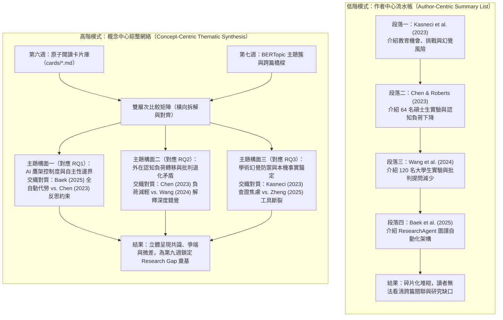
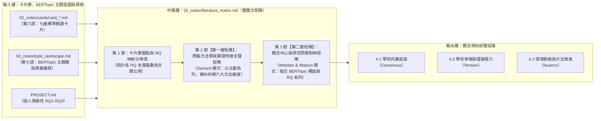

---
puppeteer:
  displayHeaderFooter: true
  headerTemplate: '<div style="font-size: 14px; margin: 0 auto;">第八章：跨篇文獻矩陣共構與概念導向綜整（Literature Matrix & Thematic Synthesis）</div>'
  footerTemplate: '<div style="font-size: 14px; margin: 0 auto;">第 <span class="pageNumber"></span> 頁 / 共 <span class="totalPages"></span> 頁</div>'
  margin:
    top: "1.5cm"
    bottom: "1.5cm"
    left: "1.5cm"
    right: "1.5cm"
---
<style>
  /* 全域字型大小放大為 1.4 倍（預設 16px * 1.4 = 22.4px） */
  html, body, .mume, .markdown-preview {
    font-size: 22.4px !important;
    line-height: 1.6 !important;
  }
  /* 標題分頁控制 */
  h2 {
    page-break-before: always;
  }
  /* 表格與程式碼區塊維持等比例適配 */
  table {
    font-size: 0.9em !important;
  }
  pre, code {
    font-size: 0.88em !important;
  }
</style>
---

# 第八章：跨篇文獻矩陣共構與概念導向綜整（Literature Matrix & Thematic Synthesis）

## 課程導讀

在第六週與第七週的課堂中，我們完成了「單篇縱向深挖」與「全庫橫向探勘」的雙軌準備：第六週我們透過對抗性審稿人思維，將核心文獻淬鍊為一張張格式嚴整、拒絕強行硬填的七維標準閱讀卡片（`02_notes/cards/`）；第七週我們則直接複用 768 維稠密向量，透過 **BERTopic 區塊級主題建模** 與 **跨篇語意區塊互動網路圖（`02_notes/topic_chunk_network.html`）**，由下而上（Bottom-Up）繪製出全庫文獻的主題聚落與跨篇共鳴橋樑（`02_notes/topic_landscape.md`）。

至此，我們手中同時握有「微觀精讀的單篇卡片」與「宏觀探勘的全庫主題網路」。然而，當我們準備動筆規劃碩士學位論文 **第二章「文獻探討（Literature Review）」** 的正式結構時，幾乎所有初學者仍會撞上一堵無形卻致命的高牆：

> **「我的每一張閱讀卡片都寫得很紮實，也看過了主題網路圖，但當要把十幾篇論文串聯成一個章節時，為什麼寫出來卻還是像一份枯燥乏味、毫無靈魂的讀書報告清單？」**

在各大學研究所的論文指導與審查過程中，指導教授與口試委員對第二章最常見、也最嚴厲的批評莫過於： **「你這不是文獻探討（Literature Synthesis），這只是在報流水帳（Annotated Bibliography）！」** 許多研究生習慣採取「一人一段」的寫法：第一段寫「學者 A (2023) 做了什麼實驗，得出 X 結論」；第二段寫「學者 B (2024) 調查了什麼樣本，得出 Y 結論」；第三段寫「學者 C (2025) 則提出了 Z 系統架構……」。整章讀下來，讀者只看到前人研究成果的碎片化堆砌，既看不出文獻與文獻之間的因果演進與方法優劣，更看不見研究生本人的獨立分析視角。

為了徹底攻克這項學術寫作瓶頸，本週（第八講）我們將把第六週的「單篇精讀卡片」與第七週的「BERTopic 主題簇與跨篇相似橋樑」正式合流，專注於 **「跨篇文獻矩陣共構與概念導向綜整（What & How of Prior Art）」**；而下一週（第九講）則將在此基礎上推進至 **「學術空白鎖定與開題立論防禦（Why & So What of My Thesis）」**。

貫穿本週課程的核心法則為：

> **文獻探討不是前人成就的陳列館，而是一場由你擔任主席的學術圓桌辯論會；唯有結合「BERTopic 主題群集」與「二維比較矩陣」，將「作者中心」翻轉為「概念中心」，散落的卡片才能交織成具備解釋力的知識網絡。**

在本週的課程中，我們將深入學習 **Garrard (2020) 矩陣式文獻回顧法（The Matrix Method）** 與 **Webster & Watson (2002) 概念中心矩陣（Concept-Centric Matrix）** 的方法學原理；我們將延續第六週的「防硬填紀律」，解決「實證研究、系統性綜述（SLR）、概念立場文與系統架構論文」等異質文類在同一張比較矩陣中的橫向對齊難題；最後，我們將導入專案專屬的 `literature-matrix-synthesizer` Skill 與自動化盤點驗證腳本，引導 Agent 整合 `02_notes/cards/` 與 `02_notes/topic_landscape.md`，共構出雙層次比較矩陣並提煉出跨篇文獻的 **共識（Consensus）、爭端（Tension）與情境微差（Nuance）**，正式產出 `02_notes/literature_matrix.md`，為第九週鎖定學術空白鋪設最堅實的地基。

---

## 課前準備：擴充第八週專屬 Skill 模組與盤點卡片庫

在展開本週的跨篇文獻矩陣共構實作前，請同學依照以下三項步驟，在個人論文工作區 `my_thesis_workspace` 下擴充第八週專屬的 Skill 模組，並執行課前卡片庫盤點：

### 1. 工作區目錄結構擴充（新增 `skills/literature_matrix_synthesizer/`）

繼第六週建立單篇閱讀卡片 Skill、第七週建立主題網路探索 Skill 後，本週我們將在 `skills/` 目錄下新增負責跨篇矩陣整合的第三座核心能力模組—— **`literature_matrix_synthesizer`**。請確認工作區具備以下目錄與檔案配置：

- **核心流程入口：** `my_thesis_workspace/skills/literature_matrix_synthesizer/SKILL.md`
- **靜態規範與矩陣範本：**
  - `my_thesis_workspace/skills/literature_matrix_synthesizer/resources/matrix_template.md`（雙層次跨篇矩陣與三態綜整分析 Schema 範本）
  - `my_thesis_workspace/skills/literature_matrix_synthesizer/resources/synthesis_criteria.md`（概念中心轉換規準、異質文類適配法則與學術轉承語料庫）
- **少樣本學習標準示範：** `my_thesis_workspace/skills/literature_matrix_synthesizer/examples/sample_literature_matrix.md`（完整生產級跨篇文獻矩陣示範）
- **本機自動化輔助與驗證腳本：** `my_thesis_workspace/skills/literature_matrix_synthesizer/scripts/matrix_synthesizer.py`（卡片庫批次掃描、RQ 映射覆蓋率統計與矩陣合規檢驗工具）

完成配置後，工作區與本週相關之目錄結構如下：

```text
my_thesis_workspace/
│
├── PROJECT.md                                      # 專案研究規格書（定義個人 RQ1-RQ3）
│
├── 02_notes/
│   ├── cards/                                      # 第六週產出之七維標準原子閱讀卡片庫
│   │   ├── card_2023_Kasneci_LLM_Education.md
│   │   ├── card_2023_Chen_AI_Scaffolding.md
│   │   └── ... (建議結合第七週樞紐論文雷達累積 5 至 10 張卡片)
│   ├── topic_chunk_network.html                    # 第七週產出之跨篇語意區塊互動網路圖
│   ├── topic_landscape.md                          # 第七週產出之 BERTopic 主題版圖與跨篇橋樑報告
│   └── literature_matrix.md                        # 【本週核心交付物】雙層次跨篇文獻比較矩陣與綜整
│
└── skills/
    ├── academic_reading_card/                      # 第六週：單篇批判精讀卡片化 Skill
    ├── topic_network_explorer/                     # 第七週：BERTopic 主題建模與區塊網路 Skill
    └── literature_matrix_synthesizer/              # 【本週新增】跨篇文獻矩陣與概念綜整 Skill
        ├── SKILL.md                                # 六步標準作業流程（SOP）與防硬填治理守則
        ├── resources/
        │   ├── matrix_template.md                  # 雙層次矩陣與三態綜整空白 Schema
        │   └── synthesis_criteria.md               # Webster & Watson 概念矩陣與跨文類對齊規準
        ├── examples/
        │   └── sample_literature_matrix.md         # 涵蓋五篇異質文獻之生產級矩陣典範
        └── scripts/
            └── matrix_synthesizer.py               # 批次掃描卡片 RQ 覆蓋率與驗證矩陣格式腳本

```

### 2. 確認前置閱讀卡片資產與執行課前掃描

跨篇比較矩陣的品質，取決於底層原子卡片的積累厚度與第七週主題版圖的引導。在啟動矩陣合成前，請確認 `02_notes/cards/` 目錄下已存放針對各個 BERTopic 主題簇挑選出的代表性論文卡片（建議至少 5 至 10 張），接著於終端機執行本週腳本的 `scan` 命令：

```bash
python skills/literature_matrix_synthesizer/scripts/matrix_synthesizer.py scan

```

該腳本會自動遍歷 `02_notes/cards/card_*.md`，解析每張卡片的 YAML Frontmatter 與【第六維度】對 `PROJECT.md` 各研究問題（RQ1、RQ2、RQ3）的映射狀態，並在終端機輸出各個 RQ 目前獲得多少篇文獻實質支撐的統計摘要，協助研究者在動筆前一眼掌握文獻庫的結構分佈。

---

## 第一節：從「報流水帳」到「概念導向綜整」的思維典範轉移

### 1.1 碩士論文第二章的頭號殺手：作者中心流水帳（Author-Centric Summary List）

為什麼絕大多數研究生在讀完二十篇英文論文、寫下數萬字筆記後，寫出來的文獻探討依然會被指導教授退稿？問題的根源在於：學生將「單篇文獻閱讀的順序」，直接當成了「文獻探討章節的寫作順序」。

在認知心理學與學術寫作研究中，這種低階寫作模式被稱為 **「作者中心模式（Author-Centric Approach）」** 或 **「註解式書目流水帳（Annotated Bibliography）」**。當學生採用這種模式時，其大腦的組織單元是「個別檔案（File-by-File）」：打開第一張卡片，把 Chen (2023) 的研究目的、樣本與結論摘錄成一段；接著打開第二張卡片，把 Wang (2024) 的實驗過程與結果摘錄成下一段；再打開第三張卡片，把 Baek et al. (2025) 的系統架構摘錄成第三段。

這種寫法在學術論證上具有三個致命缺陷：第一， **責任轉嫁給讀者**：作者沒有替讀者進行跨篇的比較與歸納，而是把十幾篇論文的原石倒在讀者面前，強迫口試委員自己在大腦裡去拼湊「所以 A 跟 B 到底有什麼關係？」；第二， **掩蓋了方法學演進與理論衝突**：當每篇論文各自獨佔一個段落時，即使 A 論文與 B 論文得出了完全相反的實證結果，兩者在文本空間上也被隔開了，作者往往視而不見；第三， **無法自然推導出研究缺口**：因為前文只是平鋪直敘地羅列別人的功勞，到了章節結尾要交代「本研究動機」時，只能生硬地加上一句「綜上所述，本研究也很重要」，完全缺乏邏輯推導的必然性。

### 1.2 Webster & Watson (2002) 的典範轉移：由「作者中心」翻轉為「概念中心」

為了徹底根除流水帳病灶，資訊系統領域頂級期刊 *MIS Quarterly* 的前主編 Jane Webster 與 Richard T. Watson 在其經典方法論論文 *Analyzing the Past to Prepare for the Future: Writing a Literature Review*（**Webster & Watson, 2002**）中，提出了影響深遠的 **「概念中心矩陣法則（Concept-Centric Matrix Principle）」**。他們明確指出：一篇成功的文獻探討，必須完成從「以作者為列（Author-Centric）」到「以概念為列（Concept-Centric）」的結構翻轉。

而在我們已經完成第七週 BERTopic 主題建模與區塊網路分析的優勢下，這項翻轉變得空前直覺：第七週由演算法聚類出的 **「高階學術概念構面（Topics）」** 與 **「跨篇高相似共鳴橋樑（Cross-Paper Bridges）」**，正是我們建立概念中心矩陣最客觀的骨幹！

圖 8-1 展示了從傳統「作者中心流水帳」翻轉為「概念中心綜整網絡」的結構演進過程。我們可以觀察到兩種模式在知識組織維度上的根本差異：



從圖 8-1 可以清楚看出，在概念中心模式下，個別學者不再是章節標題或段落主角，而是退居為 **「支撐或反駁某個理論構面的證據節點（Evidence Nodes）」**。當我們以「外在認知負荷轉移與批判退化矛盾」作為段落主題時，Chen & Roberts (2023) 與 Wang et al. (2024) 會被拉進同一個段落裡正面交鋒，由研究生擔任圓桌會議主席，剖析為何兩者得出截然不同的認知後果。

為了協助同學在實際動筆時自我檢核，下表完整對照了「作者中心流水帳」與「概念導向綜整模式」在五個關鍵寫作維度上的具體差異：

| 評估維度 | 作者中心流水帳模式（低階被動摘錄） | 概念導向綜整模式（高階批判整合） |
| :--- | :--- | :--- |
| **小節標題設計** | 以「學者、年代或廣泛名詞」為標題（如：2.1 國外相關研究；2.2 國內相關研究） | 以「核心概念構面、變項關係或學理爭端」為標題（如：2.1 代理控制度對研究生認知負荷之雙向調節機制） |
| **段落主題句（Topic Sentence）** | 以單一作者開頭：`Chen and Roberts (2023) investigated the effects of AI scaffolding on 64 graduate students...` | 以跨篇概念命題開頭：`While structured AI scaffolding effectively reduces extraneous cognitive load (Chen & Roberts, 2023), unconstrained dialogue risks inducing superficial engagement (Wang et al., 2024).` |
| **引註出現型態** | 單一段落只反覆出現同一篇文獻的引註，段與段之間彼此孤立 | 同一段落內交織多篇文獻之群組引註（Clustered Citations）與對比引註，展現跨篇對話 |
| **方法學細節用途** | 像背書一樣交代某篇論文用了幾個人、做幾週，卻不解釋這些細節有何意義 | 僅在「解釋跨篇結論矛盾或指出外推邊界」時，精準調動樣本規模與實驗設計細節作為論據 |
| **作者心智定位** | 替前人整理功勞簿的「書記員（Secretary）」 | 主導各派學者同台辯論並裁決方法優劣的「圓桌會議主席（Moderator & Judge）」 |

審視上表可知，從「摘要」邁向「綜整」的核心關鍵，在於勇敢打破單篇論文原有的外殼。單篇閱讀卡片（第六週）是將一篇論文拆解為七個標準零件；全庫主題網路（第七週）是找出零件之間的隱藏磁力線；而跨篇文獻綜整（第八週），則是將十幾篇論文拆下來的同名零件放在同一張工作檯上重新組裝。

### 1.3 跨篇文獻對話的三種核心關係：共識、爭端與微差

當我們將多張閱讀卡片與第七週的跨篇共鳴段落聚集於同一概念構面下進行橫向交織時，究竟要尋找什麼樣的對話關係？在國際期刊的文獻探討中，所有具備高說服力的綜整段落，皆是由以下三種基本對話關係（Tri-Modal Dialectics）編織而成：

1. **學術共識底座（Scholarly Consensus — 求同）：**
   - **定義：** 多位學者在不同年份、不同研究場域、採用不同研究方法（如量化實驗、系統性綜述或質性訪談），卻共同支持了某項基礎假設或背景事實（對應第七週網路圖中的「同主題高相似度跨篇共鳴橋樑」）。
   - **本機文獻庫實例：** 結合工作區中的立場文（Kasneci et al., 2023）、研究生準實驗（Chen & Roberts, 2023）與科學代理人綜述（Zheng et al., 2025），三者雖文類各異，卻高度一致地指出：「未受結構化約束的開放式語言模型對話，無法獨立勝任高嚴謹度的學術研究任務，且極易因機率性生成引發虛假引用風險。」這項跨文類共識，便構成了我們研究設計為何必須引入結構化 Agent 鷹架的「合法性底座」。
2. **學術爭端與理論張力（Contradiction & Tension — 存異與交鋒）：**
   - **定義：** 兩派學者探討相似的自變項與因變項（或工程目標與教育目標），卻得出了相互衝突的實證結論或典範對立。
   - **本機文獻庫實例：** 在工作區中，計算機工程領域的系統論文（如 Baek et al., 2025 的 ResearchAgent；Schmidgall et al., 2025 的 Agent Laboratory）一致追求「端到端全自動生成研究構想與論文草稿」；然而，教育心理與學習科學實證（如 Wang et al., 2024）卻證實，當 AI 代勞程度過高且缺乏強制反思時，學生雖提升了 40% 的任務完成速度，其深度批判提問次數卻顯著退化。這種 **「工程全自動效率」與「教育主體性內化」之間的激烈張力**，正是整章文獻探討最精彩、最能展現研究生洞察力的焦點所在。
3. **情境脈絡與方法微差（Contextual Nuance & Boundary Conditions — 辨微）：**
   - **定義：** 前人的理論或工具在特定實驗條件下成立，但當研究對象、任務複雜度、時間尺度或技術環境發生轉換時，效果便會衰減或產生質變。
   - **本機文獻庫實例：** Wang et al. (2024) 的實驗是在「2 小時單次實驗室環境」下讓大學生撰寫短篇摘要；而 Chen & Roberts (2023) 雖進行了 10 週碩士班實驗，其使用的 AI 卻仍是「脫離本機文獻庫的網頁對話框」。當場景轉換至「非英語母語碩士生進行長達一學期（16 至 18 週）、需嚴格錨定本機數十篇英文 PDF 原文的學位論文文獻探討」時，前人的單純提示詞鷹架便會因工具切換斷裂與跨語言語意落差而失效。

### 1.4 課堂探索小活動：診斷「作者中心流水帳」病灶並重構概念主題句

> **活動時間：** 15 分鐘
> **活動目標：** 練習辨識典型的「報流水帳」段落，並將其改寫為具備跨篇交織張力的「概念導向綜整」段落。
>
> 1. 請同學閱讀以下這段研究生常見的初稿文字（低階流水帳範例）：
>    *「Kasneci et al. (2023) 探討了大型語言模型在教育上的機會與挑戰，指出 ChatGPT 可以協助學生寫作，但會有產生假文獻的問題。接著，Chen 與 Roberts (2023) 對 64 位碩士生進行了 10 週的實驗，發現使用 AI Agent 鷹架可以顯著降低外在認知負荷（p < .001）。另外，Wang et al. (2024) 則對 120 位資工系大學生進行 2 小時的實驗，發現使用 ChatGPT 雖然讓寫作速度變快 40%，但學生的批判提問次數卻變少了。」*
> 2. **診斷病灶：** 請圈出上述段落中所有以「人名」作為句首的句子，並思考：這三篇論文共同圍繞的核心爭議是什麼？為什麼 Chen & Roberts (2023) 與 Wang et al. (2024) 的結果看似相反？
> 3. **重構演練：** 請嘗試在不增加新事實的前提下，將上述三句話重組為一段以 **「AI 介入形式對學習者認知負荷與批判深度的雙向影響」** 為主題句（Topic Sentence）的綜整段落，讓三位學者在同一個論證架構下對話。

```text
老師的真心話：
在指導碩士論文的過程中，我常跟學生分享一個最簡單的自我檢測指標——「遮住人名測試法」。
當你寫完第二章的某個小節後，試著拿一支筆把每一段開頭的「某某學者（年份）」全部遮起來。
如果遮住人名之後，你的段落結構變成了：「他做了 A……他做了 B……他做了 C……」，那就代表你百分之百掉進了報流水帳的陷阱！
相反地，在一篇優秀的概念導向文獻探討中，學者的人名與年份應該大多出現在「句尾的括號裡」作為支撐論點的證據，而句首永遠是你提煉出來的「學術觀點、理論機制與方法爭端」。請永遠記住：是你（研究者）在駕馭文獻，而不是讓文獻牽著你的鼻子走！

```

---

## 第二節：雙層次文獻比較矩陣設計與異質文類適配

### 2.1 高維資訊的降維引擎：Garrard (2020) 矩陣式文獻回顧法

理解了「概念中心綜整」的思維典範後，下一個實務問題是：當我們面對 `02_notes/cards/` 目錄下十幾張、每張長達兩三千字的七維閱讀卡片，以及第七週 `02_notes/topic_landscape.md` 中的跨篇橋樑時，人類大腦的工作記憶（Working Memory）無法同時記住十幾篇論文的樣本數、理論框架、統計效果量與研究限制。如果直接看著卡片硬寫，最終還是會因為認知過載而退回「看一張卡片、寫一段摘要」的老路。

為了解決這項跨篇資訊處理瓶頸，健康科學與社會科學文獻回顧專家 Judith Garrard 提出了著名的 **「矩陣式文獻回顧法（The Matrix Method，Garrard, 2020）」**。其核心原理在於 **「高維文本的結構化降維（Dimensionality Reduction）」**：在動筆撰寫任何綜整段落之前，必須先建立一張二維表格（Literature Review Matrix），將散落在各篇檔案中的關鍵維度抽離出來，強制鋪平在同一個視覺平面上。

當十幾篇文獻被壓縮進同一張二維矩陣時，原本隱藏在字裡行間的規律就會瞬間產生「視覺湧現（Visual Emergence）」：
- 當我們 **由上往下（縱向掃視某一欄）** 閱讀「支撐理論框架」欄時，能立刻看出該領域目前最主流的三大理論是什麼、有哪些論文根本沒有理論基礎；
- 當我們 **由上往下掃視「研究對象與情境」欄** 時，能一眼發現「原來過去八成的研究都只做單次 2 小時的大學生實驗，幾乎沒有人做過整學期的碩士生追蹤」；
- 當我們 **由左往右（橫向掃視某一列）** 閱讀時，則能檢驗單篇論文內部「理論 $\rightarrow$ 方法 $\rightarrow$ 發現 $\rightarrow$ 限制」的邏輯鏈條是否完整。

### 2.2 雙層次矩陣架構設計：方法學全覽矩陣（Layer 1）與概念暨 RQ 對映矩陣（Layer 2）

在傳統做法中，研究者通常只畫一張以「作者為列」的比較表。然而，正如同前一節 Webster & Watson (2002) 所警示的，如果我們的工具只有一張以作者為列的表格，學生在看表寫作時依然很容易順著表格一列一列地報流水帳。

因此，在本課程的 `literature-matrix-synthesizer` Skill 中，我們設計了 **「雙層次跨篇文獻矩陣（Dual-Layer Literature Matrix）」** 架構，統一固化存放於 `02_notes/literature_matrix.md`。圖 8-2 展示了從第六週七維卡片庫與第七週 BERTopic 主題版圖，經由雙層次矩陣轉換為三態綜整分析的完整知識工程管線：



如圖 8-2 所示，這兩層矩陣扮演著截然不同卻互為表裡的認知鷹架功能：
1. **第一層矩陣（跨篇方法學與實證特徵全覽矩陣）：** 採用 Garrard (2020) 架構，以「篇名、作者與文類（Citation & Genre）」為縱軸（列），橫軸（欄）則精確對應第六週閱讀卡片的關鍵維度： **理論框架、研究對象與情境、核心機制/介入工具、評估指標與關鍵發現（含頁碼錨點）、方法學盲點與外推邊界**。其目的是完成「客觀事實的標準化拆解」。
2. **第二層矩陣（概念中心與研究問題對映矩陣）：** 採用 Webster & Watson (2002) 架構，進行 90 度的視角翻轉！縱軸（列）不再是作者，而是結合第七週 BERTopic 聚類構面與 `PROJECT.md` 的 **「核心概念構面（直接對映 RQ1、RQ2、RQ3）」**；橫軸（欄）則分為： **主流實證共識與支持文獻、跨篇爭端/反例或條件限制、現有文獻之方法學或系統結構缺口**。第二層矩陣是連結「單篇卡片」與「正式文獻探討段落」的直接橋樑——每完成第二層矩陣的一列，就等於完成了一節文獻探討的論證大綱！

### 2.3 承接第六週「防硬填紀律」：異質文類與跨 RQ 分群的橫向對齊法則

在實際建立第一層與第二層矩陣時，研究生馬上會遇到一個極為棘手的實務問題： **「我的文獻庫裡不只有量化實驗論文！我有像 Kasneci et al. (2023) 這樣的概念立場文、有像 Ramos et al. (2024) 或 Zheng et al. (2025) 這樣的系統性綜述（Survey / SLR），還有像 Baek et al. (2025) 這樣的 AI 系統架構論文。當把這些不同文類的卡片放進同一張矩陣時，『受試者樣本數』跟『統計檢定值』欄位該怎麼填？」**

如果缺乏明確的工程規範，未受約束的 AI 模型往往會為了「讓表格看起來工整對齊」，而在綜述論文或立場論文的格子裡強行生造受試者人數，或者把系統架構論文的基準資料集誤寫成心理學量表。為此，我們將第六週建立的「學術誠實與防硬填紀律（Anti-Forced Filling Principle）」正式延伸至跨篇矩陣階段，制定了 **「異質文類矩陣欄位適配準則」**。

下表詳列了四大常見學術文類在第一層比較矩陣各欄位中的標準填寫規範：

| 矩陣比較欄位 | 量化/混合實證研究 (Empirical Study) | 系統性文獻回顧/綜述 (SLR / Survey) | 概念立場論文 (Position Paper) | 系統架構與工程論文 (System / Tool Paper) |
| :--- | :--- | :--- | :--- | :--- |
| **1. 篇名作者與文類** | 標註 `[量化實驗]`、`[準實驗]` 或 `[混合實證]` | 標註 `[系統性綜述 SLR]` 或 `[領域綜述 Survey]` | 標註 `[概念立場論文 Position Paper]` | 標註 `[系統架構開發 System Architecture]` |
| **2. 理論框架** | 具體填寫心理/教育/社會學理論（如 CLT、SRL、TAM） | 誠實填寫「無特定單一理論框架（依分類學 Taxonomy 歸納）」 | 誠實填寫「無單一實證理論（跨領域專家共識與倡議藍圖）」 | 誠實填寫「無行為理論框架（基於 Multi-Agent / 圖譜檢索架構）」 |
| **3. 研究對象與情境** | 填寫人類受試者樣本數 $N$、教育階段、學科背景與介入週數 | 填寫「文獻樣本量：共篩選納入 $N = \text{XX}$ 篇論文（無人類受試者）」 | 填寫「不適用（橫跨多教育階段之宏觀論述，無人類受試樣本）」 | 填寫「不適用（採用公開基準測試資料集 Benchmark 進行系統評測）」 |
| **4. 核心機制/介入工具** | 實驗組介入工具/教學法 vs. 對照組常規條件 | 檢索資料庫範圍、PRISMA 篩選流程與分類編碼架構 | 核心探討之機會構面（Opportunities）與風險挑戰（Challenges） | 系統核心模組管線（如 Planner、Iterative Reviewer、MCP 工具鏈） |
| **5. 評估指標與關鍵發現** | 心理量表信效度、具體統計檢定值（$F, t, p, \eta_p^2$）與質性主題 | 發表趨勢統計、主流技術演進光譜與跨篇瓶頸歸納（無初級推論統計） | 核心前瞻命題與教學/政策建議（明確標註「無初級量化統計檢定」） | 基準集任務成功率、準確率、人類專家偏好勝率與消融實驗結果 |
| **6. 方法學盲點與邊界** | 內部效度威脅（霍桑效應、時數偏差）、缺乏延宕後測、樣本外推限制 | 檢索年限或語種偏誤、僅做表面分類而未檢驗納入文獻之實驗效度 | 缺乏實證數據支撐、因果推導存在黑盒子、混談不同年齡層之認知邊界 | 追求全自動代勞而忽視人類學習者認知內化、缺乏真實課堂生態效度 |

透過上表的適配規範，不同文類的論文在同一個矩陣中不僅不會互相干擾，反而能形成極具張力的 **「跨文類互補對照」**——我們能夠在矩陣中清楚看見：工程類論文（第 4 欄）展示了多麼強大的自動化潛力，但對照教育實證論文（第 1 欄）與立場論文（第 3 欄）時，卻暴露出「缺乏真實學生認知內化評估」的方法學斷層！

此外，針對第六週卡片【第六維度】中標註為 **「與本 RQ 無直接關聯」** 的項目，本週矩陣在第 1 節「卡片庫盤點與 RQ 映射分佈表」中亦要求如實呈現。這能讓研究者一眼看穿知識庫的結構健康度：若發現手邊 10 張卡片中有 9 張都支援 RQ1，卻只有 1 張支援 RQ2，便能在進入第九週開題前，及時回頭利用第七週的 `02_notes/topic_landscape.md` 挑出對應主題簇的高樞紐論文，補做第六週卡片以補強 RQ2 的實證支撐。

### 2.4 課堂實作小活動：執行 `matrix_synthesizer.py scan` 盤點個人卡片庫與 RQ 覆蓋分佈

> **活動時間：** 15 分鐘
> **活動任務：** 運用第八週專屬腳本掃描個人工作區的卡片庫，檢視各篇文獻對 RQ1–RQ3 的支撐分佈，並生成矩陣骨架初稿。
>
> 1. 打開 Antigravity 2.0 內建終端機，確認工作目錄位於個人論文工作區 `my_thesis_workspace`。
> 2. 執行卡片庫跨篇掃描指令：
>    ```bash
>    python skills/literature_matrix_synthesizer/scripts/matrix_synthesizer.py scan
>    ```
> 3. 觀察終端機輸出的 `[統計] 核心研究問題 (RQs) 卡片支撐覆蓋度`：檢查你的 RQ1、RQ2、RQ3 是否皆有至少 2 至 3 張卡片提供實質啟發？有沒有哪個 RQ 目前處於「零支撐」的孤島狀態？
> 4. 若欲先建立帶有 YAML Frontmatter 與第 1 節映射表的矩陣骨架檔案，可加上 `--init-draft` 參數執行：
>    ```bash
>    python skills/literature_matrix_synthesizer/scripts/matrix_synthesizer.py scan --init-draft
>    ```

```text
老師的提醒：
很多同學在跑完 scan 統計後會嚇一跳：「老師！我明明讀了 8 篇論文、做了 8 張卡片，為什麼腳本顯示我的 RQ3（人機協作瓶頸）只有 1 篇文獻支撐，其他 7 篇都集中在 RQ1？」
請大家給自己一個掌聲——因為這正是第六週「拒絕強行硬填紀律」、第七週「BERTopic 主題雷達」與第八週「矩陣掃描工具」聯手發揮威力的時刻！
如果在第六週你讓 AI 對每一篇論文都硬湊三段話填滿 RQ1、RQ2、RQ3，你現在就會活在「我每個問題都有 8 篇文獻支撐」的虛假安全感裡，直到寫不出第二章第 3 節時才崩潰。
現在透過矩陣盤點提早發現某個 RQ 證據單薄，你只需要打開第七週的 `topic_landscape.md`，找出對應該主題的高樞紐論文補做 2 張卡片，你的整個文獻探討大廈就會無比均衡穩固！

```

---

## 第三節：驅動 Agent 共構跨篇比較矩陣：專屬 Skill 封裝與自動化實踐

### 3.1 為什麼跨篇矩陣共構需要專屬 Skill（`literature-matrix-synthesizer`）？

在一般使用大型語言模型的情境中，若研究者直接將五、六張卡片貼入對話框，並下達簡單指令：「請幫我把這些筆記整理成文獻比較表格與綜整段落」，模型往往會出現三種典型的工程退化：
1. **欄位隨機漂移與過度簡化：** 模型每次生成的表格欄位名稱不一致，且常將第六週辛苦提取的精確統計數據（如 $F(1, 61) = 14.82, p < .001, \eta_p^2 = .195$）濃縮成一句毫無信息量的「效果顯著」，導致矩陣喪失實證錨定價值。
2. **遺忘「概念中心」規範，退回作者流水帳：** 在矩陣下方的綜整分析中，模型極易順著表格順序寫出「首先 Kasneci (2023) 指出……其次 Chen (2023) 發現……最後 Baek (2025) 開發了……」的機械式摘要。
3. **跨文類硬套與捏造：** 面對綜述或立場文時，為了對齊表格而自動腦補受試者樣本或理論名稱。

為了徹底鎖定輸出品質，我們將前述的 Garrard (2020) 第一層方法學矩陣、Webster & Watson (2002) 第二層概念中心矩陣、異質文類防硬填規準，以及「共識、爭端、微差」三態綜整邏輯，完整封裝為專案專屬的 **`skills/literature_matrix_synthesizer/`** 模組。

### 3.2 跨篇文獻矩陣 Skill 架構與六步標準作業流程（SOP）深度解構

在 `skills/literature_matrix_synthesizer/SKILL.md` 中，Agent 的執行邏輯被嚴格約束於一套六步狀態機（Six-Step SOP）內。以下解析各步驟的核心工程機制：

#### 【第一步】批次盤點卡片庫與讀取專案規格（Card Inventory & PROJECT.md Alignment）
Agent 啟動後，首先遍歷 `02_notes/cards/card_*.md` 讀取所有已完成的七維卡片，同時載入第七週的 `02_notes/topic_landscape.md` 與根目錄的 `PROJECT.md`。此步驟確保 Agent 在動筆前已全局掌握：目前共有幾篇文獻、各屬何種文類、在 BERTopic 中屬於哪個主題簇，以及每張卡片在第 6 維度與 RQ1–RQ3 的真實對接關係。

#### 【第二步】異質文類識別與欄位防硬填適配（Genre-Adaptive Field Alignment）
Agent 動態掛載 `@Resource(resources/synthesis_criteria.md)` 中的跨文類對齊表，逐一判定每張卡片的真實文類（量化/混合實證、系統性綜述 SLR、概念立場文、系統架構開發）。對於無人類受試者或無初級推論統計的文獻，強制在矩陣中標註文類屬性與「無特定單一理論框架 / 不適用 / 無初級推論統計」，嚴格杜絕削足適履。

#### 【第三步】建構「雙層次跨篇文獻矩陣」（Dual-Layer Matrix Construction）
Agent 載入 `@Resource(resources/matrix_template.md)` 骨架，依序生成：
- **第 1 節：卡片庫盤點與 RQ 映射分佈表**（量化呈現各 RQ 之支撐篇數）。
- **第 2 節（第一層矩陣）：跨篇方法學與實證特徵全覽矩陣**（以文獻為列，完整保留樣本數 $N$、量表名稱、檢定統計量與頁碼錨點，以及審查者獨立批判的效度威脅）。
- **第 3 節（第二層矩陣）：概念中心與研究問題對映矩陣**（結合第七週 BERTopic 主題構面與對應 RQ1–RQ3 的核心概念為列，將各篇文獻打散重組為「主流共識支持文獻」、「跨篇爭端與條件限制」及「未解結構缺口」三欄）。

#### 【第四步】提煉「跨篇對話三態綜整分析」（Tri-Modal Thematic Synthesis）
在雙層次矩陣下方，Agent 參照 `@Example(examples/sample_literature_matrix.md)` 的論證深度，撰寫第 4 節的三大核心分析小節：
- **4.1 學術共識底座（Scholarly Consensus）：** 整合跨文類文獻共同支持的前提命題。
- **4.2 學術爭端與理論張力（Contradiction & Theoretical Tension）：** 針對矩陣中浮現的實證矛盾（如認知減負 vs. 批判鈍化）與典範衝突（如全自動代勞 vs. 教育主體性養成），剖析背後的調節變項與方法學根源。
- **4.3 情境脈絡與方法微差（Contextual Nuance & Methodological Shifts）：** 指出前人在研究場域、時間尺度與技術環境感知上的外推邊界，為第九週的學術空白鎖定預留精準接口。

#### 【第五步】持久化落盤與出處錨點核驗（Persistence & Citation Grounding）
將完整內容寫入 `02_notes/literature_matrix.md`，並確保矩陣與內文中的關鍵數據皆附帶卡片與原文頁碼錨點（如 `[p. 6]`、`[Sec. 3, p. 4]`）。

#### 【第六步】執行自動化格式與品質檢驗（Automated Matrix Validation）
由 Agent 或研究者於終端機調用 `@Script(scripts/matrix_synthesizer.py)` 的 `validate` 子命令，自動檢查 YAML Frontmatter 必備欄位、四大主章節標題、4.1–4.3 三態綜整子節、至少兩張結構化 Markdown 表格以及 RQ1–RQ3 覆蓋標記。

### 3.3 本機自動化工具腳本解析（`matrix_synthesizer.py`）

為保持講義簡潔易讀，本節不直接貼出完整 Python 原始碼，僅說明該腳本在專案中的存放位置、核心功能與操作指令：

- **存放相對路徑：** `skills/literature_matrix_synthesizer/scripts/matrix_synthesizer.py`
- **設計目的與解決痛點：** 解決人工逐篇翻閱卡片統計 RQ 覆蓋率時容易漏算，以及 AI 生成長篇矩陣 Markdown 時可能遺漏 YAML 欄位或漏寫三態綜整小節的格式漂移問題。
- **終端機執行指令：**
  1. **掃描卡片庫並輸出 RQ 覆蓋統計：**
     ```bash
     python skills/literature_matrix_synthesizer/scripts/matrix_synthesizer.py scan
     ```
  2. **驗證產出之 `literature_matrix.md` 是否符合標準 Schema：**
     ```bash
     python skills/literature_matrix_synthesizer/scripts/matrix_synthesizer.py validate 02_notes/literature_matrix.md
     ```
- **核心驗證邏輯解析：**
  - **Frontmatter 完整性檢驗：** 檢查 `type`、`matrix_version`、`project_title`、`card_count`、`included_cards`、`rq_coverage` 與 `created_date` 七項元數據。
  - **雙矩陣結構檢驗：** 透過正規表達式偵測檔案中是否同時具備「第一層方法學全覽矩陣」與「第二層概念中心對映矩陣」之有效 Markdown 表格語法。
  - **三態綜整檢驗：** 強制檢查第 4 節是否完整包含 `### 4.1`（共識）、`### 4.2`（爭端）與 `### 4.3`（微差）三個子章節。

### 3.4 產出成果典範：雙層次文獻比較矩陣與三態綜整分析精華

當我們在 Antigravity 2.0 對話框中下達自然語言指令喚醒 `literature-matrix-synthesizer` Skill 後（完整範例檔案存放於 `skills/literature_matrix_synthesizer/examples/sample_literature_matrix.md`），系統將於 `02_notes/literature_matrix.md` 產出結構嚴整的成果。以下節錄其最核心的 **「第二層：概念中心與研究問題對映矩陣」**，展示如何將異質卡片轉化為高張力的學術論證：

```markdown
## 3. 第二層矩陣：概念中心與研究問題對映矩陣 (Concept-Centric & RQ-Clustered Matrix)

| 核心概念構面 (Core Thematic Construct) | 對應研究問題 | 主流實證共識與支持文獻 (Consensus & Supporting Evidence) | 跨篇爭端、反例或條件限制 (Tensions & Boundary Conditions) | 現有文獻之方法學或系統結構缺口 (Unresolved Structural Blind Spots) |
| :--- | :--- | :--- | :--- | :--- |
| **構面一：從開放對話到約束型 Agent 鷹架之教學設計** | **RQ1** | 開放式網頁對話易導致表面摘錄，必須引入「階段性狀態約束」與「反思審稿機制」方能促進高品質學術產出（Kasneci et al., 2023; Chen & Roberts, 2023; Baek et al., 2025）。 | **全自動代勞 vs. 教育鷹架之張力：** 工程領域（Baek et al., 2025; Zheng et al., 2025）追求「端到端全自動生成構想」，但教育實證（Chen & Roberts, 2023; Wang et al., 2024）指出過度自動化會剝奪學生的批判建構歷程。 | 現有研究尚未建立一套專為碩士班設計、同時整合「本機 MCP 工具管線」與「人機協同三層責任光譜（強制暫停點）」的漸進式課程架構。 |
| **構面二：文獻探討過程中的外在認知負荷轉移與批判深度** | **RQ2** | 研究生在面對海量文獻時普遍承受極高的外在認知負荷；適度導入結構化 AI 引導有助於釋放工作記憶資源（Chen & Roberts, 2023）。 | **效率提升 vs. 批判退化之矛盾：** Chen & Roberts (2023) 發現 AI 鷹架顯著提升綜整品質（$p = .001$），但 Wang et al. (2024) 卻發現學生雖提升 40% 速度卻喪失批判提問能力。關鍵調節變項在於「是否強制學生介入查核與親筆映射」。 | 既有實證多為單次 2 小時測試（Wang et al., 2024）或僅看期末量化量表（Chen & Roberts, 2023），缺乏一學期每週研究日誌（`04_research_data/diaries/`）的縱貫質性軌跡。 |
| **構面三：人機協作中的學術幻覺、查證焦慮與工作區斷裂** | **RQ3** | 語言模型的機率生成本質必然伴隨虛假引用與跨篇張冠李戴風險，成為學術寫作最致命的信任瓶頸（Kasneci et al., 2023; Zheng et al., 2025）。 | **雲端對話孤島 vs. 本地真實錨定：** 一般對話框（Wang et al., 2024）迫使學生手動複製貼上並承受真偽難辨的焦慮；雖有圖譜檢索架構（Baek et al., 2025），但工程門檻極高，非人文社科研究生能獨立操作。 | 缺乏探討研究生在實際操作「本機雙語 RAG 向量檢索（`search_paper_chunks`）與標準卡片驗證腳本」時，所經歷的操作障礙與幻覺防禦轉變。 |

```

觀察上方示範矩陣可以發現：原本散落在五張不同文類卡片中的資訊，經過第二層矩陣的「概念中心重組」後，每一列都精確對應我們在 `PROJECT.md` 中的一個研究問題（RQ），且每一列的最後一欄（「現有文獻之方法學或系統結構缺口」）都已經水到渠成地浮現出清晰的研究盲區！

### 3.5 課堂實作小活動：一鍵驅動 Skill 共構個人 `literature_matrix.md` 並通過驗證

> **活動時間：** 25 分鐘
> **活動任務：** 喚醒 `literature-matrix-synthesizer` Skill，將個人工作區 `02_notes/cards/` 中的閱讀卡片與第七週 `02_notes/topic_landscape.md` 的主題版圖合成為雙層次比較矩陣與三態綜整分析，並通過自動化腳本檢驗。
>
> 1. **發送 Skill 喚醒指令：** 在 Antigravity 2.0 對話框中輸入以下自然語言指令：
>    > *「請使用 `literature-matrix-synthesizer` Skill，讀取我工作區 `02_notes/cards/` 目錄下的所有閱讀卡片、`02_notes/topic_landscape.md` 以及根目錄的 `PROJECT.md`，為我建構包含『第一層方法學全覽矩陣』、『第二層概念中心與 RQ 對映矩陣』以及『跨篇對話三態綜整分析（共識、爭端、微差）』的完整文件，並儲存至 `02_notes/literature_matrix.md`。」*
> 2. **人機協同審視與防硬填把關：**
>    - 打開產出的 `02_notes/literature_matrix.md`，檢查第一層矩陣中的非實驗論文（如綜述或立場文）是否已如實標註「無特定單一理論框架 / 不適用」，確認無任何捏造之受試者數據。
>    - 閱讀第 4.2 節「學術爭端與理論張力」，確認 Agent 是否真正將兩篇以上觀點分歧或方法互補的文獻放在同一段落內進行對質，而非退回一人一段的報流水帳。
> 3. **執行終端機合規驗證：**
>    在終端機執行驗證命令，確保輸出 `[PASS] 格式合規！`：
>    ```bash
>    python skills/literature_matrix_synthesizer/scripts/matrix_synthesizer.py validate 02_notes/literature_matrix.md
>    ```

```text
老師的真心話：
當你親眼看到 `02_notes/literature_matrix.md` 在螢幕上展開的那一刻，你會體會到什麼叫做「站在巨人的肩膀上看風景」。
過去沒有這張雙層次矩陣時，每一篇英文論文都像是一座高聳入雲的迷宮，你走在裡面只覺得暈頭轉向；
但當你結合第七週的 BERTopic 網路圖，並把十幾篇核心論文壓縮成「方法學全覽矩陣」與「概念中心對映矩陣」之後，你就彷彿升到了三萬英尺的高空俯瞰整片學術大陸——
哪裡已經被前人蓋滿了高樓大廈（學術共識）、哪兩座城堡正在交戰（學術爭端）、哪裡還有一大片肥沃卻無人開墾的荒地（結構性缺口），全都一清二楚！
把這張矩陣存好，下一週（第九週），我們就要帶著這張藏寶圖，去插下屬於你個人碩士論文的領地旗幟！

```

---

## 本週小結與下週預告

在本週的第八講中，我們完成了文獻探討工程中極為關鍵的「跨篇降維與概念重組」。我們深入剖析了為何「作者中心流水帳（Annotated Bibliography）」是碩士論文第二章的頭號殺手，並導入 **Garrard (2020) 矩陣式文獻回顧法** 與 **Webster & Watson (2002) 概念中心矩陣典範**，將第六週散落於 `02_notes/cards/` 的單篇原子卡片與第七週 `02_notes/topic_landscape.md` 的主題簇合流，系統化熔煉為 `02_notes/literature_matrix.md` 中的「雙層次跨篇比較矩陣」。同時，我們嚴格貫徹了異質文類的防硬填適配準則，並運用專屬的 `literature-matrix-synthesizer` Skill 提煉出跨篇文獻的 **共識底座（Consensus）、理論爭端（Tension）與情境微差（Nuance）**。

當二維矩陣與第七週的網路圖將前人研究的版圖與裂縫清晰攤開在我們眼前時，一個決定你整篇碩士論文生死的核心問題隨之浮現： **「既然我們已經看清了網路圖中的結構洞與矩陣中的理論爭端，我們該如何用最精準、最具說服力的國際期刊修辭語言，向口試委員證明我們的研究空白（Research Gap）是真實且非做不可的？又該如何抵擋口試委員最刁鑽的質疑？」**

在下一週（第九講）的課程中，我們將正式進入文獻探討與開題立論的最高潮—— **《學術空白（Research Gap）鎖定、開題立論防禦與研究問題收斂》**。我們將學習 **Sandberg & Alvesson (2011) 的問題化理論（Problematization）** 以破除「過去沒人做過」的偽空白陷阱，掌握 **Swales (1990, 2004) CARS 模型** 的四步修辭轉折公式，並透過專屬的 `research-gap-challenger` Skill 讓 Agent 化身為最嚴厲的學位口試委員對你的立論進行三路極限壓力測試，最終將淬鍊成熟的 Research Gap 與研究問題正式回寫定錨至根目錄的 `PROJECT.md (v0.4)`！

---

## 附錄：本章學理基礎與參考文獻（References）

本章所建立之「作者中心轉概念中心矩陣架構」、「雙層次比較矩陣設計」與「跨篇對話三態綜整方法」，其學理基礎與方法論出處如下（採 APA 第七版格式標註，同學於學位論文或研究計畫中亦可作為方法論之參考文獻）：

### 1. 概念中心矩陣與整合性文獻回顧方法論
- **Garrard, J. (2020).** *Health sciences literature review made easy: The matrix method* (6th ed.). Jones & Bartlett Learning.
- **Klopper, R., Lubbe, S., & Rugbeer, H. (2007).** The matrix method of literature review. *Alternation*, *14*(1), 262–276.
- **Torraco, R. J. (2005).** Writing integrative literature reviews: Guidelines and examples. *Human Resource Development Review*, *4*(3), 356–367. https://doi.org/10.1177/1534484305278283
- **Webster, J., & Watson, R. T. (2002).** Analyzing the past to prepare for the future: Writing a literature review. *MIS Quarterly*, *26*(2), xiii–xxiii.

### 2. 本機文獻庫跨篇矩陣貫穿示範文獻
- **Baek, J., Jauhar, S. K., Cucerzan, S., & Hwang, S. J. (2025).** ResearchAgent: Iterative research idea generation over scientific literature with large language models. *arXiv preprint arXiv:2404.07738*.
- **Kasneci, E., Sessler, K., Küchemann, S., Bannert, M., Dementieva, D., Fischer, F., Gasser, U., Groh, G., Günnemann, S., Hüllermeier, E., Krusche, S., Kutyniok, G., Michaeli, T., Nerdel, C., Pfeffer, J., Poquet, O., Sailer, M., Schmidt, A., Seidel, T., … Kasneci, G. (2023).** ChatGPT for good? On opportunities and challenges of large language models for education. *Learning and Individual Differences*, *103*, 102274. https://doi.org/10.1016/j.lindif.2023.102274
- **Schmidgall, S., Su, Y., Wang, Z., Sun, X., Wu, J., Yu, X., Liu, J., Liu, Z., & Barsoum, E. (2025).** Agent Laboratory: Using LLM agents as research assistants. *arXiv preprint arXiv:2501.04227*.
- **Zheng, T., et al. (2025).** From automation to autonomy: A survey on large language models in scientific discovery. *arXiv preprint*.
