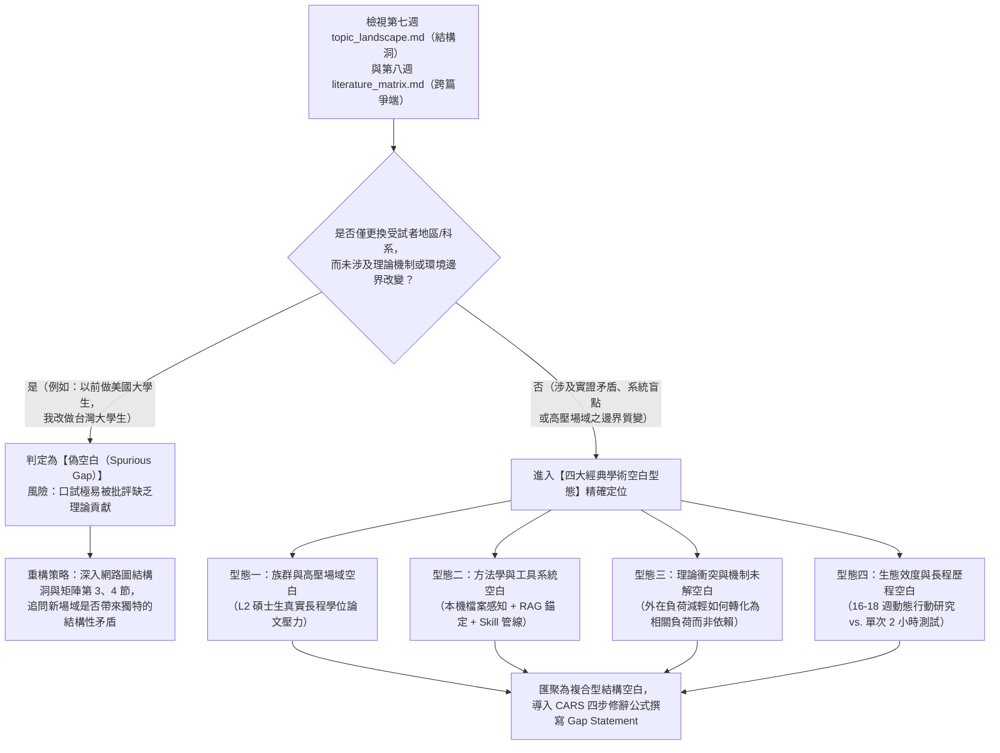
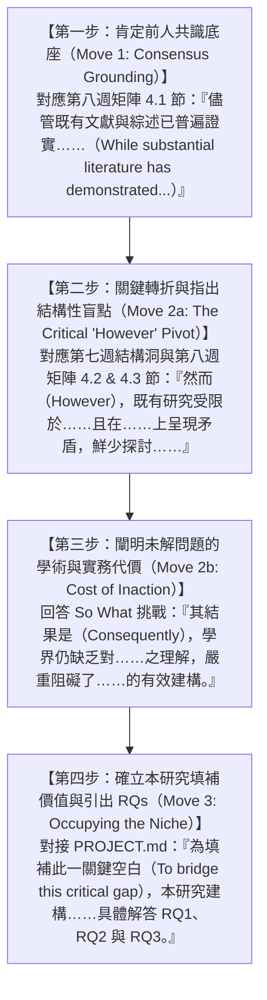
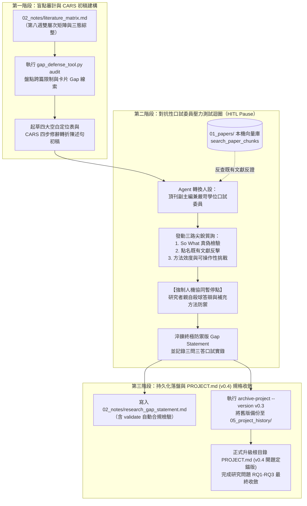

---
puppeteer:
  displayHeaderFooter: true
  headerTemplate: '<div style="font-size: 14px; margin: 0 auto;">第九章：學術空白（Research Gap）鎖定、開題立論防禦與研究問題收斂</div>'
  footerTemplate: '<div style="font-size: 14px; margin: 0 auto;">第 <span class="pageNumber"></span> 頁 / 共 <span class="totalPages"></span> 頁</div>'
  margin:
    top: "1.5cm"
    bottom: "1.5cm"
    left: "1.5cm"
    right: "1.5cm"
---
<style>
  /* 全域字型大小放大為 1.4 倍（預設 16px * 1.4 = 22.4px） */
  html, body, .mume, .markdown-preview {
    font-size: 22.4px !important;
    line-height: 1.6 !important;
  }
  /* 標題分頁控制 */
  h2 {
    page-break-before: always;
  }
  /* 表格與程式碼區塊維持等比例適配 */
  table {
    font-size: 0.9em !important;
  }
  pre, code {
    font-size: 0.88em !important;
  }
</style>
---

# 第九章：學術空白（Research Gap）鎖定、開題立論防禦與研究問題收斂

## 課程導讀

在第七週與第八週的課堂中，我們先透過 `topic-network-explorer` Skill 建立了全庫 768 維語意區塊的 **BERTopic 主題版圖與跨篇相似度互動網路圖（`02_notes/topic_chunk_network.html` / `topic_landscape.md`）**，找出了主題群集間的跨篇橋樑與「結構洞（Structural Holes）」；接著在第八週運用 `literature-matrix-synthesizer` Skill，將單篇閱讀卡片與主題版圖合流，成功重組為儲存於 `02_notes/literature_matrix.md` 的「雙層次跨篇文獻比較矩陣」，提煉出前人研究在各個核心概念上的 **學術共識（Consensus）、實證爭端（Tension）與情境脈絡微差（Nuance）**。

至此，我們已經把「前人做了什麼、彼此有何異同」的學術版圖繪製得清清楚楚。然而，在碩士學位論文計畫書審查與期刊投稿的實戰中，把前人研究整理得再漂亮，都只完成了文獻探討的一半任務。口試委員在翻開你的計畫書第一章「研究動機與目的」以及第二章結尾的「文獻小結」時，真正決定你能否順利通過審查的終極拷問只有一個：

> **「既然前人已經發表了這麼多優秀的論文，為什麼學術界還需要你這篇碩士論文？你到底解決了哪一個前人沒能解決的關鍵缺口？」**

面對這個問題，許多研究生最常脫口而出的一句話是： **「因為過去國內外很少有人研究過 X 工具對 Y 群體的影響，所以本研究具有創新性。」** 在學位口試現場，這句話幾乎等同於自殺式宣告——經驗豐富的口試委員往往會立刻追問：「過去沒有人做，會不會是因為這個問題根本顯而易見、毫無研究價值？或者換一個群體根本不會改變底層的心理學機制？」當學生無法從理論張力與方法學缺陷正面回應時，整篇論文的立論根基便會在幾分鐘內土崩瓦解。

貫穿本週（第九講）實戰教學的核心法則為：

> **真正的學術空白（Research Gap）絕不是「別人剛好沒撿到的石頭」，而是現有文獻體系中「已經顯露於網路圖結構洞與比較矩陣爭端、卻因方法局限或理論矛盾而尚未被化解的結構性裂縫」；找不出經得起對抗檢驗的學術空白，你的研究問題（RQs）就失去了存在的合法性。**

在本週的課程中，我們將帶領同學完成從「文獻綜整」躍升至「開題立論」的最後一哩路：首先，我們將導入 **Sandberg & Alvesson (2011) 的缺口鎖定與問題化理論（Gap-Spotting & Problematization）** 以及 **Robinson et al. (2011) 的系統性研究缺口分類框架**，教大家精準識別四大經典學術空白型態並徹底破除「偽空白（Spurious Gap）」；接著，我們將掌握語言學大師 **John Swales (1990, 2004) 的 CARS 模型（Create a Research Space）**，運用國際頂級期刊通用的「四步修辭轉折公式」撰寫具備強大邏輯張力的學術空白陳述句（Gap Statement）；最後，我們將啟動專案專屬的 `research-gap-challenger` Skill，讓 Agent 化身為最嚴厲的學位口試委員對你的立論發動三路極限壓力測試，並將淬鍊定稿的研究空白與研究問題正式回寫至根目錄 `PROJECT.md (v0.4 開題定錨版)`，完美達成前九週基礎工程的收斂閉環！

---

## 課前準備：擴充第九週專屬 Skill 模組與執行矩陣盲點審計

在展開本週的學術空白鎖定與口試對抗實作前，請同學依照以下步驟，在個人論文工作區 `my_thesis_workspace` 下擴充第九週專屬的 Skill 模組，並執行課前矩陣盲點審計：

### 1. 工作區目錄結構擴充（新增 `skills/research_gap_challenger/`）

請在個人工作區的 `skills/` 目錄下建立負責開題立論、口試壓力測試與專案規格升級的第四座核心能力模組—— **`research_gap_challenger`**，並確認以下檔案配置就位：

- **核心流程入口：** `my_thesis_workspace/skills/research_gap_challenger/SKILL.md`
- **靜態規範與立論防禦範本：**
  - `my_thesis_workspace/skills/research_gap_challenger/resources/gap_statement_template.md`（學術空白診斷、CARS 四步陳述、三回合口試答辯與 RQ 收斂映射範本）
  - `my_thesis_workspace/skills/research_gap_challenger/resources/defense_rubric.md`（真偽空白鑑別分類學、CARS 修辭架構與口試委員三路壓力測試規準）
- **少樣本學習標準示範：** `my_thesis_workspace/skills/research_gap_challenger/examples/sample_gap_statement.md`（完整生產級學術空白陳述與口試對抗防禦範例）
- **本機自動化審計、歸檔與驗證腳本：** `my_thesis_workspace/skills/research_gap_challenger/scripts/gap_defense_tool.py`（跨篇矩陣盲點審計、歷史規格 `PROJECT.md` 自動歸檔與防禦報告合規檢驗工具）

完成配置後，`my_thesis_workspace` 與本週相關之目錄結構如下：

```text
my_thesis_workspace/
│
├── PROJECT.md                                      # 【本週升級】v0.4 學術空白鎖定與開題定錨版
│
├── 02_notes/
│   ├── cards/                                      # 第六週：七維標準原子閱讀卡片庫
│   ├── topic_chunk_network.html                    # 第七週：跨篇語意區塊互動網路圖
│   ├── topic_landscape.md                          # 第七週：BERTopic 主題版圖與結構洞診斷報告
│   ├── literature_matrix.md                        # 第八週：雙層次跨篇文獻比較矩陣與三態綜整
│   └── research_gap_statement.md                   # 【本週核心交付物】學術空白陳述與口試防禦報告
│
├── 05_project_history/                             # 專案歷史規格演進歸檔庫
│   ├── PROJECT_v0.1.md                             # 第一週：概念孵化版
│   ├── PROJECT_v0.2.md                             # 第二週：智慧文獻管線與工具治理版
│   └── PROJECT_v0.3.md                             # 【本週自動歸檔】本機 RAG 與雙語鷹架治理版
│
└── skills/
    ├── academic_reading_card/                      # 第六週 Skill
    ├── topic_network_explorer/                     # 第七週 Skill
    ├── literature_matrix_synthesizer/              # 第八週 Skill
    └── research_gap_challenger/                    # 【本週新增】學術空白鎖定與口試防禦 Skill
        ├── SKILL.md                                # 六步 SOP、人機對抗暫停點與規格升級守則
        ├── resources/
        │   ├── gap_statement_template.md           # 四維空白診斷 + CARS 四步陳述 + 答辯實錄範本
        │   └── defense_rubric.md                   # Sandberg & Alvesson 問題化與 CARS 修辭規準
        ├── examples/
        │   └── sample_gap_statement.md             # 完整生產級學術空白與三回合口試答辯典範
        └── scripts/
            └── gap_defense_tool.py                 # 盲點審計 (audit)、規格歸檔 (archive-project) 與驗證腳本

```

### 2. 執行課前跨篇矩陣盲點審計（`gap_defense_tool.py audit`）

在正式動筆起草學術空白之前，請確認第七週的 `02_notes/topic_landscape.md` 與第八週的 `02_notes/literature_matrix.md` 已就位，接著於終端機執行本週腳本的 `audit` 子命令：

```bash
python skills/research_gap_challenger/scripts/gap_defense_tool.py audit

```

該指令會自動讀取根目錄的 `PROJECT.md`、`02_notes/literature_matrix.md` 以及 `02_notes/cards/*.md`，檢查矩陣中是否已具備「跨篇爭端與張力（4.2 節）」與「情境脈絡與邊界（4.3 節）」，並將每張閱讀卡片第 6 維度所記錄的「本研究可推進的空間」匯集列出，作為本週鎖定全篇核心 Research Gap 的高價值線索清單。

---

## 第一節：什麼是真正的「學術空白」？破除偽空白與結構性問題化

### 1.1 開題口試最常見的滑鐵盧：「過去沒人做過」為何是偽空白（Spurious Gap）？

在研究所的開題報告中，初學者最容易陷入一種被稱為 **「單純未做型偽空白（Mere Neglect / Spurious Gap）」** 的思維誤區。許多同學在搜尋完文獻後，發現沒有任何一篇論文的題目跟自己一模一樣，便欣喜若狂地在第一章寫下：「經文獻回顧發現，過去雖然有許多 AI 輔助寫作的研究，但鮮少有研究針對『台灣某國立大學教育研究所碩士生使用 AI Agent 撰寫論文』進行探討，因此本研究將填補此一研究空白。」

為什麼這樣的論述會在口試時遭到委員嚴厲駁斥？管理學方法論學者 Mats Alvesson 與 Jörgen Sandberg 在發表於頂級期刊 *Academy of Management Review* 的經典論文（**Alvesson & Sandberg, 2011; Sandberg & Alvesson, 2011**）中一針見血地指出： **「在科學界，某個組合尚未被研究過（Something has not been done before），本身並不具備任何發表的正當性。」**

如果我們只因為「過去沒人在 Z 科系測過 X 工具」就宣稱這是學術空白，就如同宣稱「過去有人研究過穿紅衣服喝咖啡對工作效率的影響，但從來沒有人研究過『星期二下午穿藍衣服在台北喝咖啡』的影響，因此我要填補這個空白」一樣荒謬。除非研究者能從理論機制上證明：「Z 群體或 Z 場域具有某種獨特的結構性約束（Boundary Condition），會導致前人在其他群體得出的因果結論發生翻轉或失效」，否則單純更換受試者標籤，在學術界只會被視為毫無理論貢獻的「重複性瑣碎填補（Trivial Gap-Filling）」。

### 1.2 Sandberg & Alvesson (2011) 框架：從「被動找漏」邁向「結構性問題化」

那麼，真正具備學術含金量、能讓期刊審稿人與口試委員眼睛一亮的研究空白，究竟是如何誕生出來的？結合 **Sandberg & Alvesson (2011)** 的缺口建構理論、**Burt (1992) 的結構洞理論** 與 **Robinson et al. (2011)** 的系統性回顧缺口分類學，我們可以將學術空白的提煉提升為四個具有嚴謹學理依據的層次：

1. **混淆與矛盾缺口（Confusion Spotting — 化解實證衝突）：**
   - 過去並非沒有相關研究，而是既有研究針對同一個問題得出了**相互矛盾、無法調和的實證結論**（即第八週矩陣第 4.2 節提煉出的「理論張力」）。本研究的價值在於引入一個前人忽略的「調節變項（Moderator）」或「中介機制（Mediator）」，解開為什麼 A 學者成功而 B 學者失敗的謎團。
2. **結構性忽視缺口（Structural Neglect Spotting — 補齊關鍵機制）：**
   - 並非單純「某個群體沒被測過」，而是整個領域的主流研究設計 **系統性地遺漏了某個決定真實世界成敗的核心環節**（例如：過去所有 AI 寫作實驗都把重點放在「如何生成文字」，卻集體忽略了學術寫作中最關鍵的「本機原文事實查核與防幻覺驗證迴圈」）。
3. **跨領域互補與應用缺口（Application Spotting — 架構跨域嫁接与修補結構洞）：**
   - 對應第七週互動網路圖（`topic_chunk_network.html`）中的 **「結構洞（Structural Holes）」**：將工程領域的新興架構（如具備 MCP 與 Skill 狀態機的自主代理人主題簇）引入教育心理學的認知鷹架主題簇中，搭起兩座長期斷裂島嶼之間的實證橋樑。
4. **預設問題化（Problematization — 挑戰主流隱含假設）：**
   - 這是最高階層的學術創新。研究者直接挑戰既有文獻不言自明的「共同基本假設（Underlying Assumptions）」。例如：計算機領域的科學代理人研究（Baek et al., 2025; Schmidgall et al., 2025）普遍隱含一個預設——「AI 自動化程度越高、人類介入越少，系統就越優秀」；但我們從教育學視角對該預設進行「問題化（Problematization）」，指出在碩士研究人才培育中， **「無摩擦的全自動化反而有害，刻意設計人機摩擦點（強制覆核與親筆主導）才是促成認知內化的必要條件」**！

圖 9-1 展示了研究者在面對第七週網路圖與第八週跨篇文獻矩陣時，如何運用「真偽空白鑑別決策樹」篩除偽空白，並精準鎖定結構性學術空白的思維流程：



從圖 9-1 可以觀察到，優秀的碩士論文往往不是只靠單一薄弱的理由支撐，而是將上述多個維度交織成一道「複合型結構空白防線」。當口試委員從方法面挑戰時，你有理論面的衝突支撐；當委員從理論面挑戰時，你有長程生態效度的獨特設計作為後盾。

### 1.3 四大經典學術空白型態與本機矩陣貫穿實例

為了讓同學能夠直接將第七週的 `02_notes/topic_landscape.md` 與第八週產出的 `02_notes/literature_matrix.md` 轉化為本週的立論武器，我們將社會科學、教育科技與資訊系統領域最具說服力的學術空白，操作化定義為以下四大經典型態，並以本課程專案文獻庫為貫穿實例進行剖析：

| 空白型態名稱 | 核心識別判準（於網路圖與比較矩陣觀察之特徵） | 低階偽空白寫法（口試高風險） | 高階結構性空白定位（以本專案文獻庫為例） |
| :--- | :--- | :--- | :--- |
| **型態一：族群與場域脈絡空白**<br>(Population & Context Gap) | 矩陣「樣本與情境」欄顯示前人受試者多處於低風險、短時、通用語境，缺乏高壓專業場域之邊界檢驗。 | 「過去多研究大學生，很少人研究碩士生，所以我研究碩士生。」 | 既有研究多以大學部短篇英文寫作為任務（Wang et al., 2024），忽略了 **「非英語母語（L2）碩士生面對正式學位論文時，必須同時克服跨語言語意落差與高強度事實查核壓力」** 的獨特認知瓶頸。 |
| **型態二：方法學與工具系統空白**<br>(Methodological & System Gap) | 矩陣「核心機制/介入工具」欄與網路圖顯示工程系統群集與教育應用群集之間存在結構洞。 | 「過去研究用的是舊版 ChatGPT，我用的是最新的 Antigravity 2.0 軟體。」 | 既有教育實證侷限於「脫離本機文獻庫的孤島式網頁對話框」（Chen & Roberts, 2023），而工程系統則走向「全自動黑箱代勞」（Baek et al., 2025），缺乏 **「整合本機檔案感知、雙語 RAG 錨定與人機暫停點之教學型 Agent 管線」**。 |
| **型態三：理論衝突與機制未解空白**<br>(Theoretical Tension Gap) | 矩陣第 4.2 節顯示兩派實證研究在核心因變項上呈現正反矛盾，缺乏中介/調節解釋模型。 | 「過去對認知負荷的研究還不夠多，所以我要繼續研究認知負荷。」 | 針對 AI 介入究竟是「降低外在負荷促學（Chen & Roberts, 2023）」抑或「誘發解釋深度錯覺與批判退化（Wang et al., 2024）」之實證矛盾，學界尚未釐清 **「三層級人機責任邊界如何調節工作記憶資源向深層相關負荷轉化」** 的核心機制。 |
| **型態四：生態效度與長程歷程空白**<br>(Ecological Validity Gap) | 矩陣「研究設計與盲點」欄顯示前人多為單次短時實驗室施測，缺乏真實場域之動態演進數據。 | 「過去實驗只做 2 小時，我做比較久，做 16 週。」 | 既有研究多採 2 小時單次橫斷面測試（Wang et al., 2024），無法捕捉研究生在長達一學期（16 至 18 週）中從 **「初期工具蜜月期、中期幻覺幻滅期到後期主導權重建期」** 的非線性認知轉變軌跡。 |

仔細對照上表第三欄與第四欄的差異可以發現：同樣是「做碩士生、用新系統、探討認知負荷、做 16 週」，低階寫法只看到了表面的「題材標籤差異」，而高階寫法則精準咬住了前人研究在 **認知機制、系統耦合與時間動態上的結構性缺陷**。

### 1.4 課堂探索小活動：真偽學術空白鑑別診斷室

> **活動時間：** 15 分鐘
> **活動目標：** 檢視自己初步構思的研究動機，診斷是否含有「偽空白」成分，並利用四大空白型態進行結構化升級。
>
> 1. 請同學打開第七週的 `02_notes/topic_landscape.md`（第 4.1 節結構洞診斷）與第八週的 `02_notes/literature_matrix.md`（第 2、3 節最後一欄缺口）。
> 2. 寫下你原本預計在計畫書第一章使用的研究動機一句話（例如：「過去很少有研究探討……因此本研究……」）。
> 3. **自我拷問：** 如果口試委員問你：「過去沒人做過這件事，會不會是因為前人在其他領域做過的結論已經可以直接套用過來，根本不需要重做？」請從四大空白型態（族群場域邊界、方法系統架構、理論衝突調節、長程生態效度）中，挑選至少兩項，重寫你的空白定位。

```text
老師的提醒：
在學術寫作中，請大家把「因為過去很少有人研究 X（Because little research has examined X）」這句話列為最高警戒禁語！
頂尖期刊的主編看到這句話時，心裡的第一反應永遠是：「So what?（那又怎樣？）」
真正能折服審稿人的寫法，永遠是：「儘管過去已有大量研究探討了 X，然而既有研究普遍依賴 A 預設（或受限於 B 方法），導致當面對 C 情境時會產生 D 矛盾，進而阻礙了我們對 E 機制的理解。」
從「別人沒做過」升級為「別人做的方法在某個關鍵機制上走不通」，你的論文立論高度就會瞬間從碩士生練習作躍升為國際期刊水準！

```

---

## 第二節：Swales CARS 模型與學術空白陳述句公式化寫作

### 2.1 國際頂級期刊的引言修辭密碼：Swales (1990, 2004) CARS 模型

當我們在心智上鎖定了結構性學術空白後，下一步便是將其轉化為無懈可擊的書面學術論證。許多研究生雖然心裡明白前人研究的缺點，但落筆寫在第一章「研究背景與動機」或第二章結尾的「文獻小結」時，卻常寫得委婉含糊、重點分散，讓口試委員讀完三頁還找不到這篇論文的核心切入點。

在英語學術寫作與語類分析（Genre Analysis）領域，密西根大學語言學榮譽教授 John M. Swales 對全球數百篇頂級學術期刊論文的引言與文獻綜整結尾進行了系統性解剖，提出了享譽國際的 **「CARS 模型（Create a Research Space，開拓學術研究空間模型；Swales, 1990, 2004）」**。

Swales 發現，所有成功的學者都不是在「真空」中憑空提出研究問題，而是像在擁擠的生態系中爭奪一塊陽光充足的棲息地（Ecological Niche）一樣，嚴格遵循三個修辭移動步驟（Rhetorical Moves）：
1. **Move 1：確立研究領地（Establishing a Territory）** —— 向學界證明這個研究領域充滿活力且至關重要，並透過綜整前人共識（第八週矩陣第 4.1 節），展現自己對既有版圖的全面掌握。
2. **Move 2：確立研究利基與缺口（Establishing a Niche）** —— 這是整篇論文最關鍵的轉折樞紐！作者透過「指出缺口（Indicating a Gap）」、「提出反詰或矛盾（Counter-claiming）」或「質疑既有假設（Problematizing）」，證明前人看似完整的領地中存在一道尚未癒合的結構性裂縫，並點出若不修補這道裂縫將付出的代價。
3. **Move 3：佔領研究利基（Occupying the Niche）** —— 正式宣告本研究登場！清楚陳述本研究的目的、採用何種創新架構或方法修補上述裂縫，並順理成章引出具體的研究問題（RQ1、RQ2、RQ3）。

### 2.2 四步修辭轉折公式（Four-Move Rhetorical Formula）：從肯定前人到強勢立論

為了讓同學能夠在中文碩士論文與英文期刊投稿中精準操作 Swales 的 CARS 模型，我們將 Move 2 進一步細分為「關鍵轉折（2a）」與「未解代價（2b）」，建立起一套隨插即用、邏輯張力極強的 **「CARS 四步修辭轉折公式（Four-Move Gap Statement Formula）」**。

圖 9-2 展示了 CARS 四步修辭轉折公式如何像漏斗一樣，從寬廣的前人共識一路收斂並精準導出個人論文的 RQ1–RQ3：



從圖 9-2 可以看出，這四個步驟環環相扣，缺一不可：若少了第一步，會顯得作者狂妄無知、忽視前人貢獻；若少了第二步的強勢轉折詞（**然而 / However**），讀者無法感知前人研究的極限；若少了第三步的未解代價（**其結果是 / Consequently**），口試委員就會質疑「就算有這個空白，不填補又會怎樣？」；而有了前三步的蓄力鋪墊，第四步引出本研究與 RQ1–RQ3 時，便會產生千鈞萬馬、順理成章的說服力！

下表提供 CARS 四步修辭轉折公式的結構拆解、中英文標準句型範式與對應之矩陣資料來源：

| 公式步驟 | 修辭功能與核心任務 | 對應前兩週產出章節 | 國際期刊英文標準句型 (Academic English Template) | 碩士論文繁體中文標準句型 |
| :--- | :--- | :--- | :--- | :--- |
| **第一步**<br>肯定前人共識<br>(Consensus Grounding) | 先褒後貶：肯定既有文獻的基礎貢獻，建立領域重要性底座 | 第八週矩陣第 3 節主流共識欄、第 4.1 節 | *"While burgeoning empirical studies and systematic reviews have broadly confirmed that... (Author A, Year; Author B, Year),"* | 「儘管近年實證研究與系統性綜述已廣泛證實，……在……上具備顯著潛力（Author A, Year; Author B, Year），」 |
| **第二步**<br>關鍵轉折與點出矛盾<br>(The Critical "However" Pivot) | 強勢轉折：精準指出既有研究在認知機制、工具架構或時間尺度上的矛盾與盲點 | 第七週結構洞、第八週矩陣第 4.2 與 4.3 節 | *"however, profound structural disconnects persist regarding... Specifically, while Author A (Year) found..., Author B (Year) observed..., and prior interventions remain confined to..."* | 「**然而（However）**，既有文獻體系在……與……上仍存在深刻的結構性斷裂。首先，實證研究對……呈現明顯分歧……；其次，既有介入多受限於……，鮮少探討……」 |
| **第三步**<br>闡明未解代價<br>(Cost of Inaction) | 價值錨定：說明若放任此缺口不管，將導致何種理論黑盒子或教學實務困境 | 第八週矩陣第 3 節未解結構缺口欄 | *"Consequently, the field lacks longitudinal empirical evidence on how..., which severely hampers the theoretical modeling and practical design of..."* | 「**其結果是（Consequently）**，學術界與實務現場對於……如何克服……並轉化為……，仍缺乏動態的理論解釋模型與實證證據，這嚴重阻礙了……的有效建構。」 |
| **第四步**<br>確立填補價值與引出 RQs<br>(Bridging the Gap & RQs) | 正式亮劍：宣告本研究的介入設計、研究方法，並精確點名解答 RQ1–RQ3 | 對接根目錄 `PROJECT.md` | *"To bridge this critical gap, the present study conducts... to investigate..., specifically addressing RQ1, RQ2, and RQ3."* | 「**為填補此一關鍵學術空白（To bridge this critical gap）**，本研究採行……方法，建構並實證探究……，具體解答 RQ1、RQ2 與 RQ3。」 |

### 2.3 實例解剖：將 `literature_matrix.md` 轉化為中英雙語 Gap Statement

讓我們直接以本課程專案的真實情境為例，展示如何將第八週矩陣中的五篇代表文獻（Kasneci et al., 2023; Chen & Roberts, 2023; Wang et al., 2024; Baek et al., 2025; Zheng et al., 2025），透過上述四步公式熔煉為一段可直接放入碩士論文第一章與第二章結尾的黃金段落：

> **【CARS 四步修辭轉折實例展示（繁體中文定稿版）】**
>
> **（第一步：肯定共識）** 儘管近年實證研究與系統性綜述已廣泛證實，生成式 AI 與自主代理人（AI Agents）在加速文獻篩選與輔助學術起草上具備顯著潛力（Kasneci et al., 2023; Chen & Roberts, 2023; Zheng et al., 2025）， **（第二步：關鍵轉折與指出矛盾/盲點）** **然而（However）**，既有文獻體系在「認知轉化機制」與「工具生態效度」上仍存在深刻的結構性斷裂。首先，實證研究針對 AI 介入的認知後果呈現明顯分歧：部分研究發現反思型提示能降低外在認知負荷（Chen & Roberts, 2023），但另有實驗指出開放式 AI 對話雖提升 40% 任務速度，卻導致學習者產生「解釋深度錯覺」並顯著削弱批判提問深度（Wang et al., 2024）；同時，計算機領域所開發的端到端科學代理人（如 Baek et al., 2025）致力於以全自動代勞取代人類構思，若直接套用於研究生教育，將嚴重剝奪學位論文訓練核心的批判內化歷程。其次，既有教育實證多受限於單次短時實驗或孤立於瀏覽器視窗的聊天機器人，鮮少探討具備「本機工作區檔案感知、雙語 RAG 向量事實錨定與人機協同強制暫停點」之結構化 Agent 管線。 **（第三步：闡明未解代價）** **其結果是（Consequently）**，學界對於非英語母語碩士生在面對高壓、長週期的學位論文文獻探討時，如何透過精確的人機責任邊界設計克服幻覺查證焦慮，並將釋放出的工作記憶實質轉化為跨篇概念綜整與研究空白立論能力，仍缺乏長程的動態實證證據。 **（第四步：確立填補價值與引出 RQs）** **為填補此一關鍵學術空白（To bridge this critical gap）**，本研究採行全學期（16 至 18 週）之教育行動研究，於碩士班研究課程中導入結合上下文工程（`PROJECT.md`）、PRISMA 檢索追蹤、七維批判閱讀卡片、BERTopic 語意網路與雙層次文獻矩陣之 AI Agent 漸進式鷹架，深入剖析該教學架構之設計原則（RQ1）、研究生認知負荷與自我效能之縱貫演變軌跡（RQ2），以及人機協同過程中的質性障礙與破局策略（RQ3）。

請同學細細品味上面這段 450 字的論述：裡面沒有任何一句空洞的口號，每一個轉折都有具體的文獻引用作為支撐，並且將「工程系統文獻」與「教育心理文獻」的矛盾化為自己登場的最佳舞台！

### 2.4 課堂實作小活動：運用 CARS 四步公式起草個人論文 Gap Statement

> **活動時間：** 15 分鐘
> **活動任務：** 依據表 9-2 的 CARS 四步修辭轉折公式，結合個人工作區的 `02_notes/literature_matrix.md`，親手或協同 Agent 起草一段 250 至 400 字的個人碩士論文學術空白陳述句。
>
> 1. **對照矩陣填槽：**
>    - **第一步槽位：** 從你的矩陣第 4.1 節挑選 2 至 3 篇達成共識的代表文獻。
>    - **第二步槽位：** 從你的矩陣第 4.2 與 4.3 節（以及第七週網路圖結構洞）挑選互相矛盾或方法受限的文獻，寫在「然而（However）」之後。
>    - **第三步槽位：** 寫下「其結果是（Consequently）」，明確指出這個未解問題對你的研究領域造成了什麼具體阻礙。
>    - **第四步槽位：** 寫下「為填補此一關鍵學術空白（To bridge this critical gap）」，將論述精準收束至你在 `PROJECT.md` 中的 RQ1、RQ2 與 RQ3。
> 2. **自我檢核：** 檢查你的段落中是否明確出現了「儘管……然而……其結果是……為填補此一關鍵學術空白……」這四個邏輯路標詞（Signposting Words）。

```text
老師的真心話：
很多同學問我：「老師，使用這種『儘管……然而……其結果是……為填補此空白……』的四步公式，會不會讓人覺得太八股、太像套模板？」
我的回答永遠是：「在藝術創作裡，打破規則叫創新；但在嚴肅的科學論證裡，遵循國際通用的修辭結構叫『專業素養』！」
頂級期刊的審稿人一年要審幾十篇論文，他們沒有時間在散文般的文字迷宮裡猜測你的研究貢獻是什麼。
當你用最標準的 CARS 四步路標詞把論證結構標示得清清楚楚時，審稿人與口試委員在三秒鐘內就能精準接收到你的研究定位，這種「零認知阻力的閱讀體驗」，正是讓口試委員對你的論文產生高度好感與信任的秘密武器！

```

---

## 第三節：人機對抗性口試壓力測試與專案規格收斂（`PROJECT.md` v0.4）

### 3.1 將 Agent 訓練為「最嚴苛學位口試委員」：結合本機 RAG 的三路極限質詢

寫完一段看起來氣勢磅礴的 CARS 四步學術空白陳述句後，我們是否就可以高枕無憂了？千萬別掉以輕心！因為在撰寫初稿時，研究者往往會無意識地陷入「確認偏誤（Confirmation Bias）」——只挑對自己有利的角度講，卻忽略了口試委員可能會從哪個死角發動突襲。

在 Antigravity 2.0 架構中，最能體現人機協同高階價值的應用，就是要求 Agent 瞬間卸下「溫柔體貼的研究助理」人設，化身為 **「國際頂級期刊副主編兼最嚴厲的學位口試委員（Adversarial Oral Defense Committee Member）」**，並直接連線我們在第五週建立的本機 RAG 向量索引（`search_paper_chunks`）與第八週的比較矩陣（`02_notes/literature_matrix.md`），對你的 Gap Statement 發動毫不留情的 **「三路極限壓力測試（Three-Pronged Stress Test）」**：

1. **第一路質詢：真偽性與「那又怎樣（So What?）」挑戰**
   - Agent 口試委員將嚴格檢視你的 Gap 是否只是「換個軟體版本」或「換個受試系所」的瑣碎應用空白（Trivial Application Gap），並逼問你：「如果三年後這套軟體被淘汰了，你的論文還有什麼可遷移的理論貢獻？」
2. **第二路質詢：既有文獻反擊（Prior Art Counter-Attack）**
   - 這是最致命也最實戰的一關！Agent 會主動讀取 `02_notes/literature_matrix.md` 並調用 `search_paper_chunks`，直接點名你文獻庫裡的某篇具體論文（例如：「同學，請看你矩陣裡的 Chen & Roberts (2023) 第 6 頁，他們已經做過 10 週碩士生 AI Agent 鷹架實驗並測量了認知負荷，你的研究跟他們到底有什麼本質區別？你宣稱的空白是不是早就被他們填補了？」）。
3. **第三路質詢：方法學可操作性與效度威脅挑戰（Feasibility & Validity Challenge）**
   - Agent 會對照你 `PROJECT.md` 中的研究場域（如一學期 16 至 18 週、單一班級 $N=15$、行動研究或準實驗設計），尖銳質疑：「你宣稱要填補這麼龐大的理論空白，但你的樣本只有 15 人且沒有雙盲隨機對照組，你要如何排除霍桑效應與社會期許偏誤？」

圖 9-3 展示了 `research-gap-challenger` Skill 如何整合雙層次矩陣、本機 RAG 檢索、人機對抗性答辯迴圈（Human-in-the-Loop Pause），並最終將成果收斂回 `PROJECT.md (v0.4)` 的完整閉環流程：



如圖 9-3 所示，這場在自己電腦工作區內進行的「模擬口試壓力測試」，能夠讓研究生在正式站上口試講台前，就把口試委員最可能攻擊的三大死角全部演練並修補完畢！

### 3.2 專屬 Skill 架構解析與本機工具腳本（`gap_defense_tool.py`）

本週建立的 `skills/research_gap_challenger/` 模組，將上述完整的立論、對抗與規格升級流程封裝為標準化工程資產。為保持講義簡潔，以下說明其核心腳本 `gap_defense_tool.py` 的存放位置、設計目的與三項子命令操作方式：

- **存放相對路徑：** `skills/research_gap_challenger/scripts/gap_defense_tool.py`
- **設計目的與解決痛點：**
  1. 自動從第八週矩陣與第六週卡片庫中抽取所有關於「研究限制」與「可推進空間」的線索，避免研究者在起草 Gap 時遺漏重要論據。
  2. 提供零風險的 `PROJECT.md` 歷史版本歸檔機制（`archive-project`），確保在升級根目錄規格書前，舊版 `v0.3` 已安全備份至 `05_project_history/PROJECT_v0.3.md`。
  3. 自動驗證產出的 `02_notes/research_gap_statement.md` 是否完整包含 YAML Frontmatter、四大空白型態定位、CARS 四步結構、三回合口試答辯實錄與 RQ 收斂映射。
- **終端機執行指令：**
  1. **執行跨篇盲點與卡片線索前導審計：**
     ```bash
     python skills/research_gap_challenger/scripts/gap_defense_tool.py audit
     ```
  2. **將現有 `PROJECT.md (v0.3)` 安全歸檔至歷史目錄：**
     ```bash
     python skills/research_gap_challenger/scripts/gap_defense_tool.py archive-project --version v0.3
     ```
  3. **驗證 `research_gap_statement.md` 是否符合標準 Schema：**
     ```bash
     python skills/research_gap_challenger/scripts/gap_defense_tool.py validate 02_notes/research_gap_statement.md
     ```

### 3.3 完成前九週上下文工程閉環：從探索性問題到定錨版 `PROJECT.md (v0.4)`

還記得我們在第一週 [01_課程介紹.md](file:///c:/Users/Leo/Documents/GitHub/literature_agent/01_%E8%AA%B2%E7%A8%8B%E4%BB%8B%E7%B4%B9.md) 中立下的核心觀念嗎？當時我們強調： **「`PROJECT.md` 絕不是刻在石板上不可更動的死規矩，而是一份隨著文獻消化不斷演進的活文件（Living Document）。」**

回顧我們從第一週走到第九週的完整演進軌跡：
- **第一週（`v0.1 概念孵化版`）：** 我們只有模糊的研究興趣與開放式的探索性問題（Exploratory RQs）；
- **第二至四週（`v0.2 智慧文獻管線與工具治理版`）：** 我們注入了 OpenAlex 檢索條件、PRISMA 追蹤規範與 PDF 雙欄清洗紀律；
- **第五至八週（`v0.3 本機 RAG 向量檢索與雙語鷹架治理版`）：** 我們建立了 768 維向量事實錨定、七維批判精讀卡片、BERTopic 語意區塊互動網路與雙層次跨篇比較矩陣；
- **第九週（`v0.4 學術空白鎖定與開題定錨版`）：** 經過全庫主題網路拓撲、十幾篇核心文獻的橫向對質與口試委員壓力測試的洗禮，我們終於擁有足夠的底氣，將原本寬泛的「探索性問題」，正式收斂定錨為具備明確理論構念、操作化機制與實證資料來源的 **「定錨版研究問題（Anchored & Refined RQs）」**！

下表展示本研究專案在經歷第九週對抗性壓力測試後，如何將原本的探索性 RQ1–RQ3 收斂升級為 `PROJECT.md (v0.4)` 的定錨版研究問題（完整範例報告存放於 `skills/research_gap_challenger/examples/sample_gap_statement.md`）：

| 研究問題編號 | 原探索版研究問題 (`PROJECT.md` v0.1–v0.3) | 經學術空白與矩陣定錨後之收斂版研究問題 (`PROJECT.md` v0.4) | 對應之空白型態與實證檢證資料來源 (`04_research_data/`) |
| :--- | :--- | :--- | :--- |
| **RQ1** | 在碩士班文獻探討教學中，如何建構以 AI Agent 為核心的漸進式引導架構，以支援不同研究主題學生的文獻梳理？ | **RQ1（教學鷹架與人機責任邊界設計）：** 在碩士班學位論文文獻探討教學中，如何建構整合「上下文工程（`PROJECT.md`）、本機 RAG 事實錨定、BERTopic 語意網路與三層級人機責任光譜」之模組化 AI Agent 漸進式鷹架，以兼顧機械性減負與高階批判主體性？ | **方法與系統空白**；教師每週教學省思日誌、Skill 管線迭代紀錄、學生卡片與矩陣製品合規率分析 |
| **RQ2** | 研究生在導入 AI Agent 輔助文獻探討的過程中，其研究動機、檢索策略與認知負荷呈現何種轉變歷程？ | **RQ2（認知負荷轉化與縱貫發展軌跡）：** 碩士生在經歷「文獻檢索、七維卡片精讀、語意網路探勘、跨篇矩陣共構至學術空白鎖定」的 16 至 18 週行動歷程中，其外在認知負荷如何轉化為相關認知負荷？其研究自我效能感經歷何種階段性轉折？ | **理論衝突與長程空白**；`04_research_data/diaries/` 每週研究日誌質性編碼、Paas 心理努力量表縱貫趨勢、`05_project_history/` 規格演進分析 |
| **RQ3** | 學生在與 Agent 協作產出文獻探討時，最常遭遇的質性障礙為何？（如幻覺識別困難、批判反思不足、過度依賴等）。 | **RQ3（人機協作瓶頸與防禦機制）：** 非英語母語碩士生在與具備本機感知之 AI Agent 協作時，於「跨語言語意檢索、幻覺查證、防硬填抗拒及主導權協商」上面臨哪些核心瓶頸？「對抗性審稿與口試壓力測試機制」如何協助其突破過度依賴？ | **族群場域與理論機制空白**；學生提示詞操作日誌、卡片/矩陣驗證錯誤紀錄、期末半結構式深度訪談 |

當這份收斂後的 RQ1–RQ3 連同 CARS 四步學術空白陳述句正式寫入根目錄的 `PROJECT.md (v0.4)` 時，未來從第十週開始，無論我們調用 `introduction-writer` 撰寫第一章緒論，或是調用 `chapter-writer` 撰寫第二章文獻探討正式草稿（`03_drafts/`），Agent 在啟動瞬間就會自動載入這份堅不可摧的立論基石，確保整本學位論文首尾呼應、一氣呵成！

### 3.4 課堂實作小活動：迎戰 Agent 口試委員三路質詢並正式升級 `PROJECT.md (v0.4)`

> **活動時間：** 25 分鐘
> **活動任務：** 喚醒 `research-gap-challenger` Skill，完成個人論文的學術空白診斷、CARS 四步陳述、三回合口試壓力測試答辯，產出 `02_notes/research_gap_statement.md` 並升級根目錄 `PROJECT.md (v0.4)`。
>
> 1. **執行前導審計與備份舊版規格：**
>    在終端機依序執行以下兩道指令，盤點盲點線索並將現有 `PROJECT.md (v0.3)` 歸檔至 `05_project_history/`：
>    ```bash
>    python skills/research_gap_challenger/scripts/gap_defense_tool.py audit
>    python skills/research_gap_challenger/scripts/gap_defense_tool.py archive-project --version v0.3
>    ```
> 2. **喚醒 Skill 發動口試壓力測試：**
>    在 Antigravity 2.0 對話框中發送指令：
>    > *「請使用 `research-gap-challenger` Skill，讀取我的 `02_notes/topic_landscape.md`、`02_notes/literature_matrix.md` 與 `PROJECT.md`，協助我完成四大空白型態診斷與 CARS 四步修辭轉折陳述句初稿；接著請化身為最嚴厲的學位口試委員，結合本機文獻庫對我提出三路尖銳質詢並暫停等待我答辯！」*
> 3. **親自殺球答辯與落盤驗證：**
>    - 針對 Agent 口試委員提出的三大質詢，在對話框中認真提出你的理論與方法辯護。
>    - 請 Agent 將完整診斷表、CARS 中英雙語陳述句、三問三答口試實錄與收斂後的 RQ 映射表寫入 `02_notes/research_gap_statement.md`，並同步將根目錄 `PROJECT.md` 更新為 `v0.4 學術空白鎖定與開題定錨版`。
>    - 於終端機執行驗證腳本，確認輸出 `[PASS] 格式合規！`：
>      ```bash
>      python skills/research_gap_challenger/scripts/gap_defense_tool.py validate 02_notes/research_gap_statement.md
>      ```

```text
老師的真心話：
在學術界，平庸的研究者總是在「證明別人已經知道的事」，而優秀的研究者則是在「照亮前人留下的結構性盲區」。
很多同學在真正踏進學位論文口試試場前，心裡總是充滿恐懼，生怕口試委員問倒自己。
但當你在第九週親身經歷過 Agent 口試委員結合你本機文獻庫發動的三路極限質詢，並且親手把三問三答的防禦邏輯寫進 `02_notes/research_gap_statement.md` 後，你的心態會發生徹底的蛻變。
當你在口試現場，氣定神閒地打開你的跨篇語意網路圖、雙層次文獻矩陣與空白防禦報告，指著上面十幾篇文獻的限制與結構洞，清清楚楚地說出：
「委員好，Chen & Roberts (2023) 止步於雲端提示而未解決本機查證焦慮，Baek et al. (2025) 走向全自動代勞而忽視認知內化，而本研究的三層級責任光譜正是為了解決這道結構性矛盾而生！」
那一刻，你就不再是一個等待被審判的學生，而是一位真正走進學術對話核心、令人敬重的獨立研究學者！

```

---

## 本週小結與後續章節展望

在本週的第九講中，我們成功跨越了從「文獻綜整」邁向「獨立開題立論」的最高門檻。我們運用 **Sandberg & Alvesson (2011) 的問題化理論** 與 **Burt (1992) 的結構洞理論** 徹底破除了「因為過去沒人做過」的偽空白迷思，學會從族群場域、方法系統、理論衝突與生態效度四個維度精準鎖定結構性缺口；我們掌握了國際頂刊通用的 **Swales (1990, 2004) CARS 模型與四步修辭轉折公式**；更重要的是，我們透過專屬的 `research-gap-challenger` Skill 與 `gap_defense_tool.py` 腳本，經歷了嚴苛的三回合口試對抗壓力測試，產出了 `02_notes/research_gap_statement.md`，並正式將根目錄的 `PROJECT.md` 迭代定錨至 `v0.4` 版本。

截至第九週，我們整個碩士論文文獻探討的前置知識工程與立論地基已全數建構完畢：
- **第一至二週（規格定義與智慧檢索）：** 建立標準五層工作區、定義 `PROJECT.md` 上下文工程，並透過 OpenAlex API 與 PRISMA 規範完成候選論文檢索與篩選（`01_papers/candidate_papers_XX.md`）。
- **第三至四週（外部文獻治理與文字工程）：** 完成自尋 PDF 文獻之 CrossRef 元數據對齊入庫，並利用 `pymupdf4llm` 破除雙欄排版詛咒，產出純淨 Markdown 全文（`01_papers/extracted_text/`）。
- **第五至六週（向量事實錨定與單篇卡片化）：** 建立本機 768 維稠密向量索引（`vector_index.json`），並透過 `academic-reading-card` Skill 與三層責任光譜，淬鍊出嚴格防硬填的七維標準閱讀卡片（`02_notes/cards/`）。
- **第七至九週（BERTopic 語意網路、跨篇矩陣共構與學術空白鎖定）：** 透過 `topic-network-explorer` Skill 建立全庫主題版圖與區塊互動網路圖（`02_notes/topic_chunk_network.html` / `topic_landscape.md`），再由 `literature-matrix-synthesizer` Skill 合成雙層次概念中心比較矩陣（`02_notes/literature_matrix.md`），最終由 `research-gap-challenger` Skill 完成 CARS 四步空白陳述、口試對抗防禦（`02_notes/research_gap_statement.md`）與 `PROJECT.md (v0.4)` 研究問題最終定錨。

在接下來的課程中，我們將正式挺進 **`03_drafts/` 學位論文正式章節草稿生成與精修階段**！我們將運用沉澱在 `02_notes/` 中的所有卡片、主題網路、雙層次矩陣與學術空白防禦報告，引導 Agent 撰寫具備高度批判張力、符合 APA 第七版引註規範且百分之百錨定本機真實文獻的 **第二章「文獻探討」與第一章「緒論」正式章節初稿**！

---

## 附錄：本章學理基礎與參考文獻（References）

本章所建立之「真偽學術空白鑑別框架」、「問題化理論（Problematization）」、「Swales CARS 四步修辭轉折模型」與「對抗性口試防禦機制」，其學理基礎與方法論出處如下（採 APA 第七版格式標註，同學於學位論文或研究計畫中亦可作為方法論之參考文獻）：

### 1. 學術空白鎖定（Gap-Spotting）、結構洞與問題化理論（Problematization）
- **Alvesson, M., & Sandberg, J. (2011).** Generating research questions through problematization. *Academy of Management Review*, *36*(2), 247–271. https://doi.org/10.5465/amr.2009.0188
- **Burt, R. S. (1992).** *Structural holes: The social structure of competition*. Harvard University Press.
- **Müller-Bloch, C., & Kranz, J. (2015).** A framework for rigorously identifying research gaps in qualitative literature reviews. In *Proceedings of the 36th International Conference on Information Systems (ICIS 2015)* (pp. 1–19).
- **Robinson, K. A., Saldanha, I. J., & McKoy, N. A. (2011).** Development of a framework to identify research gaps from systematic reviews. *Journal of Clinical Epidemiology*, *64*(12), 1325–1330. https://doi.org/10.1016/j.jclinepi.2011.06.009
- **Sandberg, J., & Alvesson, M. (2011).** Ways of constructing research questions: Gap-spotting or problematization? *Organization*, *18*(1), 23–44. https://doi.org/10.1177/1350508410372151

### 2. 學術語類分析與 CARS 開拓研究空間模型
- **Booth, W. C., Colomb, G. G., Williams, J. M., Bizup, J., & FitzGerald, W. T. (2016).** *The craft of research* (4th ed.). University of Chicago Press.
- **Swales, J. M. (1990).** *Genre analysis: English in academic and research settings*. Cambridge University Press.
- **Swales, J. M. (2004).** *Research genres: Explorations and applications*. Cambridge University Press. https://doi.org/10.1017/CBO9781139524827
- **Whetten, D. A. (1989).** What constitutes a theoretical contribution? *Academy of Management Review*, *14*(4), 490–495. https://doi.org/10.5465/amr.1989.4308371
