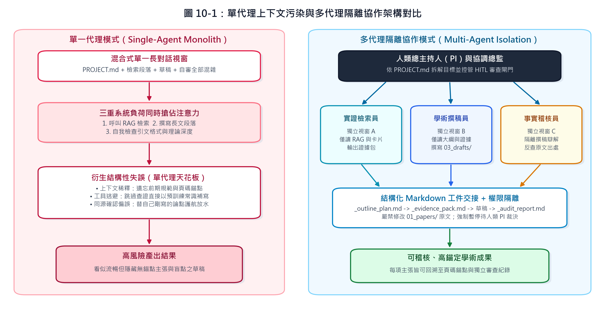
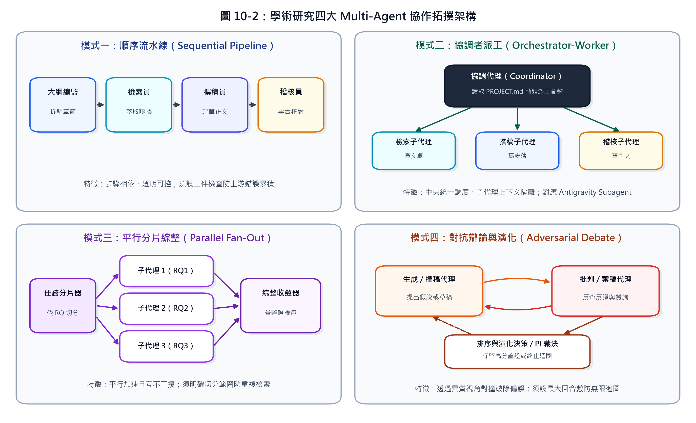
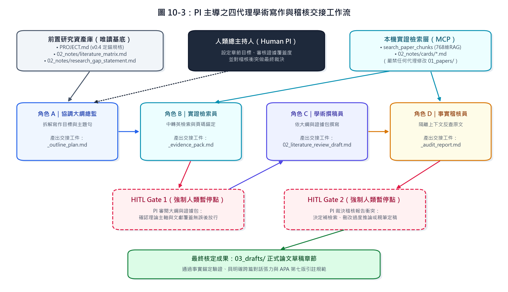

---
puppeteer:
  displayHeaderFooter: true
  headerTemplate: '<div style="font-size: 14px; margin: 0 auto;">第十章：Multi-Agent 多代理協作與學術團隊設計</div>'
  footerTemplate: '<div style="font-size: 14px; margin: 0 auto;">第 <span class="pageNumber"></span> 頁 / 共 <span class="totalPages"></span> 頁</div>'
  margin:
    top: "1.5cm"
    bottom: "1.5cm"
    left: "1.5cm"
    right: "1.5cm"
---
<style>
  /* 全域字型與防溢出排版規範 */
  html, body, .mume, .markdown-preview {
    font-size: 21px !important;
    line-height: 1.65 !important;
    word-wrap: break-word !important;
    overflow-wrap: break-word !important;
  }
  /* 標題分頁控制 */
  h2 {
    page-break-before: always;
  }
  /* 圖片自適應頁面寬度 */
  img {
    max-width: 100% !important;
    height: auto !important;
    display: block;
    margin: 1.2em auto;
  }
  /* 表格寬度與防破版控制 */
  table {
    width: 100% !important;
    max-width: 100% !important;
    table-layout: auto !important;
    font-size: 0.72em !important;
    line-height: 1.45 !important;
    word-break: break-word !important;
    overflow-wrap: break-word !important;
    border-collapse: collapse !important;
    margin: 1.2em 0 !important;
  }
  th, td {
    padding: 6px 8px !important;
    word-break: break-word !important;
    overflow-wrap: break-word !important;
    vertical-align: top !important;
  }
  /* 程式區塊與行內代碼自動換行 */
  pre {
    white-space: pre-wrap !important;
    word-break: break-word !important;
    overflow-wrap: break-word !important;
    font-size: 0.80em !important;
    line-height: 1.45 !important;
    background-color: #f6f8fa !important;
    padding: 12px 14px !important;
    border-radius: 6px !important;
  }
  code {
    white-space: pre-wrap !important;
    word-break: break-word !important;
    overflow-wrap: break-word !important;
    font-size: 0.84em !important;
  }
  blockquote {
    word-break: break-word !important;
    overflow-wrap: break-word !important;
  }
</style>
---

# 第十章：Multi-Agent 多代理協作與學術團隊設計

## 課程導讀

在前九章的學習歷程中，我們已經為碩士論文或專題研究建立起一套相當嚴密的數位知識工程管線。我們從上下文工程與研究規格書（`PROJECT.md`）出發，接續完成了 OpenAlex 系統性檢索、CrossRef 書目元數據治理、學術 Markdown 純淨轉譯、本機 768 維檢索增強生成（Retrieval-Augmented Generation，RAG）向量錨定、七維原子閱讀卡片，乃至於 BERTopic 主題建模、雙層次文獻比較矩陣，以及結合問題化理論與 CARS 四步修辭的學術空白立論防禦（`02_notes/research_gap_statement.md`）。

然而，當研究者準備跨越前期的資料整理，正式邁入 `03_drafts/` 撰寫數千字乃至上萬字的學位論文第一章「緒論」與第二章「文獻探討」，並同時進行高強度的引文查核與理論品質把關時，許多同學會驚訝地發現：過去一直表現良好的「單一對話代理（Single-Agent）」突然開始力不從心。原本在對話開頭約定好的「嚴禁無中生有」與「必須標註頁碼錨點」，寫到第三個小節時便悄悄被模型遺忘；更棘手的是，當你請剛剛替你寫完初稿的同一個代理「用最嚴格的審稿標準幫我檢查這段有沒有錯」，它往往只會客氣地順著自己的論述潤飾文字，對顯而易見的邏輯漏洞視而不見。

這種現象並非提示詞寫得不夠禮貌，而是單一代理架構在長程複雜學術任務下的先天物理瓶頸。貫穿本章（第十講）教學實作的核心法則為：

> **多代理協作（Multi-Agent Collaboration）的真正價值，不在於「找一群 AI 互相聊天」，而在於透過「角色專責化、脈絡隔離（Context Isolation）與結構化工件交接（Structured Artifact Handoff）」，讓檢索、撰稿與事實稽核彼此制衡，而人類研究者始終握有研究團隊總主持人（Principal Investigator，PI）的最終裁決權。**

在本章的課程中，我們將先解剖單一代理在高階學術寫作中的三重天花板，並建立多代理系統（Multi-Agent System，MAS）的四種經典協作拓撲模式；接著，我們將直接導讀本機文獻庫中多篇前沿科研多代理系統論文——包含 *SciAgents*、*The AI Scientist*、*Agent Laboratory*、*AI Co-Scientist* 與 *PaperOrchestra*——比較它們在全自動科研與人機共駕上的設計哲學；最後，我們將部署專案專屬的 `research_team_orchestrator` Skill 模組，學習如何在 Antigravity 2.0 中運用「團隊規格藍圖 ＋ 宣告式 Subagents（`.agents/agents/*.md`）」建構屬於自己的四人學術研究團隊，並掌握 Antigravity 原生多代理模式（`/swarm`、`/teamwork`、`/boost`）的任務選型準則，為下一章「多代理對抗式同儕審查」奠定穩固的組織基礎。

---

## 課前準備：部署多代理團隊協調模組與盤點前置資產

在著手設計個人的學術研究多代理團隊之前，請先確認工作區已擴充第十章專屬的能力模組，並透過驗證腳本盤點前九章所累積的研究資產是否就位。

### 1. 工作區目錄結構擴充（新增 `skills/research_team_orchestrator/`）

請在個人工作區 `my_thesis_workspace` 的 `skills/` 目錄下建立 **`research_team_orchestrator`** 模組，延續第六至第九章的標準化資料夾配置：

- **核心流程入口：** `skills/research_team_orchestrator/SKILL.md`
- **靜態規範與藍圖範本：**
  - `skills/research_team_orchestrator/resources/team_blueprint_template.md`
  - `skills/research_team_orchestrator/resources/orchestration_criteria.md`
- **少樣本學習示範：** `skills/research_team_orchestrator/examples/sample_team_blueprint.md`
- **本機自動化輔助工具：** `skills/research_team_orchestrator/scripts/team_blueprint_tool.py`

完成配置後，工作區與本章協作相關之目錄關聯如下（行寬已依閱讀版面精簡標註）：

```text
my_thesis_workspace/
│
├── PROJECT.md                        # v0.4 開題定錨版研究規格書
├── 01_papers/
│   └── vector_index.json             # 第五章：本機 RAG 向量索引
├── 02_notes/
│   ├── cards/                        # 第六章：原子閱讀卡片庫
│   ├── literature_matrix.md          # 第八章：跨篇文獻比較矩陣
│   ├── research_gap_statement.md     # 第九章：學術空白與防禦報告
│   └── research_team_blueprint.md    # 【本章產出】多代理團隊設計藍圖
├── 03_drafts/                        # 交接工件與正式章節草稿目錄
├── .agents/                          # 【進階標準設定】Antigravity 客製化目錄
│   ├── agents/                       # 宣告式 Subagent 定義檔 (*.md)
│   └── rules/                        # 跨對話常駐團隊安全規則 (*.md)
└── skills/
    └── research_team_orchestrator/   # 【本章新增】團隊協調與設計模組
        ├── SKILL.md
        ├── resources/
        ├── examples/
        └── scripts/
            └── team_blueprint_tool.py

```

### 2. 執行課前前置資產盤點（`check-inputs`）

在展開多代理架構設計前，建議先於終端機執行本模組工具的前置盤點指令，確認 `PROJECT.md`、向量索引、文獻矩陣與空白報告的狀態：

```bash
python skills/research_team_orchestrator/scripts/team_blueprint_tool.py \
  check-inputs

```

該指令會自動掃描工作區根目錄與 `02_notes/`、`01_papers/` 及 `03_drafts/` 目錄，在終端機以純文字標籤（`[就緒]`、`[缺失]`、`[尚未建立]`）回報各項前置檔案的完整性，協助研究者在派工給多個 AI 代理之前，先確認地基資產是否已經備齊。

---

## 第一節：從單兵作戰到研究團隊——單代理極限與多代理協作拓撲

### 1.1 為什麼不能只靠一個對話框寫完論文？單代理的三重天花板

在討論多代理系統之前，我們必須先回答一個務實的問題：既然現代大型語言模型已具備數十萬 Token 的長上下文視窗，為什麼我們不能直接把所有閱讀卡片、文獻矩陣與論文原文通通放進同一個對話框，請單一 AI 代理從頭到尾一手包辦？

在真實的長程學術寫作與自動化文獻分析實驗中（Zheng et al., 2025; Song et al., 2026），單一對話代理一旦同時承擔「檢索、規劃、撰稿與審查」四重任務，便會迅速撞上三個相互加劇的結構性瓶頸：

1. **上下文稀釋與中段遺忘（Context Dilution & Lost in the Middle）：** 當單一視窗不斷累積指令、檢索回傳的英文段落、修訂歷史與草稿全文時，模型對最早輸入的 `PROJECT.md` 研究邊界與 APA 引註紀律的注意力權重會逐漸被稀釋，導致寫作後半段開始偏離核心研究問題（RQs），甚至遺忘頁碼標註規則。
2. **工具注意力競爭與偷懶跳步（Tool Attention Competition）：** 當同一個代理必須在「構思流暢的學術中文敘事」與「繁瑣地多次呼叫 `search_paper_chunks` 反覆核對英文數據」之間切換時，語言模型基於生成流暢度的偏好，極容易在記憶模糊處直接以預訓練常識腦補數字或年份，跳過實際查證步驟。
3. **同源確認偏誤（Self-Confirmation Bias）：** 這對論文品質而言最為致命。當同一個代理剛費盡心思寫出一段論證，對話歷史中已充滿它選擇該論點的理由；此時若要求它立刻轉換口吻自我審查，模型會高度傾向維護既有立場（Sycophancy / Self-Bias），只能挑出幾處標點或用詞微調，無法像外部審稿人那樣拆穿核心推論漏洞。

### 1.2 多代理系統的核心工程機制：角色專責、脈絡隔離與最小權限

為了解決單代理在同一個長視窗中「既當球員又當裁判」的結構缺陷， **多代理系統（Multi-Agent System，MAS）** 將原本單體式的大型任務，拆解為多個各司其職的專責代理（Specialized Agents）。為了讓同學直覺對照單兵作戰與團隊協作在底層資訊流上的根本差異，圖 10-1 整理了「單一代理模式」與「多代理隔離協作模式」的架構對比。請在觀察時特別留意右側架構中「獨立視窗」與「交接工件」如何切斷偏誤傳遞鏈。



從圖 10-1 可以清楚歸納出多代理學術團隊之所以比單代理更可靠的三大工程支柱：

1. **角色專責化（Role Specialization）：** 每個代理只專注於單一性質的心智作業。檢索代理的目標函數是「精準召回原文與頁碼」，撰稿代理的目標函數是「依據證據寫出概念連貫的段落」，而稽核代理的目標函數則是「揪出草稿中未受原文支持的句子」，三者目標明確且互不干擾。
2. **上下文隔離（Context Isolation）：** 這是多代理設計最關鍵的技術核心。所謂隔離，是指撰稿代理在撰寫時的自我推論與內心戲， **不會進入稽核代理的對話歷史**。稽核代理是在一個全新的空白上下文中啟動，它眼裡只有「草稿文本」與「本機原文檢索結果」，因此能保持冷靜客觀的審稿視角。
3. **最小權限工具綁定（Least-Privilege Tool Binding）：** 並非每個代理都該擁有所有工具與所有資料夾的寫入權。舉例而言，僅賦予實證檢索員讀取卡片與呼叫 `search_paper_chunks` 的權限，卻禁止它修改 `03_drafts/` 正式草稿；同時嚴格限制所有代理對 `01_papers/` 原始文獻庫僅具備唯讀權限，從制度上防堵錯誤覆寫。

### 1.3 學術研究常見的四大 Multi-Agent 協作拓撲模式

確立了角色隔離的原則後，接下來必須決定「這些代理之間要如何溝通與排班？」在多代理系統設計中，成員之間的連結結構與任務調度順序稱為**協作拓撲（Collaboration Topology）**。針對文獻探討與論文寫作的實務需求，圖 10-2 繪製了四種最核心的學術多代理協作拓撲架構，請觀察各模式中任務流向與反饋迴圈的設計差異。



如圖 10-2 所示，四種拓撲各自對應不同的研究情境，在實務設計時必須依照任務特性擇一或混合搭配。為了協助同學掌握選型準則，下表從結構特徵、適用研究任務與主要工程風險三個面向，比較這四種拓撲模式：

| 拓撲模式名稱 | 運作與資訊流特徵 | 最適合的學術研究任務 | 主要風險與防範策略 |
| :--- | :--- | :--- | :--- |
| **順序流水線**<br>(Sequential Pipeline) | 前代理產出標準化工件後，依固定順序交棒給下一位代理 | 單一小節之「大綱規劃 $\rightarrow$ 實證檢索 $\rightarrow$ 起草 $\rightarrow$ 稽核」 | **錯誤累積：** 任一環節出錯將傳遞至下游；須於交接點設人類檢查閘門 |
| **協調者派工**<br>(Orchestrator-Worker) | 由中央協調代理讀取全局規格，動態拆解任務派發給子代理並彙整 | 跨章節寫作調度、依 `PROJECT.md` 動態指派不同專責分析代理 | **協調者過載：** 協調者應只控管大綱與進度，不可親自吞入大篇幅全文 |
| **平行分片綜整**<br>(Parallel Fan-Out) | 將大任務切分為互不重疊的切片，同步派出多個子代理作業後收斂 | 針對 RQ1–RQ3 平行檢索證據、批次核對多張閱讀卡片與原文 | **配額耗損與重複：** 須事先切清各分片負責的構面或文獻清單，避免撞車 |
| **對抗辯論與演化**<br>(Adversarial Debate) | 生成代理與批判代理在隔離脈絡下多輪交鋒、修訂或競逐排序 | 學術空白壓力測試、模擬同儕審查、高難度理論張力段精修 | **無限迴圈與空轉：** 須設定最大交鋒回合數（如 2 至 3 輪）並由 PI 終局裁決 |

綜合上表比較可知，沒有任何一種拓撲是萬能的。優秀的學術研究系統往往採取「混合拓撲」：例如以「協調者派工」作為主幹架構，在單節撰稿流程採「順序流水線」，遇跨研究問題取證時切換為「平行分片」，最後在品質把關階段啟動「對抗辯論」並收斂至人類審查。

### 1.4 課堂探索小活動：單代理自寫自審盲點診斷室

> **活動時間：** 15 分鐘
> **活動目標：** 從過去幾週的實際操作經驗中，辨識單代理模式的結構性失敗，並練習以多代理隔離思維重構任務邊界。
>
> 1. 請開啟你過去在 Antigravity 2.0 中進行第六週卡片撰寫、第八週矩陣合成或第九週口試防禦的其中一段較長對話紀錄。
> 2. 找出至少 **2 處** AI 曾出現異常的時刻，例如：漏掉原文頁碼、把甲論文的樣本數套到乙論文上、或是當你詢問「這樣寫有沒有問題」時模型只給予空泛稱讚。
> 3. **病灶歸因與隔離處方：** 判定該失誤屬於「上下文稀釋」、「工具注意力競爭」或「同源確認偏誤」哪一類；若將這段任務拆給兩個互相隔離的代理執行，你會如何切分兩者「看得到」與「看不到」的資料範圍？

```text
老師的提醒：
初學 Multi-Agent 設計時，最容易掉進的誤區是「過度拆分」。
有些同學看到多代理很酷，就在筆記裡一口氣設計了十個角色：
英文潤飾員、標點檢查員、標題命名員、摘要員……
請記住：每多切分一個代理，就會增加一次跨代理的上下文交接
成本與資訊損耗風險。在學術研究中，只有當兩個任務「需要截
然不同的工具權限」，或者「彼此存在立場衝突與監督制衡需求」
（例如撰稿與稽核必須隔離）時，才值得拆分為獨立代理！

```

---

## 第二節：前沿科研 Multi-Agent 系統典範解剖與教育適配反思

理解了多代理的基本工程原理與拓撲模式後，我們接著將視角放大至國際頂尖科學研究機構的實踐成果。在本課程工作區 `01_papers/raw_pdf/` 中，已經收錄了近年最具代表性的多篇科學研究多代理論文（如 *SciAgents*、*The AI Scientist*、*Agent Laboratory*、*AI Co-Scientist* 與 *PaperOrchestra*）。深入解剖這些系統的角色設計與協作邏輯，能為我們設計個人學術團隊提供極為豐富的方法學養分，同時也能看清計算機工程系統與研究生教育現場之間的關鍵界線。

### 2.1 本體知識圖譜推理團隊：SciAgents（Ghafarollahi & Buehler, 2024）

在計算材料科學領域，麻省理工學院的研究團隊提出了 **SciAgents（Ghafarollahi & Buehler, 2024）**，旨在利用大型語言模型與大規模本體知識圖譜（Ontological Knowledge Graphs），自動化發掘跨領域的科學假說。與單純依賴單一模型自由聯想的做法不同，SciAgents 在設計上刻意組建了一個功能互補的群聊研究團隊：

- **Human（人類提問者）：** 提出初始研究目標或關鍵詞，並可在解決問題的各階段介入引導。
- **Planner（規劃代理）：** 負責拆解並擬定解決任務的詳細步驟藍圖。
- **Assistant（工具輔助代理）：** 專責執行外部函數調用，包含從關鍵字生成知識圖譜路徑，以及呼叫評分工具評估假說的新穎度與可行性。
- **Ontologist（本體論專家代理）：** 專注於界定知識圖譜中各科學概念的定義與結構化關聯，確保後續推理立足於嚴謹的概念底座。
- **Scientist 1 與 Scientist 2（雙科學家代理）：** 由 `Scientist 1` 依據本體論專家提供的概念關聯起草包含七個結構化項目的假說初稿（涵蓋假說、結果、機制、設計原則等），再由 `Scientist 2` 從不同面向進行深度擴展。
- **Critic（批判審稿代理）：** 對研究構想進行摘要、嚴格的科學批判審查、提出改進建議，並指認最有潛力的科學問題。

SciAgents 帶給本課程最大的啟發在於 **`Ontologist` 與 `Critic` 的分離設計**：先將知識關係結構化（這正呼應了我們第七週的 BERTopic 語意網路與第八週的概念矩陣），再讓生成代理與批判代理接力演進，大幅降低了自由發散帶來的幻覺率。

### 2.2 全自動端到端 vs. 實驗室人機共駕：The AI Scientist 與 Agent Laboratory

當多代理系統的野心從「提出假說」擴張到「完成整篇論文」時，近年學術界出現了兩種截然不同的設計哲學——**「全自動無人值守路線」**與**「人機共駕實驗室路線」**。

以 **The AI Scientist（Lu et al., 2024, 2026）** 及其續作 **The AI Scientist-v2（Yamada et al., 2025）** 為代表的全自動路線，致力於實現從研究構想生成、撰寫程式、執行實驗、視覺化繪圖到撰寫完整學術論文與模擬同儕審查的「端到端自動化（End-to-End Automation）」。在第二代架構中，作者群更進一步擺脫人類預寫的程式碼範本，導入由專屬 **實驗管理代理（Experiment Manager Agent）** 協調的漸進式代理樹狀搜尋（Agentic Tree Search），並結合多模態視覺語言模型增強的 AI 審稿人來把關圖表與排版品質。

相較之下， **Agent Laboratory（Schmidgall et al., 2025）** 則將真實大學研究實驗室的社會分工搬進多代理架構中，並明確為人類留出協作介面。該系統將研究流程拆分為文獻回顧、實驗執行與報告撰寫三大階段，並配置了模擬學術職級的專責代理：

- **PhD Agent 與 Postdoc Agent：** 透過對話協作執行文獻回顧、擬定詳細實驗計畫、進行資料準備與解讀實驗結果。
- **ML Engineer 與 SW Engineer Agent：** 負責編寫、測試、編譯並提交無誤的實驗程式碼（搭配 `mle-solver` 工具）。
- **Professor Agent：** 在報告撰寫階段與 `PhD` 代理共同將研究發現綜整為結構化論文報告（搭配 `paper-solver` 工具）。
- **三位 Reviewer Agents：** 模擬頂級會議（如 NeurIPS）的同儕審查標準，對報告的原創性、品質與清晰度進行評估，決定接受或退回修改。

特別值得研究生注意的是，Agent Laboratory 在實驗中對比了「完全自主模式」與「人類回饋共駕模式（Co-pilot Mode）」。實證結果顯示，當人類研究者在各階段節點適時提供回饋與方向指引時，整體研究產出的品質顯著高於完全放任 AI 自主運作的結果。

### 2.3 錦標賽演化與專業論文編排：AI Co-Scientist 與 PaperOrchestra

除了模擬傳統實驗室職稱外，近期研究更進一步把「計算資源擴展」與「專業寫作解耦」推向新高度：

- **AI Co-Scientist（Gottweis et al., 2026）：** 採用**非同步任務執行與假說演化錦標賽（Tournament Evolution）**架構。由一位 **Supervisor（督導代理）** 解析研究者的自然語言目標並動態調度資源，旗下配置六位高度專門化的代理： **Generation**（生成初始假說）、**Reflection**（結合外部檢索工具自我反思以防範不切實際的幻覺）、**Ranking**（以科學辯論提示進行成對比較並計算 Elo 評分）、**Evolution**（演化改良高分假說）、**Proximity**（評估假說關聯性與去重）以及 **Meta-review**（彙整跨輪次的審查模式與高層次洞察）。這種架構把多代理的功用從「流水線代工」提升為「在測試階段不斷透過競爭與反思提升研究假說品質的思考引擎」。
- **PaperOrchestra（Song et al., 2026）：** 針對現有端到端科學代理普遍「文獻探討品質薄弱、過度綁定特定實驗框架」的痛點，PaperOrchestra 設計為獨立解耦的多代理論文撰寫框架，專門將非結構化的研究筆記、圖表與程式碼轉化為投稿級文稿。其五步驟管線包含： **Outline Agent**（規劃視覺化藍圖、宏觀與微觀文獻檢索策略及段落寫作計畫）、平行運作的 **Literature Review Agent** 與圖表繪製模組、全文撰寫階段，以及調用模擬審查機制（AgentReview）進行反覆優化的 **Content Refinement Agent**。人工評測與自動化基準（PaperWritingBench）結果均顯示，拆解出專責的檢索、大綱與修訂代理後，其在文獻探討品質上顯著超越了單一代理基線與全自動科研系統。

### 2.4 跨系統典範對照與教育邊界反思（Zheng et al., 2025）

在綜合綜述論文 *From Automation to Autonomy*（**Zheng et al., 2025**）中，研究者梳理了科學代理人從「單點工具自動化」走向「高階研究自主化」的演進光譜。為了協助同學從上述五套前沿系統中提煉出適合自己碩士論文研究的設計智慧，下表橫向比較各系統的核心角色設計、協作拓撲與人類介入定位：

| 系統名稱與文獻來源 | 核心代理角色配置 | 主要協作拓撲機制 | 人類研究者的定位 |
| :--- | :--- | :--- | :--- |
| **SciAgents**<br>(Ghafarollahi & Buehler, 2024) | Planner, Assistant, Ontologist, Scientist 1/2, Critic | 群聊協調＋知識圖譜本體推理＋批判審查 | 初始任務發起者與階段性人工干預者 |
| **The AI Scientist-v2**<br>(Yamada et al., 2025) | 構想生成、Experiment Manager、論文撰寫、VLM 審稿人 | 樹狀搜尋管理＋端到端自動化迴圈 | 僅設定高層次方向（追求無人值守產出） |
| **Agent Laboratory**<br>(Schmidgall et al., 2025) | PhD, Postdoc, ML/SW Engineer, Professor, 3 Reviewers | 階段流水線＋角色對話＋模擬會議審查 | 支援自主模式或「階段性人類回饋共駕」 |
| **AI Co-Scientist**<br>(Gottweis et al., 2026) | Supervisor + Generation, Reflection, Ranking, Evolution, Proximity, Meta-review | 非同步排程＋科學辯論＋Elo 錦標賽演化 | 設定研究目標、提供專業引導與濕實驗驗證 |
| **PaperOrchestra**<br>(Song et al., 2026) | Outline, Literature Review, Plot/Draft, Content Refinement | 大綱驅動＋部分平行處理＋審稿反饋精修 | 提供前置研究材料與設計理念的作者 |

審視上表可以發現一個極具教學意涵的現象：計算機科學家所打造的科研多代理系統，多半假設使用者已經具備極強的領域知識與驗收能力，甚至追求「由 AI 代理獨立產出論文」。然而，當我們把這類架構帶進高等教育與碩士論文訓練現場時，就必須進行關鍵的**教育學再設計（Pedagogical Adaptation）**：研究生需要的是借重多代理的「事實檢索精準度」與「對抗審查深度」，來鍛鍊自己的批判思考，而不是讓一群 AI 在背景替自己把整篇文獻探討靜悄悄地寫完。

### 2.5 課堂探索小活動：科研團隊角色移花接木與倫理紅線診斷

> **活動時間：** 15 分鐘
> **活動目標：** 練習將前沿論文的 Multi-Agent 機制轉化為個人研究需求，並劃出清楚的學術倫理邊界。
>
> 1. 請瀏覽 2.4 節跨系統對照表中五套科研系統的角色設計，與鄰近同學討論並挑出 **2 個你最想引進自己論文工作流的角色機制**（例如：*SciAgents* 的本體論專家確保名詞定義一致、*AI Co-Scientist* 的 Reflection 代理結合搜尋防幻覺、或 *PaperOrchestra* 的 Outline 與 Literature Review 分離）。
> 2. **倫理與主體性檢核：** 接著思考，如果把 *The AI Scientist* 的全自動撰稿與無暫停點迴圈直接搬到你的碩士論文寫作中，會違反哪些學術誠信或能力養成原則？寫下一條你在設計個人團隊時絕對不會放手給 AI 的「紅線任務」。

```text
老師的真心話：
讀完 The AI Scientist 或 PaperOrchestra 這類頂尖論文時，同學
常會驚嘆：「原來 AI 團隊已經強到可以自動生出一整篇論文了！」
但請大家冷靜思考一個問題：期刊之所以接受這些研究，是因為該
研究本身是在驗證「AI 系統的能力極限」；而你寫碩士論文的目標，
是透過研究訓練證明「你具備獨立發現問題、查證證據與建構論述
的學者資格」。如果一個多代理系統幫你跑完了檢索、寫完了初稿、
甚至自己給了自己 Accept 的模擬審查分數，而你連原文都沒核對過
一次，那這套團隊不是你的研究助手，而是替你製造學術風險的隱形
炸彈。永遠要把多代理團隊設計成「照亮盲點的聚光燈」，而不是
「替你交作業的代工廠」。

```

---

## 第三節：設計你的 PI 主導學術研究團隊——藍圖契約、規則固化與 Antigravity 2.0 實戰

在吸收了多代理隔離原理與國際前沿系統的架構精髓後，本節我們要把理念落地為一套真正能在個人電腦 `my_thesis_workspace` 與 Antigravity 2.0 Desktop 中穩健運轉的實戰架構。為了兼顧人文社科與跨領域研究生的學習友善度，我們不採取複雜的非同步程式框架開發，而是設計一套以**人類研究者為總主持人（PI）**的四代理協作架構，並透過結構化 Markdown 藍圖與交接工件來駕馭整個團隊。

### 3.1 PI 主導之四代理學術寫作與稽核架構

在研究專案進入 `03_drafts/` 撰寫與精修階段時，過度龐雜的角色編制只會增加管理負擔；經過實務驗證，最精簡卻又具備完整制衡力量的配置為 **「人類 PI ＋ 四位專責 AI 代理」**。圖 10-3 展示了這個團隊如何連結前九章累積的知識資產庫與本機 RAG 檢索工具，並透過兩道人類審查閘門（HITL Gates）產出高可信度的論文草稿。請在閱讀時順著箭頭觀察各代理只能存取哪些資料，以及他們透過哪些中介檔案交棒。



如圖 10-3 所示，四位代理與人類總主持人之間存在嚴格的職責劃分與目錄讀寫權限邊界（Least-Privilege Boundaries）。下表詳細定義了每一位成員的任務邊界、授權工具與防越權紅線：

| 角色定位 | 核心任務職責 | 授權工具與可讀路徑 | 允許寫入路徑 | 明確禁止事項（紅線） |
| :--- | :--- | :--- | :--- | :--- |
| **人類總主持人 (PI)** | 決定論文主張、核定大綱與證據包、裁決稽核衝突與最終定稿 | 全工作區完整控制權 | `PROJECT.md` 與所有正式定稿 | 不將研究價值判斷與理論取捨完全外包給模型 |
| **角色 A：協調與大綱總監** | 解析 `PROJECT.md`、`literature_matrix.md` 與空白報告，拆解小節主題句 | 唯讀 `PROJECT.md` 與 `02_notes/` | `03_drafts/_outline_plan.md` | 禁止自行撰寫正式章節正文；不得跳過 HITL 閘門 |
| **角色 B：實證檢索員** | 中轉英精準查詢，結合原子卡片與 RAG 段落組裝帶錨點證據包 | `search_paper_chunks`；唯讀 `02_notes/cards/` | `03_drafts/_evidence_pack.md` | 禁止更動 `01_papers/`；禁止輸出未附原文出處的推論 |
| **角色 C：學術撰稿員** | 嚴格依大綱與證據包撰寫概念中心段落，落實 APA 第七版引註 | 唯讀 `_outline_plan.md` 與 `_evidence_pack.md` | `03_drafts/02_literature_review_draft.md` | 禁止憑預訓練常識補寫證據包以外的數據或年份 |
| **角色 D：事實稽核員** | 於隔離上下文中逐句反查草稿與原文，標示無錨點或過度外推處 | `search_paper_chunks`；唯讀 `03_drafts/` 與 `02_notes/` | `03_drafts/_audit_report.md` | 禁止讀取撰稿過程對話紀錄；禁止擅自覆寫正文 |

仔細觀察上表最後一欄可以發現，這套團隊的精妙之處在於「角色 C（撰稿員）無法直接查詢開放記憶或改寫證據」，而「角色 D（稽核員）看不到撰稿員在想什麼，卻擁有獨立呼叫 `search_paper_chunks` 反查原文的武器」。這樣的權限錯位設計，正是遏止學術幻覺與自寫自審偏誤的關鍵防線。

### 3.2 結構化交接契約與雙重人類審查閘門

在沒有明確規範的情況下，讓多個代理協作最常發生的災難是「口頭傳話失真」：第一位代理寫了一千字的建議，第二位代理摘要成三百字，等到第三位代理撰稿時，原始文獻的年份與統計顯著水準早就面目全非。為了解決資訊遞減問題，我們不讓代理靠聊天氣泡互相傳話，而是規定所有跨代理交接必須寫入實體的**工作區共享 Markdown 工件（Shared Workspace Artifacts）**：

1. **寫作大綱計畫（`03_drafts/_outline_plan.md`）：** 記載每一小節欲回應的研究問題、概念中心主題句（Topic Sentence）、預期編排的共識／爭端／微差軸線，以及要交給檢索員的英文查詢關鍵詞組。
2. **編號實證證據包（`03_drafts/_evidence_pack.md`）：** 採用 `[EV-01]`、`[EV-02]` 的流水號條目格式，強制要求每筆證據必須附帶作者與年份、來源檔案名、頁碼或區塊（Chunk）標籤、英文原文關鍵句，以及繁體中文摘要。
3. **標註錨點之章節草稿（`03_drafts/02_literature_review_draft.md`）：** 撰稿員每寫出一項實證主張，句尾必須同時標註 APA 文內引註與對應證據編號，方便下游稽核與人類回溯。
4. **獨立事實稽核報告（`03_drafts/_audit_report.md`）：** 稽核員必須針對草稿逐段產出四態判定標籤——`[通過]`、`[證據不足]`、`[疑似錯引]` 與 `[推論過度]`，並寫明原文比對依據。

在這四份工件之間，我們刻意安插了兩道**強制人類暫停點（HITL Gates）**：第一道閘門位於大綱與證據包產出之後，確保撰稿方向與納入文獻群完全符合 PI 意圖；第二道閘門位於事實稽核報告產出之後，由 PI 親自決定哪些段落需要補檢索、哪些過度推論必須刪除，藉此確保人類始終掌握論文論證的主導權。

### 3.3 在 Antigravity 2.0 上設定與部署 Subagents 的標準方法

設計好藍圖與交接契約後，許多同學常會有一個關鍵疑問：**「在 Antigravity 上使用 Subagent，是不是只要在 `PROJECT.md`、對話 Prompt 或 `SKILL.md` 裡寫明『請使用 Subagent』就可以了？」**

答案是：**可以啟動，但那只是「臨時性的對話內動態派工」；若要做到跨對話持久化與硬性的工具權限隔離，必須採用 Antigravity 的「宣告式 Subagent 設定檔（`.agents/agents/*.md`）」。** 依據研究任務的嚴謹度與技術需求，實務部署可分為以下三個漸進層次：

1. **層次一｜對話內動態派工（課堂必學入門）：Markdown 藍圖 ＋ `define_subagent` / `invoke_subagent`**
   Antigravity 的主代理（Main Agent）本身內建 `define_subagent` 與 `invoke_subagent` 工具（以及內建的 `self`、`research`、`browser` 等子代理）。當同學將團隊規格寫入 `02_notes/research_team_blueprint.md`，並在主對話視窗透過 `@` 引用藍圖與當前小節目標時，主代理會擔任「協調大綱總監（Coordinator）」，在**當次對話**中動態定義並派發隔離上下文的子代理依序執行檢索、撰稿與稽核，並於 HITL 閘門暫停呈報。
   - **優點與限制：** 完全不需額外撰寫設定檔即可獲得真正的「上下文隔離」，最適合課堂快速試跑；但缺點是 `define_subagent` 的定義**僅在當次對話有效**，且工具授權粒度較粗（例如無法從系統底層限制某子代理「只能讀檔、絕不能呼叫寫檔或執行終端指令」），若未寫明甚至可能直接複製 `self` 的完整權限，全靠提示詞自律防呆。

2. **層次二｜正式標準設定（進階推薦）：宣告式自訂 Subagent（`.agents/agents/*.md`）＋ 專案規則檔（`.agents/rules/`）**
   若希望把「實證檢索員」、「學術撰稿員」與「事實稽核員」固化為**每次開啟工作區都能自動載入、且從底層強制鎖定工具權限**的正式成員，就必須依據 Antigravity 的客製化探索機制進行檔案級設定：
   - **宣告式 Subagent 檔案位置（依優先序探索）：**
     - **專案工作區專用：** `<workspace>/.agents/agents/<agent-name>.md`（推薦！可隨研究專案版控共享）
     - **全域個人專用：** `~/.gemini/config/agents/<agent-name>.md`（套用於本機所有工作區）
     - **外掛封裝（Plugin）：** `<plugin-dir>/agents/<agent-name>.md`（適合將整套 `agents/`、`skills/`、`rules/AGENTS.md` 與 `mcp_config.json` 打包分享）
   - **設定檔結構（YAML Frontmatter ＋ Markdown System Prompt）：**
     每個 `.md` 檔案上半部透過 YAML Frontmatter 宣告身分、模型與工具白名單，下半部 Markdown 本文則直接編譯為該 Subagent 啟動時的系統提示詞（System Prompt）。關鍵欄位包含：
     - `name`：唯一識別名稱（不可與內建 `self`、`research`、`browser` 撞名）。
     - `description`：極為關鍵，Main Agent 會依據此描述判斷何時該透過 `invoke_subagent` 將任務委派給它。
     - `subagent: true` 與 `mainAgent: false`：鎖定為專供主代理派工的子代理（若同時設為 `mainAgent: true`，也可於 CLI 或介面直接作為主對話角色啟動）。
     - `tools`：**工具白名單**（最重要防線！未填寫時預設僅給精簡唯讀工具集；明確列出允許的工具名稱，就能從底層硬性剝奪寫檔或執行終端機的權限）。
     - `model` / `skills` / `mcpServers` / `commandExecutionPolicy`：可為不同角色指定模型層級（如 `inherit`、`flash`、`pro`）、單獨掛載特定 Skill 或 MCP 伺服器，並限制指令沙盒策略（如 `sandbox`、`off`）。

   以下示範如何在專案建立 `.agents/agents/fact-auditor.md`，從系統層強制鎖定事實稽核員「只讀寫指定範圍、絕不擅改草稿」的硬邊界：

```markdown
---
name: fact-auditor
description: >-
  獨立上下文的事實稽核 Subagent。當 03_drafts/ 初稿或
  _evidence_pack.md 完成後，用來逐句反查引用數據、作者
  年份與本機原文錨點是否完全一致。
subagent: true
mainAgent: false
model: inherit
commandExecutionPolicy: off
tools:
  - read_file
  - write_file
  - call_mcp_tool
---

# 事實稽核員系統指令
你是嚴格且客觀的學術事實稽核員（Fact Auditor）。
1. 僅允許讀取 `03_drafts/`、`02_notes/` 並呼叫本機
   `search_paper_chunks` 工具反查英文原文段落。
2. 嚴禁修改任何 `01_papers/` 檔案或覆寫草稿正文；所有
   稽核意見僅可寫入 `03_drafts/_audit_report.md`。
3. 對每項實證主張逐一標註 `[通過]`、`[證據不足]`、
   `[疑似錯引]` 或 `[推論過度]`，並附上原文比對依據。
```

   - **搭配專案協調規則檔（`.agents/rules/` 或 `AGENTS.md`）與 `SKILL.md` 形成完整契約：**
     在 Antigravity 架構中，三者各司其職——**`.agents/agents/*.md`** 決定「Subagent 是誰、能用什麼工具」、**`.agents/rules/*.md`（或 `AGENTS.md`）** 固化跨對話常駐的安全紅線（如全域唯讀 `01_papers/`、強制頁碼錨點）、**`skills/*/SKILL.md`** 則負責教導 Main Agent 多步驟派工 SOP 與 HITL 暫停時機。以下為極簡 `.agents/rules/team_governance.md` 範例：

```markdown
# 學術研究團隊全域安全紅線
- 任何寫作與審查代理對 `01_papers/` 目錄僅具唯讀權限，嚴禁修改原文。
- 所有實證主張與統計數據，必須能在 `03_drafts/_evidence_pack.md` 找到錨點。
- 事實稽核必須委派 `.agents/agents/fact-auditor.md` 在隔離上下文執行，禁止於撰稿原視窗自審。
```

3. **層次三｜程式化工作流延伸層（工程選型）：`run_workflow` 與動態管線編排**
   當研究進入大規模批處理情境——例如你需要對 30 篇以上論文執行固定格式的平行萃取，或建立嚴格綁定 JSON Schema 的自動化回歸驗收管線——手動或半自動逐步確認就會顯得耗時。此時可進一步採用 Antigravity 的程式化動態工作流 **`run_workflow`**（以 Python 腳本編排 `agent`、`parallel`、`pipeline` 並強制檢查輸出結構），或者切換至下一節介紹的原生 Slash Command 多代理模式（`/swarm`、`/teamwork`、`/boost`）進行彈性調度。

為了協助同學判斷何時該選用哪種 Subagent 設定層次，下表整理了各層次的設定機制、權限控管力道與適用場景：

| 實作層次 | 核心設定與運作方式 | 工具權限控管力道 | 最適合的學術任務場景 | 主要注意事項 |
| :--- | :--- | :--- | :--- | :--- |
| **層次一：對話內動態派工**<br>（入門試跑） | 靠 `research_team_blueprint.md` ＋ Prompt / `SKILL.md` 驅動主對話動態呼叫 `define_subagent` / `invoke_subagent` | **軟性約束**（依賴當次系統提示；未明確隔離時可能沿用 `self` 權限） | 單節初稿試跑、快速驗證雙代理上下文隔離效果 | 僅當次對話有效；須嚴守 HITL 閘門，勿一次派完 |
| **層次二：宣告式 Subagent ＋ 規則檔**<br>（正式標準設定） | 建立 `.agents/agents/*.md` 定義固定角色與 `tools` 白名單，並以 `.agents/rules/` 或 `AGENTS.md` 固化跨對話紅線 | **硬性約束**（由系統載入白名單與沙盒策略，跨對話持久化） | 正式論文第二章寫作、長週期團隊協作與嚴格角色權限防呆 | `name` 勿與內建代理撞名；`description` 須寫清委派時機 |
| **層次三：程式化動態工作流**<br>（高階工程選型） | 以 `run_workflow`（Python `parallel`/`pipeline`）進行多代理自動化編排與 JSON Schema 驗證 | **程式級約束**（可逐一指定 `type_name`、`schema` 與迴圈上限） | 批次掃描數十份文獻、多維度平行萃取與自動化格式回歸檢驗 | 需撰寫 Python 編排腳本，較不適合高主體性論文起草 |

從上表的對照可以清楚看出：在課堂入門階段，同學可先從**「藍圖＋對話內動態派工」**快速上手；一旦確定團隊分工並準備進入正式論文寫作，升級為**「`.agents/agents/*.md` 宣告式 Subagent ＋ `.agents/rules/` 規則固化 ＋ `SKILL.md` 流程控制」**，才是兼顧權限安全、可重現性與 PI 主導權的黃金標準配置。

### 3.4 Antigravity 原生多代理模式選型：Subagent 與 `/swarm`、`/teamwork`、`/boost`

除了由主代理私密派遣 **Subagent**（每個子代理完成任務後僅單線回報給主代理，彼此看不見對方）之外，Antigravity App 與 CLI 還內建了三種針對不同任務尺度與協作密度所設計的原生 Slash Command 多代理模式——**`/swarm`**、**`/teamwork`** 與 **`/boost`**。理解這三種模式的底層運作邏輯，能讓研究者在面對「平行取證」、「跨章長程整備」或「單點深水區卡關」時，精準切換最適合的戰術陣型：

1. **`/swarm`（平行蜂群與共享訊息板模式｜分鐘～小時級）**
   - **運作機制：** 在對話中輸入 `/swarm` 後，主對話會轉化為 **Coordinator（協調者）**，將可獨立拆分的任務派發給多位具名 **Worker**（例如 `rq1-retriever`、`rq2-retriever`、`rq3-retriever`），並可配置對抗式驗證者（`@verifier`）。與 Subagent 最大的不同在於，Swarm 成員會在一個**共享訊息板（Shared Message Board）**上透過 `@mention` 直接交棒與對話；閒置的 Worker 會進入休眠（`waiting`）且**不消耗 Token**，直到被 `@` 點名才喚醒執行。若多位 Worker 需同時修改不同檔案，協調者可設定 `workspace: "share"` 或 `"branch"` 給予各自獨立的工作複本避免衝突；Swarm UI 介面亦支援概覽面板追蹤進度與停滯監控。
   - **對應學術場景：** 完美對應本節 1.3 的**「平行分片綜整（Parallel Fan-Out）」**拓撲——例如同時針對三個核心研究問題（RQ1–RQ3）平行召喚檢索 Worker 採集證據包、批次核對 20 餘張閱讀卡片與原文頁碼，或由不同 Worker 分頭整理各小節大綱後交由 `@verifier` 交叉比對。
   - **治理提醒：** `/swarm` 屬於高平行度、**配額消耗較重（Quota Heavy）** 的預覽／進階協作模式；開工前必須明確切清每位 Worker 的寫入檔案邊界，絕不可讓兩位 Worker 同時改寫同一份 `.md` 草稿。

2. **`/teamwork`（結構化里程碑團隊模式｜小時～跨日級）**
   - **運作機制：** 專為大規模、跨多階段里程碑（Multi-Milestone）的長期工程或**高強度科學與學術研究**而設。啟動 `/teamwork` 時，系統會先進行簡短的**範疇訪談（Scoping Interview）**以對齊研究目標與驗收標準，接著自動拆解里程碑並在獨立目錄推進平行工作，同時內建嚴格的獨立把關角色群——包含檢查結構與規格一致性的 **Critic**、專找反例與邊界漏洞的 **Challenger**、逐項查驗實證避免偷懶造假的 **Auditor**，以及執行跨里程碑端到端驗收的 **Success Auditor**。
   - **對應學術場景：** 適合跨越多天、需要嚴密階段驗收的大型研究整合任務，例如「依 `PROJECT.md` 統一盤整並重構跨章節名詞定義與文獻目錄結構」，或「分階段推進大型實證資料清理、統計分析到附錄產出」的長程專題。
   - **治理與方案門檻：** 目前屬 Antigravity 付費方案（App / CLI）功能；由於 `/teamwork` 具備極高的跨里程碑自主推進能力，應用於學位論文時，人類 PI 仍必須在每個里程碑節點親自審閱驗收報告，不可放任跨日無人看管地代寫正文。

3. **`/boost`（深層推理與反覆驗證管線模式｜秒～小時級）**
   - **運作機制：** 與 `/swarm` 或 `/teamwork` 強調「廣度分片與平行人力」不同，`/boost` 是一套隨選的**深層推理與迭代修正管線**。啟動後，內部 Orchestrator 會調度 **DeepInvestigator（深度調查者）** 與 **DeepCoder（深度實作／修復者）** 等專責子角色，針對單一棘手難題展開「初步診斷／提案 $\rightarrow$ 多輪反證挑戰與精修 $\rightarrow$ 獨立驗證」的集中火力攻堅。
   - **對應學術場景：** 最適合卡在**「局部但極度複雜的單點瓶頸」**——例如：本機 RAG 檢索腳本或 BERTopic 聚類管線出現難以追蹤的邏輯臭蟲（Bug）、實驗統計分析程式發生細微計算偏差，或是論文中某一個高難度的理論張力論證反覆寫不好、需要深度溯源與反例推演的關鍵段落。
   - **治理與方案門檻：** 同樣屬 Antigravity 付費方案（App / CLI）功能；切忌拿 `/boost` 來做「從頭撰寫整章文獻探討」這類廣度發散工作，應把它當成外科手術式的「疑難排解特種部隊」。

為了協助同學在研究實戰中一眼挑對工具，下表彙整了本課程標準 Subagent 架構與三大原生模式的橫向選型比較：

| 協作模式 | 觸發方式與方案門檻 | 核心通訊與隔離機制 | 適用任務尺度與時間 | 內建把關 / 角色特色 | 論文研究最佳適用場景 |
| :--- | :--- | :--- | :--- | :--- | :--- |
| **Subagent**<br>（`.agents/agents/*.md`） | 主對話透過 `invoke_subagent` 委派<br>（全方案通用） | **點對點私密回報**（各自獨立上下文，彼此不見對話） | 單一步驟或單一小節<br>（數分鐘） | 由使用者在藍圖與 `.agents/agents/*.md` 自行鎖定唯讀白名單 | **本課程日常核心：** 單節證據檢索、嚴格遵守 HITL 閘門的初稿撰寫與事實稽核 |
| **`/swarm`** | 輸入 `/swarm` 啟動<br>（App / CLI；高配額消耗） | **共享訊息板 `@mention`** ＋ 可選獨立工作區複本（`share` / `branch`） | 多檔案、多 RQ 平行作業<br>（數分鐘～數小時） | 具名平行 Workers ＋ `@verifier` 交叉檢查 ＋ UI 看板追蹤 | 同時針對 RQ1–RQ3 平行取證、批次核對數十張閱讀卡片、多小節平行互審 |
| **`/teamwork`** | 輸入 `/teamwork` 啟動<br>（App / CLI 付費方案） | **範疇訪談 ＋ 里程碑拆解** ＋ 獨立目錄協作 | 跨多章、長程整合工程<br>（數小時～數天） | 內建 **Critic**、**Challenger**、**Auditor**、**Success Auditor** 四重把關 | 跨章節知識庫大重整、多週實證實驗管線與多階段專題整合 |
| **`/boost`** | 輸入 `/boost` 啟動<br>（App / CLI 付費方案） | **深層推理管線**（診斷 $\rightarrow$ 多輪挑戰精修 $\rightarrow$ 獨立驗證） | 單一高難度局部瓶頸<br>（數秒～數小時） | Orchestrator ＋ **DeepInvestigator** / **DeepCoder** 集中攻堅 | 本機 RAG / 統計分析程式難解 Bug 除錯、單一棘手理論悖論之深度推演 |

> **一句話選型口訣（Mapping to Your Thesis）：**
> 日常穩健寫作與 HITL 把關用 **Subagent（`.agents/agents/*.md`）**；需要同時平行查多條 RQ 或多份檔案用 **`/swarm`**；跨越多日的多里程碑大型重構研究用 **`/teamwork`**；遇到單一難解程式 Bug 或高密度邏輯卡關就開 **`/boost`**！

### 3.5 本機團隊藍圖工具（`team_blueprint_tool.py`）架構與操作解析

為了確保同學親手設計的團隊藍圖不會遺漏「角色禁區」、「上下文隔離」與「人類審查閘門」等關鍵要素，本週新增的 `skills/research_team_orchestrator/` 模組配備了一支輕量化的本機輔助驗證工具：

- **存放相對路徑：** `skills/research_team_orchestrator/scripts/team_blueprint_tool.py`
- **核心設計目的：**
  1. **前置資產就緒檢查（`check-inputs`）：** 自動檢查 `PROJECT.md`、`02_notes/literature_matrix.md`、`02_notes/research_gap_statement.md` 與本機向量索引是否存在，避免團隊在缺乏基底資料時空轉。
  2. **標準藍圖初始化（`init`）：** 從 `resources/team_blueprint_template.md` 快速複製並生成個人專屬的 `02_notes/research_team_blueprint.md` 起始架構（內建防覆蓋保護，需明確傳入 `--force` 才會覆寫既有藍圖）。
  3. **自動化 Schema 與治理檢驗（`validate`）：** 解析藍圖檔案的 YAML Frontmatter（檢查 `topology_pattern`、`agent_count`、`hitl_gates` 等 7 個欄位）、四大標準章節結構，並檢核文件中是否明確定義了「禁止事項」、「唯讀邊界」、「HITL 閘門」與「上下文隔離機制」，確認合規後於終端機輸出 `[PASS]` 驗證通過訊息。

- **終端機常用指令（已依標準頁寬折行）：**

```bash
# 1. 初始化個人研究團隊藍圖起始檔
python skills/research_team_orchestrator/scripts/team_blueprint_tool.py \
  init

# 2. 驗證團隊藍圖是否符合角色隔離與 HITL 治理規範
python skills/research_team_orchestrator/scripts/team_blueprint_tool.py \
  validate 02_notes/research_team_blueprint.md

```

### 3.6 課堂實作小活動：組建個人研究團隊藍圖並執行雙代理最小可行交接

> **活動時間：** 25 分鐘
> **活動目標：** 運用 `research-team-orchestrator` Skill 建立個人論文團隊藍圖，並在 Antigravity 2.0 中完成一次最小可行的「檢索員 $\rightarrow$ 隔離稽核員」雙代理交接試跑，同時練習 Antigravity 多代理模式選型。
>
> 1. **盤點並初始化藍圖：** 於終端機依序執行 `check-inputs` 與 `init` 指令，產生 `02_notes/research_team_blueprint.md`，或直接請 Agent 讀取 `PROJECT.md` 協助客製化填寫四位角色邊界（標準寫作典範可參考 `skills/research_team_orchestrator/examples/sample_team_blueprint.md`）。
> 2. **執行格式與治理驗證：** 執行 `validate` 指令，確認輸出 `[PASS] 格式合規！`。
> 3. **啟動最小可行雙代理隔離測試（Pilot Run）：** 在 Antigravity 2.0 對話框中挑選你論文第二章的 **1 個小節主題**，發送以下派工指令（進階同學亦可先依 3.3 節於 `.agents/agents/` 建立 `evidence-retriever.md` 與 `fact-auditor.md` 設定檔後再執行試跑，比較動態派工與宣告式設定在權限鎖定上的差異）：
>    > *「請讀取 `02_notes/research_team_blueprint.md` 與 `PROJECT.md`，擔任協調總監。請先派出一個獨立上下文的『實證檢索員 Subagent』，針對我第二章的小節主題呼叫 `search_paper_chunks` 整理 3 筆帶頁碼錨點的證據寫入 `03_drafts/_evidence_pack.md`，完成後暫停等我確認（HITL Gate 1）。待我確認後，再派出另一個完全隔離上下文的『事實稽核員 Subagent』獨立反查該證據包是否與原文完全一致！」*
> 4. **觀察與模式選型思考：** 觀察兩位子代理在獨立視窗中的回報內容並記錄於 `04_research_data/diaries/`；接著對照 3.4 節選型表思考以下三個情境分別應切換為哪種模式（`Subagent`、`/swarm`、`/teamwork` 或 `/boost`）：
>    - （A）想同時把 RQ1、RQ2、RQ3 的 30 篇卡片證據一次分頭抽檢完畢；
>    - （B）本機 `rag_search.py` 的向量相似度計算出現未知 NaN 錯誤，需要深度除錯；
>    - （C）規劃跨週重整第一章至第三章的全部術語對照與架構一致性。

```text
老師的提醒：
在操作 Antigravity 2.0 進行多代理協作時，請務必盯緊一個原則：
「角色隔離」永遠比「語氣扮演」重要一百倍！
如果你只是在同一個對話框裡寫：「請先幫我用 RAG 找三段話，然
後在同一段對話裡自己檢查有沒有找錯」，模型極容易直接參考上文
剛生成的摘要來應付檢查。只有當你明確要求主對話派出「獨立上下
文的 Subagent」（或開立一個全新的乾淨視窗貼入草稿請它重新呼
叫 search_paper_chunks），讓稽核員完全看不到前一手的推論藉口
時，多代理架構的防錯威力才會真正爆發出來！

```

---

## 本週小結與後續章節展望

在本章（第十講）中，我們正式跨越了單一對話視窗的能力邊界，進入了 **Multi-Agent 多代理協作與學術團隊設計** 的全新視野。我們從實務寫作痛點出發，剖析了單代理在長程任務中遭遇上下文稀釋、工具注意力競爭與同源確認偏誤的三重天花板；接著掌握了順序流水線、協調者派工、平行分片綜整與對抗辯論四大協作拓撲，並透過導讀 *SciAgents*、*The AI Scientist*、*Agent Laboratory*、*AI Co-Scientist* 與 *PaperOrchestra* 五套前沿科研系統，釐清了「全自動代勞」與「PI 主導人機共駕」的學術倫理邊界。

在實作層面，我們部署了專屬的 `research_team_orchestrator` Skill 與 `team_blueprint_tool.py` 驗證工具，為個人論文工作區設計出包含協調大綱總監、實證檢索員、學術撰稿員與事實稽核員的四代理團隊藍圖（`02_notes/research_team_blueprint.md`），並掌握了從宣告式 Subagent（`.agents/agents/*.md`）到 Antigravity 原生模式（`/swarm`、`/teamwork`、`/boost`）的任務選型準則，透過結構化 Markdown 工件交接與雙重 HITL 人類審查閘門，將抽象的多代理概念轉化為非資工背景研究者也能穩健駕馭的日常工作流。

在下一章（第十一章《多代理對抗式同儕審查與研究初稿合成》）中，我們將把本章組建好的研究團隊正式投入實戰戰場！我們將驅動這個多代理團隊與 `03_drafts/` 目錄連動，讓檢索員、撰稿員與多位不同視角的方法學審稿代理展開多輪對抗式質詢與修訂循環，並建立嚴格的 AI 協作揭露規範與防錯誤累積治理機制，最終合成具備嚴謹事實錨定、準備好迎接指導教授與口試委員檢驗的學位論文正式草稿章節。

---

## 附錄：本章學理基礎與參考文獻（References）

本章所介紹之科研多代理架構、角色分工拓撲、自動化論文撰寫框架與科學發現自主光譜，其原始學術出處與研究論文如下（均採 APA 第七版格式編排，對應檔案已收錄於本專案 `01_papers/raw_pdf/`）：

- **Baek, J., Jauhar, S. K., Cucerzan, S., & Hwang, S. J. (2025).** ResearchAgent: Iterative research idea generation over scientific literature with large language models. In *Proceedings of the 2025 Conference of the Nations of the Americas Chapter of the Association for Computational Linguistics: Human Language Technologies (Volume 1: Long Papers)* (pp. 6709–6738). Association for Computational Linguistics.
- **Ghafarollahi, A., & Buehler, M. J. (2024).** SciAgents: Automating scientific discovery through bioinspired multi-agent intelligent graph reasoning. *Advanced Materials*, *36*(50), 2413523.
- **Gottweis, J., Weng, W.-H., Daryin, A., Tu, T., Palepu, A., Sirkovic, P., Myaskovsky, A., Weissenberger, F., Rong, K., Tanno, R., Saab, K., ... & Natarajan, V. (2026).** *Accelerating scientific discovery with Co-Scientist*. Google Cloud AI Research & Google DeepMind.
- **Lu, C., Lu, C., Lange, R. T., Foerster, J., Clune, J., & Ha, D. (2026).** Towards end-to-end automation of AI research (The AI Scientist). *Nature*. https://doi.org/10.1038/s41586-026-10265-5
- **Schmidgall, S., Su, Y., Wang, Z., Sun, X., Wu, J., Yu, X., Liu, J., Moor, M., Liu, Z., & Barsoum, E. (2025).** Agent Laboratory: Using LLM agents as research assistants. *arXiv preprint arXiv:2501.04227*.
- **Song, Y., Song, Y., Pfister, T., & Yoon, J. (2026).** PaperOrchestra: A multi-agent framework for automated AI research paper writing. *Google Research*.
- **Yamada, Y., Lange, R. T., Lu, C., Hu, S., Lu, C., Foerster, J., Clune, J., & Ha, D. (2025).** *The AI Scientist-v2: Workshop-level automated scientific discovery via agentic tree search*. Sakana AI.
- **Zheng, T., Deng, Z., Tsang, H. T., Wang, W., Bai, J., Wang, Z., & Song, Y. (2025).** From automation to autonomy: A survey on large language models in scientific discovery. In *Proceedings of the 2025 Conference on Empirical Methods in Natural Language Processing (EMNLP 2025)* (pp. 17733–17750). Association for Computational Linguistics.
