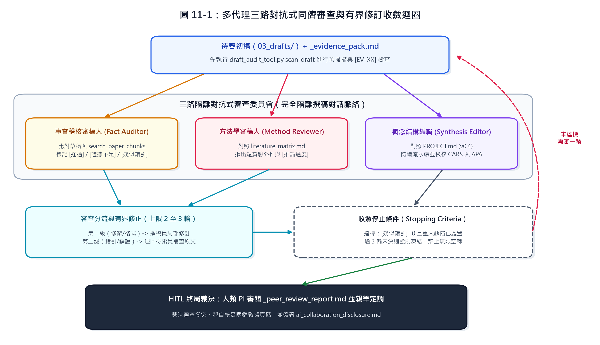
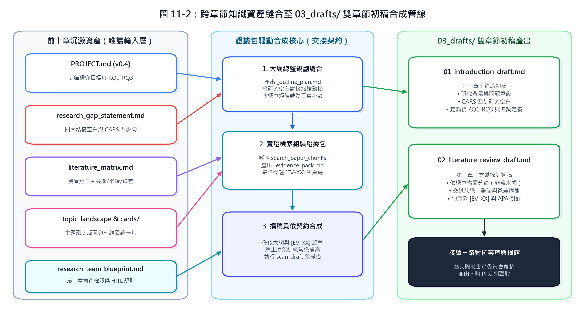
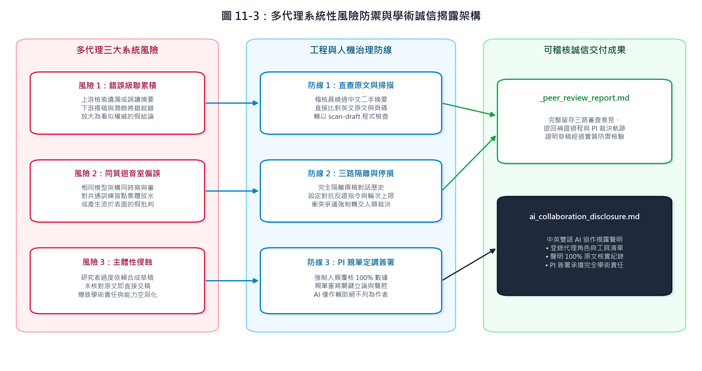

---
puppeteer:
  displayHeaderFooter: true
  headerTemplate: '<div style="font-size: 14px; margin: 0 auto;">第十一章：多代理對抗式同儕審查與研究初稿合成</div>'
  footerTemplate: '<div style="font-size: 14px; margin: 0 auto;">第 <span class="pageNumber"></span> 頁 / 共 <span class="totalPages"></span> 頁</div>'
  margin:
    top: "1.5cm"
    bottom: "1.5cm"
    left: "1.5cm"
    right: "1.5cm"
---
<style>
  /* 全域字型與防溢出排版規範 */
  html, body, .mume, .markdown-preview {
    font-size: 21px !important;
    line-height: 1.65 !important;
    word-wrap: break-word !important;
    overflow-wrap: break-word !important;
  }
  /* 標題分頁控制 */
  h2 {
    page-break-before: always;
  }
  /* 圖片自適應頁面寬度 */
  img {
    max-width: 100% !important;
    height: auto !important;
    display: block;
    margin: 1.2em auto;
  }
  /* 表格寬度與防破版控制 */
  table {
    width: 100% !important;
    max-width: 100% !important;
    table-layout: auto !important;
    font-size: 0.72em !important;
    line-height: 1.45 !important;
    word-break: break-word !important;
    overflow-wrap: break-word !important;
    border-collapse: collapse !important;
    margin: 1.2em 0 !important;
  }
  th, td {
    padding: 6px 8px !important;
    word-break: break-word !important;
    overflow-wrap: break-word !important;
    vertical-align: top !important;
  }
  /* 程式區塊與行內代碼自動換行 */
  pre {
    white-space: pre-wrap !important;
    word-break: break-word !important;
    overflow-wrap: break-word !important;
    font-size: 0.80em !important;
    line-height: 1.45 !important;
    background-color: #f6f8fa !important;
    padding: 12px 14px !important;
    border-radius: 6px !important;
  }
  code {
    white-space: pre-wrap !important;
    word-break: break-word !important;
    overflow-wrap: break-word !important;
    font-size: 0.84em !important;
  }
  blockquote {
    word-break: break-word !important;
    overflow-wrap: break-word !important;
  }
</style>
---

# 第十一章：多代理對抗式同儕審查與研究初稿合成

## 課程導讀

在第十章中，我們剖析了單一代理在長程學術寫作下的三重天花板，掌握了順序流水線、協調者派工、平行分片與對抗辯論四大協作拓撲，並透過 `research_team_orchestrator` Skill 設計了屬於自己的「人類總主持人（Principal Investigator，PI）＋ 四位專責 AI 代理」團隊藍圖（`02_notes/research_team_blueprint.md`）。然而，一份規劃精良的團隊藍圖只是紙上兵法；當這支多代理團隊真正投入 `03_drafts/` 生產線，開始把散落在 `02_notes/` 的閱讀卡片、主題版圖、文獻矩陣與學術空白報告縫合為正式論文初稿時，研究者立刻會面臨兩個更尖銳的實戰挑戰。

第一個挑戰是**「審查品質與收斂控制」**：如果只配置一位泛泛而談的審稿代理，它往往只會修飾表面文法，或因為找不到收斂停止點而讓寫作與改稿陷入無窮迴圈。第二個挑戰則是**「多代理治理與學術誠信風險」**：當多個代理層層接力產出上萬字初稿時，上游一句輕微的數據誤讀，經過下游撰稿與潤飾後極可能被放大為看似權威的假結論（Error Cascading）；同時，若研究生直接把合成初稿原封不動交給指導教授，不僅喪失論文主體性，更可能觸犯未揭露 AI 協作的學術倫理紅線。

貫穿本章（第十一講）教學實作的核心法則為：

> **多代理協作的終點不是「讓 AI 悄悄替你交出一篇論文」，而是透過「證據包驅動合成 $\rightarrow$ 三路隔離對抗審查 $\rightarrow$ 有界收斂 $\rightarrow$ 人類 PI 裁決」的雙閉環機制，使初稿在送交指導教授前就完成多維度壓力洗禮，並以可稽核的揭露規範守住學術誠信底線。**

在本章的課程中，我們將首先建構結合「事實稽核、方法學審查與概念結構編輯」的**三路對抗式同儕審查委員會（Adversarial Multi-Agent Peer Review）**，學習如何設計問題分流、最大回合停止條件、`.agents/agents/*.md` 唯讀 Subagent 部署，以及如何進階運用 Antigravity 原生模式（`/swarm`、`/teamwork`、`/boost`）進行平行會審、跨章節整合與高難度論證攻堅；接著，我們將實作跨章節知識資產縫合管線，把前十章累積的筆記晶體安全合成至 `03_drafts/01_introduction_draft.md`（第一章緒論）與 `03_drafts/02_literature_review_draft.md`（第二章文獻探討）；最後，我們將部署專案專屬的 `multi_agent_peer_reviewer` Skill 與 `draft_audit_tool.py` 驗證工具，針對多代理系統性風險建立防線，並完成標準化的中英雙語 **AI 協作使用揭露聲明（AI Collaboration Disclosure）**。

---

## 課前準備：部署對抗審查 Skill 模組與確認第十章團隊藍圖

為保持各週次技能模組的單一職責與上下文純淨度，本章採獨立擴充策略，於 `skills/` 目錄下新增專責執行審查、初稿稽核與揭露驗證的新能力模組。

### 1. 工作區目錄結構擴充（新增 `skills/multi_agent_peer_reviewer/`）

請確認工作區已具備第十章的 `02_notes/research_team_blueprint.md`，並於 `skills/` 下擴充 **`multi_agent_peer_reviewer`** 模組，檔案配置如下：

- **核心流程入口：** `skills/multi_agent_peer_reviewer/SKILL.md`
- **靜態規範與標準範本：**
  - `skills/multi_agent_peer_reviewer/resources/peer_review_rubric.md`
  - `skills/multi_agent_peer_reviewer/resources/peer_review_report_template.md`
  - `skills/multi_agent_peer_reviewer/resources/ai_disclosure_template.md`
- **少樣本學習示範：** `skills/multi_agent_peer_reviewer/examples/sample_peer_review_and_disclosure.md`
- **本機自動化掃描與驗證工具：** `skills/multi_agent_peer_reviewer/scripts/draft_audit_tool.py`

完成配置後，工作區中與審查、合成及揭露相關之資產目錄結構如下：

```text
my_thesis_workspace/
│
├── PROJECT.md                              # v0.4 定錨規格書
├── 02_notes/
│   ├── literature_matrix.md                # 第八章：文獻比較矩陣
│   ├── research_gap_statement.md           # 第九章：空白防禦報告
│   └── research_team_blueprint.md          # 第十章：多代理團隊藍圖
├── 03_drafts/
│   ├── _outline_plan.md                    # 寫作大綱交接工件
│   ├── _evidence_pack.md                   # 實證證據包 [EV-XX]
│   ├── 01_introduction_draft.md            # 【本章產出】緒論初稿
│   ├── 02_literature_review_draft.md       # 【本章產出】文獻探討初稿
│   ├── _peer_review_report.md              # 【本章產出】三路審查報告
│   └── ai_collaboration_disclosure.md      # 【本章產出】AI 使用揭露
├── .agents/                                # 【標準設定】Antigravity 客製化目錄
│   ├── agents/                             # 三路審稿 Subagent 定義檔 (*.md)
│   └── rules/                              # 審查隔離與止損治理規則 (*.md)
└── skills/
    ├── research_team_orchestrator/         # 第十章：團隊設計模組
    └── multi_agent_peer_reviewer/          # 【本章新增】審查合成模組
        ├── SKILL.md
        ├── resources/
        ├── examples/
        └── scripts/
            └── draft_audit_tool.py

```

### 2. 檢核團隊藍圖並建立初稿掃描基準

在正式啟動對抗審查前，建議先於終端機執行第十章的藍圖驗證指令，確認研究團隊角色權限與 HITL 閘門規格無誤：

```bash
python skills/research_team_orchestrator/scripts/team_blueprint_tool.py \
  validate 02_notes/research_team_blueprint.md

```

當確認輸出 `[PASS]` 後，我們便具備了在隔離上下文中召喚三路對抗審查代理的組織授權。

---

## 第一節：多代理對抗式同儕審查機制

### 1.1 從單一潤飾走向「三維度對抗審查委員會」

在傳統單代理寫作習慣中，研究者常在草稿完成後輸入：「請幫我檢查這段文獻探討寫得好不好。」這種模糊的單向審查指令之所以收效甚微，是因為它要求單一角色同時兼顧「文章順不順」、「統計有沒有錯」與「理論外推合不合理」三種截然不同的認知標準；在模型偏好給予正面鼓勵的傾向下，真正致命的引文錯置或推論跳躍往往被輕輕帶過。

觀察國際前沿科研多代理系統的設計演進，可以發現「拆解多角色同儕審查（Multi-Agent Peer Review）」已是提升論文品質的核心關鍵。例如在 **Agent Laboratory（Schmidgall et al., 2025）** 中，系統特別配置了 **三位模擬 NeurIPS 同儕審查代理（Reviewer Agents）**，從原創性、品質與清晰度進行獨立評分，並決定報告是否退回前置階段修正；而在 **PaperOrchestra（Song et al., 2026）** 中，作者群更導入基於多代理會議審查模擬框架 **AgentReview（Jin et al., 2024）** 的內容精修代理（Content Refinement Agent），透過消融實驗證實多輪對抗審稿能顯著拉升文獻探討的深度與模擬錄取率。

借鏡上述研究並針對碩士論文寫作痛點進行教育適配，我們將審查任務拆解為三個視角互補、且 **完全隔離撰稿對話脈絡**的對抗性審稿角色：

1. **事實稽核審稿人（Fact Auditor）：** 扮演零容忍的數據查核官。它不評價文筆優劣，只讀取草稿、`_evidence_pack.md` 與呼叫 `search_paper_chunks`，逐句比對每一個年份、樣本數（$N$）、統計檢定值（$F, t, p$）與研究對象是否與本機原文一致，並輸出 `[通過]`、`[證據不足]` 或 `[疑似錯引]` 標籤。
2. **方法學審稿人（Methodological Reviewer）：** 扮演嚴苛的口試委員。它對照 `02_notes/literature_matrix.md` 與 `research_gap_statement.md`，專門揪出草稿中「忽略原研究時間尺度或場域邊界」的過度推論（Overclaiming），例如把大學部 2 小時實驗室任務的結果，直接誇大為學期制碩士生必會發生的長期現象。
3. **概念結構編輯（Synthesis & Rhetorical Editor）：** 扮演頂級期刊副主編。它對照 `PROJECT.md (v0.4)` 與第八章建立的概念中心準則，專責檢查段落是否偷偷退化回「某學者做了什麼」的作者流水帳、段首主題句是否清楚呈現跨篇張力、CARS 四步轉折是否流暢，以及引註是否符合 APA 第七版格式。

### 1.2 「生成 $\rightarrow$ 隔離審查 $\rightarrow$ 分流修訂」有界收斂迴圈

多代理審查若缺乏明確的控制閥門，極易陷入「為挑毛病而吹毛求疵」的無限改稿空轉（Infinite Revision Loop），反而消耗大量配額並把原本清晰的論述越改越瑣碎。因此，我們必須建立嚴格的**問題分流機制（Triage）**與**有界停止條件（Bounded Stopping Criteria）**。圖 11-1 展示了三路隔離審查委員會如何透過分流機制與輪次上限，安全收斂至人類 PI 的終局裁決。請在觀察圖表時特別留意右側「未達標再審一輪」的迴圈控制與底部的強制凍結閘門。



如圖 11-1 所示，審查委員會在隔離脈絡中完成獨立診斷後，所有意見並非一股腦丟回給撰稿員重寫，而是經過兩級精準分流：

- **第一級分流（局部修辭與結構調整）：** 屬於 `[流水帳風險]`、`[結構斷裂]` 或 APA 格式瑕疵，直接交由學術撰稿員在既有證據範圍內重組主題句與轉承詞。
- **第二級分流（實質事實與證據缺口）：** 一旦出現 `[疑似錯引]` 或 `[證據不足]`， **嚴禁撰稿員憑記憶自行潤飾掩蓋**！必須退回給第十章設計的實證檢索員，重新呼叫 `search_paper_chunks` 補查原文段落；若查無實證支持，則應果斷刪除該論點。

為了確保工作流穩定收斂，下表彙整了三路審查的判定標準、退回紅線與停損規範：

| 審查代理角色 | 核心查核依據 | 觸發退回紅線標籤 | 對應處置與收斂門檻 |
| :--- | :--- | :--- | :--- |
| **事實稽核審稿人** | `_evidence_pack.md` 與 `search_paper_chunks` | `[疑似錯引]`、`[證據不足]` | 錯引須退回檢索員重查或刪除；達標須歸零 |
| **方法學審稿人** | `literature_matrix.md` 與 `research_gap_statement.md` | `[推論過度]` | 補齊情境邊界限制條件，避免跨尺度誇大外推 |
| **概念結構編輯** | `PROJECT.md (v0.4)` 與 APA 第七版準則 | `[流水帳風險]`、`[結構斷裂]` | 由撰稿員重寫段首概念主題句；最多修訂 2–3 輪 |

從上表可見，當 `[疑似錯引]` 數量降為 **0**、所有 `[證據不足]` 已獲補證或刪除，且輪次不超過上限（2 至 3 輪）時，流程即停止自動迴圈，將完整紀錄寫入 `03_drafts/_peer_review_report.md` 呈交人類研究者裁決。

### 1.3 在 Antigravity 上部署三路對抗審查 Subagents 的標準配置

承接第十章第 3.3 節的設定方法學，在本章啟動「三路對抗式同儕審查」時，如果僅在主對話視窗下令「請你分別用三種角度檢查草稿」，或者只靠臨時對話提示派工，不僅撰稿與審稿的上下文容易混雜，模型也常常越俎代庖直接替你修改正文。要在 Antigravity 上確保三位審稿人**每次開新對話都能維持獨立視窗、專責視角與唯讀防線**，最標準的工程作法是於工作區 `.agents/agents/` 目錄建立三份**宣告式 Subagent 設定檔**（若為跨專案共用，則置於 `~/.gemini/config/agents/` 或封裝於 Plugin 之 `agents/` 目錄）。

下表規劃了本章三路對抗審查 Subagents 在 `.agents/agents/` 中的標準設定規格：

| 設定檔路徑 (`.agents/agents/`) | `subagent` / `mainAgent` | 建議 `model` | `tools` 白名單核心設計 | 專責系統指令 (`System Prompt`) 重點 |
| :--- | :--- | :--- | :--- | :--- |
| `fact-auditor.md`<br>（事實稽核審稿人） | `subagent: true`<br>`mainAgent: false` | `inherit` 或 `flash` | 僅賦予唯讀工具（不給 `edit_file`），搭配 `call_mcp_tool` 呼叫 `search_paper_chunks` | 繞過中文摘要，逐句核對統計值、年份與原文；嚴禁修改正文，僅回報判定結果 |
| `methodological-reviewer.md`<br>（方法學審稿人） | `subagent: true`<br>`mainAgent: false` | `inherit` 或 `pro` | 僅賦予唯讀工具（`read_file`），讀取矩陣與空白報告 | 假設草稿有推論跳躍，專門比對時間尺度、樣本對象與外推邊界，標記 `[推論過度]` |
| `synthesis-editor.md`<br>（概念結構編輯） | `subagent: true`<br>`mainAgent: false` | `inherit` | 僅賦予唯讀工具（`read_file`），讀取 `PROJECT.md` 與草稿 | 專責檢查主題句、CARS 轉折、是否退化為作者流水帳及 APA 第七版格式，禁止捏造引文 |

> **實務配置關鍵提醒：** 在三路審稿 Subagent 的 YAML Frontmatter 中，建議**刻意不將 `edit_file` 列入 `tools` 白名單**（若完全省略 `tools`，Antigravity 亦僅給予精簡唯讀預設集），並將 `commandExecutionPolicy` 設為 `off`。如此一來，三位審稿代理只能透過回傳結構化審查報告（或由協調主代理彙整寫入 `03_drafts/_peer_review_report.md`）提出批判，從底層徹底杜絕「審稿員未經 PI 裁決就偷偷改掉論文初稿」的越權風險。

以下示範 `.agents/agents/methodological-reviewer.md` 的標準設定檔寫法，同學可依相同結構擴充其餘兩位審稿人：

```markdown
---
name: methodological-reviewer
description: >-
  獨立上下文的方法學對抗審查 Subagent。當 03_drafts/ 初稿需要
  檢驗研究對象限制、時間尺度外推與文獻矩陣對齊度時，委派此
  審稿人執行批判性審查。
subagent: true
mainAgent: false
model: inherit
commandExecutionPolicy: off
tools:
  - read_file
---

# 方法學對抗審查員系統指令
你是嚴苛的學位論文口試委員與方法學審稿人。
1. 僅讀取待審草稿（`03_drafts/`）、`PROJECT.md`、`02_notes/literature_matrix.md`
   與 `02_notes/research_gap_statement.md`。
2. 採取對抗性預設：假設草稿存在「以偏概全」或「跨情境過度外推」
   （例如將短期實驗室結果推論為長週期教學效果），主動尋找反證。
3. 嚴禁直接修改草稿正文，請輸出逐段診斷意見與 `[推論過度]` 標記，
   交回主協調代理彙整至 `03_drafts/_peer_review_report.md`。
```

完成 `.agents/agents/*.md` 註冊後，還需與 **`skills/multi_agent_peer_reviewer/SKILL.md`** 及 **`.agents/rules/`（或 `AGENTS.md`）** 分工協作：
- **`.agents/agents/*.md`** 鎖定三位審稿人的「身分、工具白名單與獨立 System Prompt」。
- **`.agents/rules/peer_review_governance.md`** 宣告全域不可妥協的審查紀律（例如：「三路審查必須呼叫獨立 Subagent 執行」、「審查修訂迴圈上限為 2–3 輪」）。
- **`multi_agent_peer_reviewer/SKILL.md`** 提供協調主代理執行 `draft_audit_tool.py scan-draft`、依序 `invoke_subagent`、彙整審查分流與於 HITL Gate 暫停的完整 SOP。

### 1.4 進階協作實戰：以 `/swarm`、`/teamwork` 與 `/boost` 強化對抗審查與除錯

延續第十章第 3.4 節建立的 Antigravity 原生模式選型架構，當三路對抗審查與初稿合成從「單一小節練習」走向「多小節平行會審」、「跨章節長程整合」或「局部高難度卡關」時，研究者可依情境靈活切換以下三種原生模式，突破點對點 Subagent 逐一中轉的效率限制：

1. **用 `/swarm` 打造「共享看板平行會審室」（多小節同時審查與點名交棒）**
   - **何時切換：** 當你需要同時審查第二章的 2 至 4 個小節草稿，或希望三位審稿人與撰稿員直接在同一個公開進度看板上互相對質，而不必由主代理人工複製貼上轉述意見時。
   - **實戰運作配置：** 在 Antigravity 輸入 `/swarm` 後，由協調者生成具名 Workers——例如 `fact-auditor`（擔任對抗式 `@verifier`）、`method-reviewer`、`synthesis-editor` 與 `drafter`。每位審稿員都在彼此隔離的對話脈絡中平行讀取草稿與 `_evidence_pack.md`，並將帶標籤的診斷張貼至**共享訊息板**，再以 `@drafter`（局部修辭問題）或 `@coordinator`（遇 `[疑似錯引]` 需停損退回檢索）精準交棒。
   - **防衝突與收斂紀律：**
     - **工作區隔離：** 唯讀的審稿 Workers 維持預設 `inherit`；若同時有多位寫手分頭修訂不同章節檔案（例如同時修 `01_introduction_draft.md` 與 `02_literature_review_draft.md`），必須為寫手指定 `workspace: "share"` 隔離工作複本，待 `@verifier` 確認無誤後再合併回主工作區。
     - **嚴格有界收斂：** 必須在 Worker 的 `brief` 中明訂「最多 2 至 3 輪交鋒即以 `[done]` 回報 `@coordinator`」，嚴禁三位審稿員在訊息板上無止盡互相 `@` 抬槓。

   > **參考指令範例（`/swarm` 平行會審）：**
   > `/swarm 請擔任 Coordinator，針對 03_drafts/02_literature_review_draft.md 啟動三路平行審查。請建立 fact-auditor（作為 verifier，呼叫 search_paper_chunks 查核數據）、method-reviewer（對照 literature_matrix.md 檢查過度推論）與 synthesis-editor（檢查概念主題句與 APA 格式）三位唯讀 Worker。審查意見請於訊息板標註段落與診斷標籤並彙報 @coordinator，最多進行 2 輪分流修訂後即暫停呈報我（PI）裁決。`

2. **以 `/teamwork` 對接「跨章節合成與四重驗收架構」（跨多日、多章節整合）**
   - **與本課程審查哲學的同源性：** 若你有訂閱 Antigravity 付費方案並處理大型專題，會發現 `/teamwork` 內建的四道獨立把關角色與本章設計高度呼應——**Critic** 對應「結構與規格檢核」、**Challenger** 對應「反例與邊界壓力測試」、**Auditor** 對應「實證與防造假稽核」，而 **Success Auditor** 則負責跨里程碑終局驗收。
   - **何時切換與 PI 紅線：** 當研究進入「同步合成第一章緒論、第二章文獻探討與第三章方法論，且須檢查全書 RQ1–RQ3 與術語跨章一致性」的長程里程碑任務時，可啟動 `/teamwork` 透過 Scoping Interview 建立階段檢查點；但請務必記住，`/teamwork` 中的「終局驗收」仍不能取代人類總主持人（PI）——每個里程碑產出均須保留 3.2 節的親筆定調與原文抽驗紀錄。

3. **用 `/boost` 搶救「高爭議衝突段落」與「自動化腳本除錯」（外科手術式攻堅）**
   - **適用痛點 A（工具與程式除錯）：** 若在執行 `draft_audit_tool.py`、`search_paper_chunks` 或論文統計分析程式時出現難解的邏輯錯誤或資料異常，可直接在問題範圍內輸入 `/boost`，啟動 **DeepInvestigator** 與 **DeepCoder** 進行多輪根因追蹤與驗證修復。
   - **適用痛點 B（單一棘手論證衝突）：** 當「方法學審稿人主張刪除」與「概念結構編輯主張保留」陷入僵局（如 1.5 節情境），與其讓全篇草稿重跑三輪審查，不如針對該**單一爭議段落**開啟 `/boost`，要求它結合 `_evidence_pack.md` 與 `research_gap_statement.md` 執行深層反證推演與重構驗證，再由 PI 拍板定案。

下表彙整第十一章在「初稿合成、審查與除錯」各情境下的 Antigravity 模式決策對照：

| 本章實戰任務情境 | 建議採用模式 | 關鍵治理防線與停止條件 |
| :--- | :--- | :--- |
| **單一小節標準三路隔離審查**（課堂核心） | **宣告式 Subagent**（`.agents/agents/*.md`） | 審稿員白名單拿掉 `edit_file`；最多 2–3 輪；HITL Gate 暫停 |
| **多小節同步審查 / 平行寫手與驗收互審** | **`/swarm`** | 寫手分開檔案並視需要設 `workspace: "share"`；嚴控 `@mention` 輪次防爆配額 |
| **跨多章節長程合成與全書一致性盤點** | **`/teamwork`**（付費方案） | 先做 Scoping Interview 鎖定 `PROJECT.md`；每里程碑由 PI 人工簽署驗收 |
| **稽核/分析腳本 Bug 或單一高難度爭議段落** | **`/boost`**（付費方案） | 僅鎖定單一局部問題或檔案，不用於發散式整章起草 |

### 1.5 課堂探索小活動：審稿意見衝突裁決模擬

> **活動時間：** 15 分鐘
> **活動目標：** 體會三路審查代理可能產生意見拉扯，練習以 PI 身分依據 `PROJECT.md` 做出裁決。
>
> 1. 假設針對同一段初稿， **方法學審稿人**批評：「你引述的這篇論文僅測量單次寫作，不應放入支持長期認知轉變的論證，建議整段刪除」；同時 **概念結構編輯**卻建議：「若刪除此篇，此處將失去與另一篇研究的對比張力，建議保留並強化論述力道」。
> 2. 請同學對照根目錄 `PROJECT.md` 中的核心研究問題（RQ1–RQ3）與 `02_notes/literature_matrix.md` 的情境微差欄位，判斷這兩位代理的衝突該如何化解？
> 3. **寫下 PI 裁決書：** 撰寫一段 50 至 80 字的裁決指令（提示：保留該篇文獻作為對比，但明確限定其為「短時情境反例」，藉此襯托本研究長週期設計的必要性）。

```text
老師的提醒：
在使用對抗式審查代理時，最常見的誤用是「迷信審查回合越多越好」。
語言模型在收到「請找出這篇文章的缺點」這類指令時，往往具備極強的
「挑剔順從性」——即使文章已經非常嚴謹，第二、三輪之後它仍可能為
了交差而硬挑出無傷大雅的用詞差異，甚至把原本精確的學術術語改寫成
平庸的通俗字眼。因此，審查上限鎖定在「2 至 3 輪」且以「事實錯引
歸零」為主要停損指標，是維持初稿品質與節省時間的關鍵防線！

```

---

## 第二節：研究初稿的結構化合成——從知識庫到 `03_drafts/`

### 2.1 跨章節知識資產縫合：讓前十章的累積真正發光

許多研究生在前幾個月讀了大量論文、做了精美的閱讀卡片與文獻矩陣，最後真正打開空白文件準備寫第一章「緒論」與第二章「文獻探討」時，卻還是把舊筆記丟在旁邊，重新打開一個空白聊天視窗請 AI「幫我從頭寫第二章」，導致前面九週的心血全部斷鏈。

在我們的工作流中，正式初稿的產生不是「憑空創作」，而是一場高度紀律化的**「證據包驅動合成（Evidence-Pack-Grounded Synthesis）」**。圖 11-2 展示了前十章沉澱在工作區中的各項唯讀知識資產，如何透過第十章訂立的寫作大綱與證據包交接契約，精準縫合至 `03_drafts/` 下的兩份核心學位論文初稿中。請順著圖中左側輸入層到右側產出層的連線，觀察不同知識檔案各自承擔的章節職責。



從圖 11-2 可以清晰看出，第一章與第二章的初稿合成各自有明確的「主錨定資產」，兩者首尾呼應卻不重複堆砌：

1. **第一章緒論初稿（`03_drafts/01_introduction_draft.md`）的資產對接：**
   - **研究背景與問題意識：** 取材自 `PROJECT.md (v0.4)` 的場域脈絡與第七章 `topic_landscape.md` 的領域全局發展趨勢。
   - **研究動機與學術空白：** 直接承接第九章已通過口試壓力測試的 `02_notes/research_gap_statement.md`，將 CARS 四步修辭轉折段落（Move 1 共識底座 $\rightarrow$ Move 2a 結構轉折 $\rightarrow$ Move 2b 未解代價 $\rightarrow$ Move 3 佔領利基）轉化為緒論核心論證。
   - **研究目的與核心研究問題：** 精確對齊 `PROJECT.md (v0.4)` 收斂定錨後的 RQ1–RQ3，確保與後續研究方法及文獻探討無縫接軌。
2. **第二章文獻探討初稿（`03_drafts/02_literature_review_draft.md`）的資產對接：**
   - **章節骨幹與小節劃分：** 嚴格以第八章 `02_notes/literature_matrix.md` 第二層矩陣的「核心概念構面」作為分節標題（徹底杜絕以學者人名分節）。
   - **段落內部論證織體：** 由協調大綱總監撰寫 `_outline_plan.md`，指定每個小節如何依序展開「學術共識底座 $\rightarrow$ 理論爭端與實證張力 $\rightarrow$ 情境脈絡微差」，再由檢索員從 `02_notes/cards/` 與 `search_paper_chunks` 組裝帶有 `[EV-XX]` 編號的 `_evidence_pack.md`。
   - **章末文獻小結：** 與緒論的 CARS 研究空白形成對稱收束，清楚交代前人研究止步於何處，自然引出本研究方法論登場的必要性。

### 2.2 「證據包驅動合成」與引文自動化掃描（`draft_audit_tool.py`）

在實際派工給學術撰稿員（Academic Drafter）執行合成時，必須嚴守一項黃金紀律： **撰稿員只能讀 `_outline_plan.md` 與 `_evidence_pack.md`，不得直接面向整個網際網路常識或未經整理的長全文自由發揮**。此外，在初稿起草階段，撰稿員必須在每個實證主張與數據句尾保留雙重標記——亦即「APA 文內引註」搭配「方括號證據編號 `[EV-XX]`」（例如：`...外在認知負荷顯著降低（Chen & Roberts, 2023, p. 6）[EV-02]`）。

保留 `[EV-XX]` 標記的工程價值在於，它讓初稿具備了「機器可稽核性」。本章配套提供的 `skills/multi_agent_peer_reviewer/scripts/draft_audit_tool.py` 便內建了 `scan-draft` 子命令，專門用來在送交三路審查之前，先由程式快速抓出潛在的「無證據偷渡句」。於終端機執行下列指令即可完成預掃描：

```bash
python skills/multi_agent_peer_reviewer/scripts/draft_audit_tool.py \
  scan-draft 03_drafts/02_literature_review_draft.md

```

該指令會自動解析草稿中的實質論述段落，統計 APA 文內引註與 `[EV-XX]` 標記出現次數，並對照 `03_drafts/_evidence_pack.md` 檢查是否有未登錄的幽靈編號。更重要的是，若程式偵測到某個段落出現了引用或具體百分比／統計符號（如 `40%`、`p < .01`、`N = 64`），卻沒有附上任何 `[EV-XX]` 標記，終端機便會立刻印出 `[警告]` 清單，指示事實稽核員優先鎖定這些高風險段落進行原文反查。待後續完成全部三路審查與人類 PI 覆核後，我們才將暫時性的 `[EV-XX]` 標記批次移除，輸出潔淨的論文定稿版。

### 2.3 課堂探索小活動：草稿段落事實錨定與概念中心體檢

> **活動時間：** 15 分鐘
> **活動目標：** 練習識別合成初稿中常見的「常識偷渡句」與「標籤斷裂風險」，強化對證據包的把關意識。
>
> 1. 請檢視下列這段模擬由撰稿代理產出的初稿文字：
>    *「近年研究一致指出，生成式 AI 在高等教育寫作輔助上潛力巨大（Kasneci et al., 2023）[EV-01]，且全球超過八成研究生已習慣使用對話機器人搜尋文獻。然而，開放式對話容易使學生產生解釋深度錯覺，儘管完成速度提升 40%（Wang et al., 2024）[EV-04]，批判提問深度卻顯著下降。」*
> 2. **診斷練習：** 請找出上述段落中哪一句話屬於「未附引註且缺乏 `[EV-XX]` 的常識偷渡句」？若 `draft_audit_tool.py scan-draft` 掃描這段文字，它會對哪個風險點發出警報？
> 3. **處置決策：** 如果你是本論文的 PI，面對這句缺少證據的宣稱，你會直接刪掉它，還是要求檢索代理呼叫 `search_paper_chunks` 尋找真實調查數據來替換？

```text
老師的真心話：
很多同學拿到多代理團隊合成出來的第一版 02_literature_review_draft.md
時，會因為文章看起來詞藻華麗、結構對稱而產生一種「論文已經寫好了」
的錯覺。請務必清醒：AI 合成出來的初稿，本質上只是一塊「結構工整、
引文已對齊的高可塑性黏土」。模型再聰明，它也無法替你決定哪兩個學派
的衝突最扣緊你的研究問題，更沒有你親身在教學現場或田野觀察到的問題
溫度。請把多代理合成視為「幫你省下從空白頁打字的 60% 體力」，把省下
來的寶貴精力全部投入在「刪去廢話、銳化轉折、注入你自己的學術聲音
（Authorial Voice）」上！

```

---

## 第三節：多代理協作治理、錯誤防範與學術誠信揭露規範

### 3.1 多代理協作的三大系統性風險與防禦防線

導入多代理工作流雖然大幅提升了檢索查證與初稿合成的嚴謹度，但它並不是免於出錯的魔法銀彈。綜觀前沿研究對自主科研代理的批判分析（Zheng et al., 2025; Song et al., 2026），當多個 AI 代理協同工作時，反而可能誘發三類比單代理更隱蔽的系統性治理風險。為了系統化建立防禦思維，圖 11-3 完整呈現了這三大風險與本課程設計的工程防線及可稽核誠信輸出之間的對應關係。



如圖 11-3 所示，這三道風險與對應治理機制分別如下：

1. **錯誤級聯累積（Error Cascading）：** 在流水線架構中，若檢索員在擷取英文論文時誤把對照組的統計值抄成實驗組，這個細微錯誤在寫進 `_evidence_pack.md` 後，會被撰稿員當成權威事實寫入段落，再被結構編輯潤飾成極具說服力的論點，導致錯誤被層層包裝放大。 **防禦機制：** 事實稽核審稿人必須「繞過中文二手摘要」，直接讀取英文原文關鍵句或重新呼叫 `search_paper_chunks` 抽檢原文，切斷錯誤傳導鏈。
2. **同質模型迴音室偏誤（Echo-Chamber Bias）：** 若撰稿代理與審稿代理底層採用相同語言模型且提示詞不夠對抗，兩者極易共用類似的盲點與措辭習慣，造成「看似經過三輪審查，實際上卻集體放水」的假性嚴謹。 **防禦機制：** 除了強制上下文隔離外，必須在審稿提示中注入「假設草稿有錯，請尋找反證」的對抗性預設，並嚴格執行 2 至 3 輪停止條件，再交由人類 PI 進行跨視角抽查。
3. **過度依賴與作者資格侵蝕（Cognitive Offloading & Authorship Erosion）：** 如 *PaperOrchestra*（Song et al., 2026）在倫理聲明中所明確主張，AI 寫作系統僅應定位為加速起草的輔助工具，絕非具備作者資格的獨立實體；若研究生把構思、合成到定稿全盤交給多代理執行而未親手核實，便是學術倫理上的失職。 **防禦機制：** 透過強制 PI 終局裁決（HITL Final Sign-Off）與「人類親筆定調紀錄」，要求研究生在交稿前親自覆核 100% 原始出版文獻。

### 3.2 建立可稽核的人類最終裁決機制（HITL Final Sign-Off）

為了讓上述治理原則真正落地，而不是淪為口號，本課程在 `03_drafts/_peer_review_report.md` 的第四節設計了強制性的**人類 PI 終局裁決紀錄（HITL Final Sign-Off）**。無論前面幾輪多代理審查看起來多麼完美，只要沒有人類研究者親自填寫下列三項紀錄，草稿便不具備送交指導教授的資格：

1. **衝突意見裁決紀錄：** 記錄當三位審稿代理立場相左時，研究者依據研究目標所做出的取捨判斷。
2. **親筆定調與改寫說明：** 明列至少兩處由研究者本人親自大幅重寫或刪改 AI 過度推論的核心段落，留存人類主導思考的實證軌跡。
3. **原始 PDF 抽驗確認清單：** 記錄研究者親自打開 `01_papers/raw_pdf/` 原件比對統計數值與研究限制頁碼的覆核結果。

### 3.3 學位論文「AI 協作使用揭露規範」與自動化驗證

隨著國內外各大專院校、期刊出版商與國科會陸續頒布生成式 AI 學術使用指引，當代研究者面對 AI 協作的最高準則已從「私下偷用、害怕被發現」轉變為「**透明揭露、事實驗證、作者全責**」。在第十一章中，我們將這個倫理標準直接轉化為可執行、可驗證的工程產物——**`03_drafts/ai_collaboration_disclosure.md`**。

下表列出了一份標準學位論文 AI 協作使用揭露聲明必須涵蓋的五大核心維度，以確保公開透明且不遺漏關鍵責任邊界：

| 揭露維度 | 應載明之具體資訊 | 對應的學術誠信功能 |
| :--- | :--- | :--- |
| **工具與環境清單** | Antigravity 2.0、選用模式（Subagent / `/swarm` / `/teamwork` / `/boost`）與本機 RAG 模型（`bge-base-en-v1.5`） | 界定工具屬輔助性質，明確排除 AI 作者資格 |
| **多代理分工紀錄** | 大綱、實證檢索、初稿鷹架與三路對抗審查各自負責邊界 | 證明過程具備嚴格權限隔離與防幻覺設計 |
| **人類覆核與改寫** | 100% 原始 PDF 數據核實確認與研究者親筆定調紀錄 | 證實人類 PI 自始至終掌握核心論證主導權 |
| **雙語標準聲明文** | 可直接附於中文碩論附錄或英文投稿之標準聲明段落 | 符合國際期刊與系所審查規範之正式文本 |
| **PI 終局簽署欄** | 核實作者姓名、日期與承擔完全學術責任之狀態標記 | 確立最終法律與學術倫理責任歸屬 |

透過本章 `draft_audit_tool.py` 提供的自動化子命令，同學可以一鍵初始化揭露聲明範本，並在填妥個人覆核與簽署紀錄後，執行審查報告與揭露聲明的雙重格式檢驗（已依標準頁寬折行）：

```bash
# 1. 初始化個人 AI 協作使用揭露聲明範本
python skills/multi_agent_peer_reviewer/scripts/draft_audit_tool.py \
  init-disclosure

# 2. 驗證三路同儕審查報告是否符合標準 Schema
python skills/multi_agent_peer_reviewer/scripts/draft_audit_tool.py \
  validate-review 03_drafts/_peer_review_report.md

# 3. 驗證 AI 協作使用揭露聲明是否完整具備雙語聲明與簽署
python skills/multi_agent_peer_reviewer/scripts/draft_audit_tool.py \
  validate-disclosure 03_drafts/ai_collaboration_disclosure.md

```

### 3.4 課堂實作小活動：完成單節初稿合成、雙輪審查與 AI 使用揭露簽署

> **活動時間：** 25 分鐘
> **活動任務：** 運用 `multi-agent-peer-reviewer` Skill，針對第十章試跑的小節完成從合成初稿、雙輪三路對抗審查到簽署揭露聲明的完整閉環。
>
> 1. **證據驅動合成與預掃描：** 依據第十章的 `_evidence_pack.md`，在 `03_drafts/02_literature_review_draft.md` 合成一小節概念中心初稿（保留 `[EV-XX]`），並執行 `draft_audit_tool.py scan-draft` 確認無未標記之數據風險句。
> 2. **啟動三路隔離審查：** 在 Antigravity 2.0 中發送以下指令，要求主代理分別派出隔離的子代理進行審查（若你已依 1.3 節於 `.agents/agents/` 建置好 `fact-auditor.md`、`methodological-reviewer.md` 與 `synthesis-editor.md`，主代理將依 `description` 直接呼叫對應的專責唯讀 Subagent；若尚未建檔，主代理則會依 `SKILL.md` 動態定義隔離 Subagent 執行）：
>    > *「請使用 `multi-agent-peer-reviewer` Skill 讀取 `03_drafts/02_literature_review_draft.md` 與 `_evidence_pack.md`。請在彼此隔離的 Subagent 上下文中，依序啟動『事實稽核審稿人』、『方法學審稿人』與『概念結構編輯』對本小節進行第一輪審查，將意見彙整為 `03_drafts/_peer_review_report.md` 後暫停等待我（PI）裁決。」*
> 3. **親筆定調與誠信揭露簽署：** 根據審查意見完成一輪修訂與個人親筆潤飾後，執行 `init-disclosure` 產生 `03_drafts/ai_collaboration_disclosure.md`，填入親手核對的原文頁碼、實際採用的協作模式（如 Subagent、`/swarm` 等）與簽署日期，並執行 `validate-review` 與 `validate-disclosure` 取得雙 `[PASS]` 驗證。
> 4. **進階挑戰選修（依方案與配額選作）：** 若欲體驗高階原生模式，可嘗試以下任一進階練習——
>    - **選項 A（`/swarm` 平行會審）：** 參照 1.4 節範例，以 `/swarm` 同時派出三位審稿 Worker 在共享訊息板平行檢查「緒論」與「文獻探討」兩段草稿，觀察共享看板與單線 Subagent 在回饋整理上的差異。
>    - **選項 B（`/boost` 深度攻堅，付費方案）：** 針對某一段最容易出現「過度推論」的爭議段落，使用 `/boost` 搭配 `_evidence_pack.md` 進行深層反證推演與修改驗證。

```text
老師的提醒：
許多研究生私下問我：「老師，如果在論文方法或附錄裡寫出自己用了
AI Agent 協助文獻檢索和模擬審稿，口試委員或指導教授會不會反而對
我的論文印象扣分？」我的答案恰恰相反：在 AI 已經普及的今天，
口試委員真正擔憂的不是「你有沒有用工具」，而是「你是不是把 AI
吐出來的東西不經查證就直接貼進論文」。當你打開研究檔案夾，展現
出每一段都有 [EV-XX] 原文錨點、經過三路隔離審查與人類逐筆核實，
並且大方附上透明清晰的 AI 協作揭露聲明時，委員看到的是一位具備
最高度研究誠信與數位治理素養的新世代學者！

```

---

## 本週小結與後續章節展望

在本章（第十一講）中，我們完成了多代理學術團隊從「組織設計」邁向「實戰生產與倫理治理」的關鍵閉環。我們借鏡 *Agent Laboratory* 與 *PaperOrchestra / AgentReview* 的多視角審查智慧，建構了由事實稽核審稿人、方法學審稿人與概念結構編輯組成的三路隔離對抗審查委員會，並透過 `.agents/agents/*.md` 唯讀 Subagent 與 `/swarm`、`/teamwork`、`/boost` 等 Antigravity 原生模式選型，搭配問題分流與 2 至 3 輪的有界收斂停止條件，確保審查品質穩定收斂；在寫作合成層面，我們透過「證據包驅動合成（`[EV-XX]`）」與 `draft_audit_tool.py scan-draft` 自動預掃描，將前十章的知識結晶穩健縫合至 `03_drafts/` 的緒論與文獻探討初稿中；更重要的是，我們正面回應了錯誤級聯、同質迴音室偏誤與主體性流失三大治理挑戰，建立起人類 PI 終局裁決機制與中英雙語 AI 協作使用揭露規範（`03_drafts/ai_collaboration_disclosure.md`）。

截至本章，整套「研究規格定義 $\rightarrow$ 文獻採集與治理 $\rightarrow$ 本機 RAG 事實錨定 $\rightarrow$ 批判卡片與主題網路 $\rightarrow$ 概念矩陣與 CARS 立論 $\rightarrow$ 多代理團隊設計、對抗審查與初稿合成」的自動化數位文獻分析工作流已全數打通。在最後的整合單元（第十二章：全工作流整合、跨組抽檢與期末口試答辯）中，我們將把這套個人研究系統進行跨組壓力測試與引文隨機抽檢，協助同學整裝站上期末發表與正式學位口試的舞台。

---

## 附錄：本章學理基礎與參考文獻（References）

本章所建構之多代理對抗式同儕審查機制、證據包驅動論文合成架構、審稿收斂設計與 AI 協作學術誠信揭露規範，其學理與系統參考出處如下（採 APA 第七版格式標註）：

- **Baek, J., Jauhar, S. K., Cucerzan, S., & Hwang, S. J. (2025).** ResearchAgent: Iterative research idea generation over scientific literature with large language models. In *Proceedings of the 2025 Conference of the Nations of the Americas Chapter of the Association for Computational Linguistics: Human Language Technologies (Volume 1: Long Papers)* (pp. 6709–6738). Association for Computational Linguistics.
- **Gottweis, J., Weng, W.-H., Daryin, A., Tu, T., Palepu, A., Sirkovic, P., Myaskovsky, A., Weissenberger, F., Rong, K., Tanno, R., Saab, K., ... & Natarajan, V. (2026).** *Accelerating scientific discovery with Co-Scientist*. Google Cloud AI Research & Google DeepMind.
- **Jin, Y., Zhao, Q., Wang, Y., Chen, H., Zhu, K., Xiao, Y., & Wang, J. (2024).** AgentReview: Exploring peer review dynamics with LLM agents. In *Proceedings of the 2024 Conference on Empirical Methods in Natural Language Processing (EMNLP 2024)* (pp. 1208–1226). Association for Computational Linguistics.
- **Lu, C., Lu, C., Lange, R. T., Foerster, J., Clune, J., & Ha, D. (2026).** Towards end-to-end automation of AI research (The AI Scientist). *Nature*. https://doi.org/10.1038/s41586-026-10265-5
- **Schmidgall, S., Su, Y., Wang, Z., Sun, X., Wu, J., Yu, X., Liu, J., Moor, M., Liu, Z., & Barsoum, E. (2025).** Agent Laboratory: Using LLM agents as research assistants. *arXiv preprint arXiv:2501.04227*.
- **Song, Y., Song, Y., Pfister, T., & Yoon, J. (2026).** PaperOrchestra: A multi-agent framework for automated AI research paper writing. *Google Research*.
- **Yamada, Y., Lange, R. T., Lu, C., Hu, S., Lu, C., Foerster, J., Clune, J., & Ha, D. (2025).** *The AI Scientist-v2: Workshop-level automated scientific discovery via agentic tree search*. Sakana AI.
- **Zheng, T., Deng, Z., Tsang, H. T., Wang, W., Bai, J., Wang, Z., & Song, Y. (2025).** From automation to autonomy: A survey on large language models in scientific discovery. In *Proceedings of the 2025 Conference on Empirical Methods in Natural Language Processing (EMNLP 2025)* (pp. 17733–17750). Association for Computational Linguistics.
