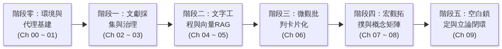
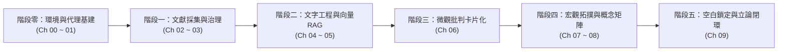
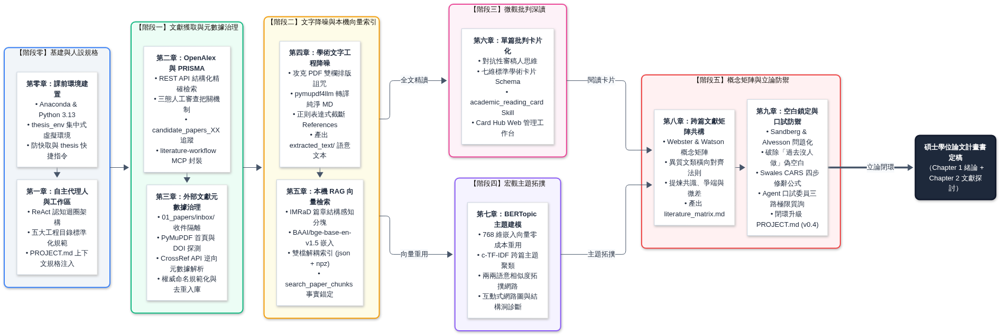

# AI Agent 學術研究與文獻探討實務：課程總導覽與知識索引 (COURSE_INDEX.md)

本課程專為碩士研究生與學術研究者設計，以 **Antigravity 2.0 Desktop** 為實踐中樞，引導研究者跨越傳統「被動對話式 Chatbot」之限制，邁向具備「環境感知、任務規劃、工具調用與批判反思」的 **自主研究代理人（AI Agent）** 協同範式。

透過本索引，您可快速瀏覽全套 10 份核心講義之精華、專案所有 Markdown 資產連結、系統化建議閱讀路徑，以及整合學理與工程實踐之全域知識地圖。

---

## 一、核心講義清單與內容摘要

以下為本課程第零章至第九章之 10 份核心講義清單，每份講義皆提供約 50 字之核心摘要、相應工程工具與核心交付物：

| 章節 | 講義檔案連結 | 核心內容摘要（約 50 字） | 關鍵工具與技術 | 核心產出資產 |
| :--- | :--- | :--- | :--- | :--- |
| **第零章** | [00_課前環境建置與虛擬環境配置.md](file:///c:/Users/vvkuo/Documents/GitHub/literature_agent/00_課前環境建置與虛擬環境配置.md) | 介紹 Anaconda、VS Code 與 Antigravity 協同架構，引導指揮 AI Agent 自主部署 `thesis_env` 集中式虛擬環境、安裝核心學術套件並配置跨檔案環境變數與快捷指令，奠定研究數位基建。 | Anaconda, Python 3.13, PowerShell Profile, VS Code Settings | `thesis_env`, `settings.json`, `mcp_config.json` |
| **第一章** | [01_課程介紹.md](file:///c:/Users/vvkuo/Documents/GitHub/literature_agent/01_課程介紹.md) | 剖析 Chatbot 被動問答與 AI Agent（ReAct 動態迴圈）之本質差異，確立五大標準工作區目錄，並透過上下文工程撰寫 `PROJECT.md` 注入研究人設、時程約束與探索性研究問題。 | Antigravity 2.0, ReAct Loop, Context Engineering | [PROJECT.md](file:///c:/Users/vvkuo/Documents/GitHub/literature_agent/PROJECT.md), 五大工作目錄 |
| **第二章** | [02_智慧文獻爬梳與學術文字工程.md](file:///c:/Users/vvkuo/Documents/GitHub/literature_agent/02_智慧文獻爬梳與學術文字工程.md) | 基於 OpenAlex API 打造自動化文獻檢索管線，結合期刊品質過濾、PRISMA 規範兩位數流水號追蹤與三態人機互動審查，並透過 MCP 協定將腳本封裝為 Agent 自主調用工具鏈。 | OpenAlex API, PRISMA, Model Context Protocol (MCP) | `candidate_papers_01.md`, `candidate_papers_01_tracking.md` |
| **第三章** | [03_外部自尋文獻匯入與學術元數據治理.md](file:///c:/Users/vvkuo/Documents/GitHub/literature_agent/03_外部自尋文獻匯入與學術元數據治理.md) | 建立 `01_papers/inbox/` 收件隔離機制，利用 PyMuPDF 探測 PDF 首頁與 DOI，並透過 CrossRef API 逆向解析元數據、自動正規化命名與去重，為非結構化外部文獻建立權威身分證。 | PyMuPDF, CrossRef API, DOI Regex, Metadata Ingestion | `01_papers/inbox/`, `external_papers_catalog.md` |
| **第四章** | [04_學術文字工程_從PDF排版詛咒到純淨Markdown.md](file:///c:/Users/vvkuo/Documents/GitHub/literature_agent/04_學術文字工程_從PDF排版詛咒到純淨Markdown.md) | 破解 PDF 雙欄混排與繪圖指令詛咒，運用 `pymupdf4llm` 轉譯純淨 Markdown，結合正規表達式精準截斷參考文獻雜訊與清洗頁眉頁腳，為本機向量索引庫打造高密度語意文本。 | PyMuPDF, pymupdf4llm, Regex Boundary Detection | `01_papers/extracted_text/*.md` |
| **第五章** | [05_本機RAG向量檢索_論文語意分塊與事實錨定.md](file:///c:/Users/vvkuo/Documents/GitHub/literature_agent/05_本機RAG向量檢索_論文語意分塊與事實錨定.md) | 剖析大模型長程遺忘與事實雜交盲點，採用學術結構感知分塊與 `bge-base-en-v1.5` 模型建立雙檔解耦向量索引，透過 MCP 工具 `search_paper_chunks` 實現毫秒級事實錨定。 | Sentence-Transformers, BGE-Base, Dual-File Index | `vector_index.json`, `vector_embeddings.npz` |
| **第六章** | [06_單篇批判精讀與標準閱讀卡片化_學術知識的晶體化.md](file:///c:/Users/vvkuo/Documents/GitHub/literature_agent/06_單篇批判精讀與標準閱讀卡片化_學術知識的晶體化.md) | 擺脫被動摘要與文獻消化不良，將 Agent 塑化為對抗性審稿人，依照七維度標準 Schema 結構化萃取文獻盲點與對研究規格書之啟發，沉澱為原子閱讀卡片並由 Card Hub 管理。 | Skill 規範, Zettelkasten, Streamlit Card Hub | `skills/academic_reading_card/`, `02_notes/cards/card_*.md` |
| **第七章** | [07_基於BERTopic之跨篇主題建模與語意區塊互動網路圖.md](file:///c:/Users/vvkuo/Documents/GitHub/literature_agent/07_基於BERTopic之跨篇主題建模與語意區塊互動網路圖.md) | 複用本機 768 維嵌入向量，結合 BERTopic 與 c-TF-IDF 演算法自動提取跨篇主題聚落，計算語意相似度建構互動式網路圖，突破 RAG 檢索隧道效應並診斷文獻結構洞。 | BERTopic, UMAP, HDBSCAN, HTML5 Canvas Network | `02_notes/topic_chunk_network.html`, `02_notes/topic_landscape.md` |
| **第八章** | [08_跨篇文獻矩陣共構與概念導向綜整.md](file:///c:/Users/vvkuo/Documents/GitHub/literature_agent/08_跨篇文獻矩陣共構與概念導向綜整.md) | 翻轉作者流水帳為概念中心矩陣，整合單篇卡片與主題網路，透過雙層次比較矩陣橫向對齊異質文類，提煉跨篇文獻之學術共識、實證爭端與情境微差，奠定立論實證基石。 | Webster & Watson 概念矩陣, Garrard 矩陣法 | `skills/literature_matrix_synthesizer/`, `02_notes/literature_matrix.md` |
| **第九章** | [09_學術空白鎖定與開題立論防禦.md](file:///c:/Users/vvkuo/Documents/GitHub/literature_agent/09_學術空白鎖定與開題立論防禦.md) | 破除「過去沒人做」之偽空白迷思，運用問題化理論診斷四大真學術空白，導入 Swales CARS 模型四步公式立論，透過 Agent 口試委員三路壓力測試，閉環升級定錨版規格書。 | Sandberg & Alvesson 問題化, Swales CARS 模型 | `skills/research_gap_challenger/`, `research_gap_statement.md` |

---

## 二、專案完整 Markdown 資產索引

本專案所有資產皆以結構化 Markdown（`.md`）進行規格化管理。以下依照功能職責分類條列，均可點擊直接開啟：

### 1. 核心課程講義 (Lecture Handouts)
- [00_課前環境建置與虛擬環境配置.md](file:///c:/Users/vvkuo/Documents/GitHub/literature_agent/00_課前環境建置與虛擬環境配置.md)：研究工具鏈安裝與 AI Agent 集中式虛擬環境治理。
- [01_課程介紹.md](file:///c:/Users/vvkuo/Documents/GitHub/literature_agent/01_課程介紹.md)：Antigravity 2.0 Desktop 核心概念、工作區規劃與 `PROJECT.md` 初建。
- [02_智慧文獻爬梳與學術文字工程.md](file:///c:/Users/vvkuo/Documents/GitHub/literature_agent/02_智慧文獻爬梳與學術文字工程.md)：OpenAlex API 自動化檢索、PRISMA 規範追蹤與 MCP 工具封裝。
- [03_外部自尋文獻匯入與學術元數據治理.md](file:///c:/Users/vvkuo/Documents/GitHub/literature_agent/03_外部自尋文獻匯入與學術元數據治理.md)：未結構化外部 PDF 首頁探測、CrossRef 逆向查詢與收件箱入庫。
- [04_學術文字工程_從PDF排版詛咒到純淨Markdown.md](file:///c:/Users/vvkuo/Documents/GitHub/literature_agent/04_學術文字工程_從PDF排版詛咒到純淨Markdown.md)：雙欄排版重構、References 邊界截斷與學術 Markdown 降噪。
- [05_本機RAG向量檢索_論文語意分塊與事實錨定.md](file:///c:/Users/vvkuo/Documents/GitHub/literature_agent/05_本機RAG向量檢索_論文語意分塊與事實錨定.md)：學術結構感知分塊、768 維稠密向量雙檔解耦索引與事實錨定檢索。
- [06_單篇批判精讀與標準閱讀卡片化_學術知識的晶體化.md](file:///c:/Users/vvkuo/Documents/GitHub/literature_agent/06_單篇批判精讀與標準閱讀卡片化_學術知識的晶體化.md)：對抗性審稿思維、七維原子閱讀卡片 Schema 與 Card Hub 平台。
- [07_基於BERTopic之跨篇主題建模與語意區塊互動網路圖.md](file:///c:/Users/vvkuo/Documents/GitHub/literature_agent/07_基於BERTopic之跨篇主題建模與語意區塊互動網路圖.md)：向量重用、c-TF-IDF 主題建模與互動式語意區塊網路圖拓撲分析。
- [08_跨篇文獻矩陣共構與概念導向綜整.md](file:///c:/Users/vvkuo/Documents/GitHub/literature_agent/08_跨篇文獻矩陣共構與概念導向綜整.md)：Webster & Watson 概念中心矩陣、異質文類橫向對齊與三態綜整。
- [09_學術空白鎖定與開題立論防禦.md](file:///c:/Users/vvkuo/Documents/GitHub/literature_agent/09_學術空白鎖定與開題立論防禦.md)：真偽學術空白鑑別、CARS 四步修辭公式與口試極限對抗壓力測試。

### 2. 研究規格書與歷史演進 (Project Specs & History)
- [PROJECT.md](file:///c:/Users/vvkuo/Documents/GitHub/literature_agent/PROJECT.md)：現行專案主規格書（當前為 v0.3 本機 RAG 向量檢索與雙語鷹架治理版）。
- [PROJECT_v0.1.md](file:///c:/Users/vvkuo/Documents/GitHub/literature_agent/05_project_history/PROJECT_v0.1.md)：第一週產出之概念孵化版歷史存檔。
- [PROJECT_v0.2.md](file:///c:/Users/vvkuo/Documents/GitHub/literature_agent/05_project_history/PROJECT_v0.2.md)：第二週產出之智慧文獻管線與工具治理版歷史存檔。

### 3. 文獻採集、追蹤與轉譯文字庫 (Papers & Extraction)
- [candidate_papers.md](file:///c:/Users/vvkuo/Documents/GitHub/literature_agent/01_papers/candidate_papers.md)：文獻庫候選總表存檔。
- [candidate_papers_01.md](file:///c:/Users/vvkuo/Documents/GitHub/literature_agent/01_papers/candidate_papers_01.md)：第一輪 OpenAlex 檢索候選清單（含人工審查標記）。
- [candidate_papers_01_tracking.md](file:///c:/Users/vvkuo/Documents/GitHub/literature_agent/01_papers/candidate_papers_01_tracking.md)：第一輪檢索文獻獲取狀態 PRISMA 追蹤表。
- [candidate_papers_02.md](file:///c:/Users/vvkuo/Documents/GitHub/literature_agent/01_papers/candidate_papers_02.md)：第二輪檢索候選清單。
- [candidate_papers_02_tracking.md](file:///c:/Users/vvkuo/Documents/GitHub/literature_agent/01_papers/candidate_papers_02_tracking.md)：第二輪檢索文獻獲取狀態 PRISMA 追蹤表。
- [2023_Kasneci_ChatGPT_for_good...md](file:///c:/Users/vvkuo/Documents/GitHub/literature_agent/01_papers/extracted_text/2023_Kasneci_ChatGPT_for_good__On_opportunities_and_challenges_of_large_language_models_for_education.md)：第四週文字工程轉譯產出之代表性純淨 Markdown 論文原件。

### 4. 筆記、主題版圖與研究日誌 (Notes, Landscape & Diaries)
- [topic_landscape.md](file:///c:/Users/vvkuo/Documents/GitHub/literature_agent/02_notes/topic_landscape.md)：第七週產出之全庫 BERTopic 主題版圖與跨篇語意網路拓撲分析報告。
- [TEMPLATE_weekly_research_diary.md](file:///c:/Users/vvkuo/Documents/GitHub/literature_agent/04_research_data/diaries/TEMPLATE_weekly_research_diary.md)：研究生每週人機協同研究日記規格範本。

### 5. 自訂 Agent 技能模組規格與範本 (Custom Agent Skills)
- **單篇學術閱讀卡片化 (`academic_reading_card`)**
  - [SKILL.md](file:///c:/Users/vvkuo/Documents/GitHub/literature_agent/skills/academic_reading_card/SKILL.md)：技能核心執行作業流程。
  - [sample_reading_card.md](file:///c:/Users/vvkuo/Documents/GitHub/literature_agent/skills/academic_reading_card/examples/sample_reading_card.md)：標準閱讀卡片示範典範。
  - [card_template.md](file:///c:/Users/vvkuo/Documents/GitHub/literature_agent/skills/academic_reading_card/resources/card_template.md)：七維空白卡片 Schema 規格。
  - [review_criteria.md](file:///c:/Users/vvkuo/Documents/GitHub/literature_agent/skills/academic_reading_card/resources/review_criteria.md)：對抗性審稿檢核評估表。
- **主題網路拓撲探索 (`topic_network_explorer`)**
  - [SKILL.md](file:///c:/Users/vvkuo/Documents/GitHub/literature_agent/skills/topic_network_explorer/SKILL.md)：主題建模與網路圖建構作業流程。
  - [sample_topic_landscape.md](file:///c:/Users/vvkuo/Documents/GitHub/literature_agent/skills/topic_network_explorer/examples/sample_topic_landscape.md)：主題版圖分析報告典範。
  - [bertopic_network_criteria.md](file:///c:/Users/vvkuo/Documents/GitHub/literature_agent/skills/topic_network_explorer/resources/bertopic_network_criteria.md)：數學降維與結構洞判準規準。
  - [topic_landscape_template.md](file:///c:/Users/vvkuo/Documents/GitHub/literature_agent/skills/topic_network_explorer/resources/topic_landscape_template.md)：主題分析報告空白範本。
- **跨篇文獻矩陣共構 (`literature_matrix_synthesizer`)**
  - [SKILL.md](file:///c:/Users/vvkuo/Documents/GitHub/literature_agent/skills/literature_matrix_synthesizer/SKILL.md)：矩陣共構與概念導向綜整流程。
  - [sample_literature_matrix.md](file:///c:/Users/vvkuo/Documents/GitHub/literature_agent/skills/literature_matrix_synthesizer/examples/sample_literature_matrix.md)：雙層次文獻比較矩陣生產級典範。
  - [matrix_template.md](file:///c:/Users/vvkuo/Documents/GitHub/literature_agent/skills/literature_matrix_synthesizer/resources/matrix_template.md)：雙層次矩陣與三態分析空白範本。
  - [synthesis_criteria.md](file:///c:/Users/vvkuo/Documents/GitHub/literature_agent/skills/literature_matrix_synthesizer/resources/synthesis_criteria.md)：概念中心轉換與異質文類對齊規準。
- **學術空白與口試防禦 (`research_gap_challenger`)**
  - [SKILL.md](file:///c:/Users/vvkuo/Documents/GitHub/literature_agent/skills/research_gap_challenger/SKILL.md)：學術空白鎖定與口試極限對抗流程。
  - [sample_gap_statement.md](file:///c:/Users/vvkuo/Documents/GitHub/literature_agent/skills/research_gap_challenger/examples/sample_gap_statement.md)：完整學術空白陳述與口試答辯示範。
  - [defense_rubric.md](file:///c:/Users/vvkuo/Documents/GitHub/literature_agent/skills/research_gap_challenger/resources/defense_rubric.md)：真偽空白分類學與口試壓力測試規準。
  - [gap_statement_template.md](file:///c:/Users/vvkuo/Documents/GitHub/literature_agent/skills/research_gap_challenger/resources/gap_statement_template.md)：CARS 空白陳述與答辯實錄範本。
- **學術章節起草專家 (`chapter_writer` & `introduction_writer`)**
  - [introduction_writer/SKILL.md](file:///c:/Users/vvkuo/Documents/GitHub/literature_agent/skills/introduction_writer/SKILL.md)：緒論第一章撰寫專家規範。
  - [chapter_writer/SKILL.md](file:///c:/Users/vvkuo/Documents/GitHub/literature_agent/skills/chapter_writer/SKILL.md)：論文專章深度寫作規格。

---

## 三、建議學習閱讀順序

本課程各章節並非獨立的技術教學，而是具備高度「前後相依與資料管線推進」的嚴謹學術工程體系。強烈建議學習者依照以下六大階段循序研讀與操作：

### 階段詳細導讀與相依性邏輯：

1. **階段零：數位研究基建與代理人環境部署（先修第零章、第一章）**
   - **必讀講義**：[00_課前環境建置與虛擬環境配置.md](file:///c:/Users/vvkuo/Documents/GitHub/literature_agent/00_課前環境建置與虛擬環境配置.md) $\rightarrow$ [01_課程介紹.md](file:///c:/Users/vvkuo/Documents/GitHub/literature_agent/01_課程介紹.md)
   - **學習目的**：打通個人電腦底層運算環境，理解 AI Agent 與傳統聊天機器人之本質區別。完成集中式虛擬環境（`thesis_env`）部署，並在專案根目錄撰寫第一版研究規格書 [PROJECT.md](file:///c:/Users/vvkuo/Documents/GitHub/literature_agent/PROJECT.md)，確立研究目標、時間限制與探索性研究問題（RQ1-RQ3）。
   - **為什麼不能跳過**：缺少相容的 Python 核心與套件，後續腳本與 MCP 伺服器將全面報錯；未定義 `PROJECT.md`，Agent 就沒有判斷文獻價值的基準錨點。

2. **階段一：雙軌文獻採集與權威元數據治理（續讀第二章、第三章）**
   - **必讀講義**：[02_智慧文獻爬梳與學術文字工程.md](file:///c:/Users/vvkuo/Documents/GitHub/literature_agent/02_智慧文獻爬梳與學術文字工程.md) $\rightarrow$ [03_外部自尋文獻匯入與學術元數據治理.md](file:///c:/Users/vvkuo/Documents/GitHub/literature_agent/03_外部自尋文獻匯入與學術元數據治理.md)
   - **學習目的**：透過 OpenAlex API 自動檢索核心文獻並建立 PRISMA 追蹤管線；同時建立 `01_papers/inbox/` 隔離機制，利用 CrossRef API 逆向反查外部 PDF 元數據，完成標準命名與去重入庫。
   - **成果指標**：`01_papers/raw_pdf/` 內所有文獻皆具備標準檔名與完整元數據。

3. **階段二：文字降噪工程與本機語意向量索引（續讀第四章、第五章）**
   - **必讀講義**：[04_學術文字工程_從PDF排版詛咒到純淨Markdown.md](file:///c:/Users/vvkuo/Documents/GitHub/literature_agent/04_學術文字工程_從PDF排版詛咒到純淨Markdown.md) $\rightarrow$ [05_本機RAG向量檢索_論文語意分塊與事實錨定.md](file:///c:/Users/vvkuo/Documents/GitHub/literature_agent/05_本機RAG向量檢索_論文語意分塊與事實錨定.md)
   - **學習目的**：將 PDF 轉譯為結構化 Markdown 並精準截斷 References 雜訊；隨後採用學術結構感知分塊，計算 768 維稠密向量，生成雙檔解耦索引（`vector_index.json` + `vector_embeddings.npz`），開啟毫秒級事實錨定。
   - **核心價值**：徹底杜絕模型將論文中段研究限制與樣本遺忘的「中間失落」現象，嚴防跨篇事實雜交與假引用。

4. **階段三：微觀解剖：單篇批判精讀與原子閱讀卡片化（精讀第六章）**
   - **必讀講義**：[06_單篇批判精讀與標準閱讀卡片化_學術知識的晶體化.md](file:///c:/Users/vvkuo/Documents/GitHub/literature_agent/06_單篇批判精讀與標準閱讀卡片化_學術知識的晶體化.md)
   - **學習目的**：將 Agent 武裝為對抗性審稿人，對核心論文進行批判性剖析，產出七維度標準閱讀卡片（`02_notes/cards/card_*.md`），並與 `PROJECT.md` 產生直接共振。
   - **產出資產**：累積 5 至 10 張高品質原子閱讀卡片，透過 Card Hub Web 工作台動態管理。

5. **階段四：宏觀拓撲：全局主題建模與概念導向矩陣綜整（進階研讀第七章、第八章）**
   - **必讀講義**：[07_基於BERTopic之跨篇主題建模與語意區塊互動網路圖.md](file:///c:/Users/vvkuo/Documents/GitHub/literature_agent/07_基於BERTopic之跨篇主題建模與語意區塊互動網路圖.md) $\rightarrow$ [08_跨篇文獻矩陣共構與概念導向綜整.md](file:///c:/Users/vvkuo/Documents/GitHub/literature_agent/08_跨篇文獻矩陣共構與概念導向綜整.md)
   - **學習目的**：複用第五週向量資產，運行 BERTopic 主題建模與繪製跨篇語意區塊互動網路圖（`topic_chunk_network.html`），診斷主題群集間的結構洞；結合第六週卡片，產出概念中心文獻矩陣（`literature_matrix.md`），提煉出學術共識、爭端與脈絡微差。
   - **重大轉變**：徹底告別一人一段的流水帳筆記，將文獻探討升級為結構嚴密的學術圓桌辯論會。

6. **階段五：終局立論：學術空白鎖定與口試極限防禦閉環（收斂精讀第九章）**
   - **必讀講義**：[09_學術空白鎖定與開題立論防禦.md](file:///c:/Users/vvkuo/Documents/GitHub/literature_agent/09_學術空白鎖定與開題立論防禦.md)
   - **學習目的**：運用問題化理論識別四大真學術空白，使用 Swales CARS 模型四步公式起草中英雙語 Gap Statement，正面迎戰 Agent 口試委員發動的三路極限壓力測試，將收斂定稿之研究問題回寫升級為 `PROJECT.md (v0.4)`。
   - **完成里程碑**：碩士學位論文計畫書第一章（緒論）與第二章（文獻探討）完成實證錨定，正式達成開題準備閉環。

---

## 四、本課程整體知識地圖 (Mindmap / Knowledge Graph)

以下為本課程橫跨「環境工程、資料治理、神經檢索、批判認知與學術立論」之全域知識地圖：

```mermaid
flowchart LR
    subgraph S0["【階段零】基建與人設規格"]
        direction TB
        C00["<b>第零章：課前環境建置</b><br/>• Anaconda & Python 3.13<br/>• thesis_env 集中式虛擬環境<br/>• 防快取與 thesis 快捷指令"]
        C01["<b>第一章：自主代理人與工作區</b><br/>• ReAct 認知迴圈架構<br/>• 五大工程目錄標準化規範<br/>• PROJECT.md 上下文規格注入"]
        C00 --> C01
    end

    subgraph S1["【階段一】文獻獲取與元數據治理"]
        direction TB
        C02["<b>第二章：OpenAlex 與 PRISMA</b><br/>• REST API 結構化精確檢索<br/>• 三態人工審查把關機制<br/>• candidate_papers_XX 追蹤<br/>• literature-workflow MCP 封裝"]
        C03["<b>第三章：外部文獻元數據治理</b><br/>• 01_papers/inbox/ 收件隔離<br/>• PyMuPDF 首頁與 DOI 探測<br/>• CrossRef API 逆向元數據解析<br/>• 權威命名規範化與去重入庫"]
        C02 --> C03
    end

    subgraph S2["【階段二】文字降噪與本機向量索引"]
        direction TB
        C04["<b>第四章：學術文字工程降噪</b><br/>• 攻克 PDF 雙欄排版詛咒<br/>• pymupdf4llm 轉譯純淨 MD<br/>• 正則表達式截斷 References<br/>• 產出 extracted_text/ 語意文本"]
        C05["<b>第五章：本機 RAG 向量檢索</b><br/>• IMRaD 篇章結構感知分塊<br/>• BAAI/bge-base-en-v1.5 嵌入<br/>• 雙檔解耦索引 (json + npz)<br/>• search_paper_chunks 事實錨定"]
        C04 --> C05
    end

    subgraph S3["【階段三】微觀批判深讀"]
        direction TB
        C06["<b>第六章：單篇批判卡片化</b><br/>• 對抗性審稿人思維<br/>• 七維標準學術卡片 Schema<br/>• academic_reading_card Skill<br/>• Card Hub Web 管理工作台"]
    end

    subgraph S4["【階段四】宏觀主題拓撲"]
        direction TB
        C07["<b>第七章：BERTopic 主題建模</b><br/>• 768 維嵌入向量零成本重用<br/>• c-TF-IDF 跨篇主題聚類<br/>• 兩兩語意相似度拓撲網路<br/>• 互動式網路圖與結構洞診斷"]
    end

    subgraph S5["【階段五】概念矩陣與立論防禦"]
        direction TB
        C08["<b>第八章：跨篇文獻矩陣共構</b><br/>• Webster & Watson 概念矩陣<br/>• 異質文類橫向對齊法則<br/>• 提煉共識、爭端與微差<br/>• 產出 literature_matrix.md"]
        C09["<b>第九章：空白鎖定與口試防禦</b><br/>• Sandberg & Alvesson 問題化<br/>• 破除「過去沒人做」偽空白<br/>• Swales CARS 四步修辭公式<br/>• Agent 口試委員三路極限質詢<br/>• 閉環升級 PROJECT.md (v0.4)"]
        C08 --> C09
    end

    FinalGoal["<b>碩士學位論文計畫書定稿</b><br/>（Chapter 1 緒論 + Chapter 2 文獻探討）"]

    S0 --> S1
    S1 --> S2
    S2 -->|"全文精讀"| S3
    S2 -->|"向量重用"| S4
    S3 -->|"閱讀卡片"| C08
    S4 -->|"主題拓撲"| C08
    C09 ==>|"立論閉環"| FinalGoal

    style S0 fill:#f1f5f9,stroke:#3b82f6,stroke-width:2px,rx:8px,ry:8px
    style S1 fill:#ecfdf5,stroke:#10b981,stroke-width:2px,rx:8px,ry:8px
    style S2 fill:#fefce8,stroke:#f59e0b,stroke-width:2px,rx:8px,ry:8px
    style S3 fill:#fdf2f8,stroke:#ec4899,stroke-width:2px,rx:8px,ry:8px
    style S4 fill:#f5f3ff,stroke:#8b5cf6,stroke-width:2px,rx:8px,ry:8px
    style S5 fill:#fff1f2,stroke:#ef4444,stroke-width:2px,rx:8px,ry:8px
    style FinalGoal fill:#1e293b,stroke:#0f172a,stroke-width:2.5px,color:#ffffff,rx:8px,ry:8px
```

---

## 五、學習評估與驗收標準

完成本課程全部單元研讀與實作後，研究者應在個人工作區中達成以下核心驗收標準：
1. **工作區基建健全性**：執行 `thesis` 可一鍵進入配有 14 核心套件之 `thesis_env`，所有設定檔同步且防快取。
2. **文獻庫資產純淨度**：`raw_pdf/` 內所有文獻均獲取 PRISMA 追蹤；外部文獻 100% 具備 CrossRef 權威 DOI 元數據；`extracted_text/` 全面剔除 References 噪音。
3. **本機 RAG 事實錨定防禦力**：Agent 針對實證研究問題之回答，100% 錨定於檢索回傳之區塊段落，杜絕文獻幻覺與事實雜交。
4. **文獻探討概念綜整度**：完成雙層次比較矩陣（`literature_matrix.md`），不落入「作者流水帳」，並清晰歸納出三大概念的共識、爭端與情境微差。
5. **開題立論合法性**：完成符合 Swales CARS 模型之學術空白陳述，成功通過 Agent 模擬口試委員三路壓力測試，並將規格正式收斂回寫至 `PROJECT.md`。
